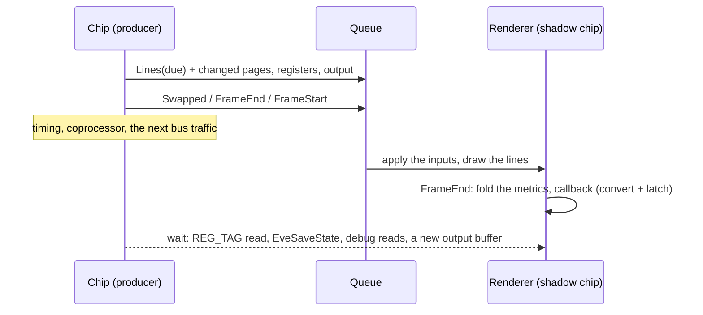

# FT812 drawing on its own thread (eve-emu `EveSetAsyncDrawing`)

Status: implemented on branch `vdac4-ft-speed`, 2026-11-17. Origin: POC 052 measurement 1
(`tools/poc/052-xtensa-jit/measurement-1-profile.md` on the POC branch): after the cheap levers (ROM trap kind per
index, one SPI transaction per FT word, the whole-word frame conversion) the VDAC4 ESP worker spends about 28 % of
its busy time drawing FT812 lines and converting the picture, inside the ESP job, on the critical path of the
frame.

## 1. What the drawing was

- Lazy (`eve-dl.cpp` `CatchUp`): lines the beam has passed are only counted; they are drawn before anything they
  read changes - a RAM_G byte write (`BusWrite`), a write to a register flagged `RegDrawing`, a swap, a memory map
  change, `EveSetOutput` - and at the frame event. In DOOM almost all of it happens at the frame event.
- The inputs of a line: RAM_G and the ROM (the memory map), the active display list, the registers (`REG` and
  `SPECIAL` regions), the bitmap handles and the graphics context, the output (buffer, size, drawing switch) and
  the host settings (line budget margin, fast paths).
- What drawing writes besides pixels: `state.handles` / `context` (the list's `BITMAP_*` words, per line; with
  drawing off the state pass at a swap), `REG_TAG` (the line at `REG_TAG_Y`, guest-visible), the line costs and
  the overflow count (folded into `state.metrics` at the frame event; not guest-visible), derived caches.

Nothing else the guest sees depends on drawing; the coprocessor never reads the handles.

## 2. The design

The chip (the producer: whichever thread advances it) keeps all its timing, coprocessor and registers. Where it
would draw it queues an **operation** instead:

| Operation | Queued by | The renderer does |
|-----------|-----------|-------------------|
| `Lines(due, draw)` | `CatchUp` when new lines passed | `DrawLinesTo` (CatchUp's own work) |
| `FrameStart` | `FrameStart` | `FrameStart` |
| `FrameEnd` | the frame event | `FoldFrameMetrics`, then the host's callback |
| `Swapped(changed)` | `DisplayListSwapped` | copies the list, `DisplayListSwapped` (the state pass when not drawing) |
| `Sync` | enabling | inputs only |

Every operation carries the inputs as of its moment: the `REG` and `SPECIAL` regions, the output, the memory map,
the settings, and the RAM_G pages changed since the previous operation (`ramGPageChanges` newer than the mark).
A pending **sync** rides on the next operation: all of RAM_G and the active list after `DrawingInvalidate`
(restore, reset, memory map change), plus the handles and context (reset, state load, enabling), the metrics
(power-on, state load, enabling), the line costs of the frame in flight (enabling).



The **renderer** is a second `EveChip` made from the producer's `EveConfig`, used only for drawing: its regions
are the shadow, its handles / context / caches / kept lines evolve from its own lines. A line sees exactly the
inputs the producer had when it would have drawn it: the picture, the line costs, the metrics and `REG_TAG` are
those of the drawing on the producer's thread, whatever the renderer's pace.

Back-pressure: the producer waits when two frame ends are queued (or 1024 operations).

### 2.1 Waits

- A host read of `REG_TAG` (`BusRead`): the renderer drains the queue (exactly the lines the synchronous drawing
  would have drawn by now) and its `REG_TAG` is copied back.
- `EveSaveState`: the handles, context and metrics in the blob are the renderer's: the same bytes as without it.
- `EveGetLineCost`, `EveGetFrameMetrics`, `EveProbePixel`: read the renderer after a wait (no wait from the
  callback).
- `EveSetOutput` with another buffer or size; the host waits before it resizes its buffers
  (`EveDrawingBarrier`).
- The machine's frame end (`EveHostCard::OnFrameEnd`): the FT812 frames finished by then are latched on the
  `Screen` before the machine's frame is over.
- Off: a wait, then the handles, context, metrics, line costs and `REG_TAG` come back to the chip; its kept lines
  are forgotten (the frame buffer holds the renderer's lines).

Only the frame-end wait happens in DOOM's steady state.

## 3. API (`eve.h`)

```c
typedef void (*EveFrameCallback)(void* user, uint64_t frame, int drawn);
int EveSetAsyncDrawing(EveChip* chip, int on, EveFrameCallback onFrame, void* user); /* 0 = done */
int EveAsyncDrawing(const EveChip* chip);
void EveDrawingBarrier(EveChip* chip);
```

## 4. Host side

`EveHostCard` (`Params::drawThread`): on for the VDAC4 Tang (`[VDAC4] FtDrawThread`, default 1; env
`UNREAL_VDAC4_FT_DRAW_THREAD`), off for VDAC2. Off while a bus capture is written (it hashes the frame buffer at
the frame event) and in a TTD replay (it composes pictures from the frame buffer); `AdvanceTo` follows the switch
as it follows `Drawing()`. The callback (`OnRendererFrame`, renderer thread) does `OnChipFrame`'s presentation:
the conversion, `Screen::LatchExternalFrame`, the presented metrics. `ConfigureOutput` waits before it resizes;
`TTDPrepareComposedPicture` waits before it converts. Status: `threads.ft_draw_thread` in `vdac4 state` on every
plane.

## 5. Tests

- `EveAsyncDrawing_Test.TheRendererDrawsWhatTheChipWouldHaveDrawn`: two chips, the same bus traffic (bitmap bytes
  and new lists mid-frame, `REG_TAG` reads, a frame without drawing, the renderer off and on again): the same
  frames, `REG_TAG` values, saved state, metrics and line costs.
- VDAC4 DOOM: the same picture hash as the synchronous drawing and master (§6).

## 6. Measurements

DOOM-VDAC4 in game on the Apple M-class build host: 6000 frames of warm-up on the paused machine, then 600 frames
as fast as possible, four interleaved rounds, ms per frame. The screen hash after the run is `a8e8486fb6c5` in
every run of every variant (the same as master).

| Variant | Rounds | Mean |
|---------|--------|------|
| master `aa7ca3f5f` | 6.16, 5.96, 6.04, 5.91 | 6.02 |
| + ROM trap kind, SPI transaction, word conversion (`FtDrawThread=0`) | 5.02, 4.98, 4.89, 4.89 | 4.95 (-18 %) |
| + drawing on the renderer thread (`FtDrawThread=1`) | 3.97, 3.87, 3.89, 3.88 | 3.90 (-35 %) |
| the same without the wait at the machine's frame end (experiment, not kept) | 3.86, 3.79, 3.78, 3.77 | 3.80 |

The wait at the machine's frame end (`EveHostCard::OnFrameEnd`) costs about 2.5 %; it is kept: the FT812 frame
finished in a machine frame is on the `Screen` when that frame ends, as without the renderer thread.
