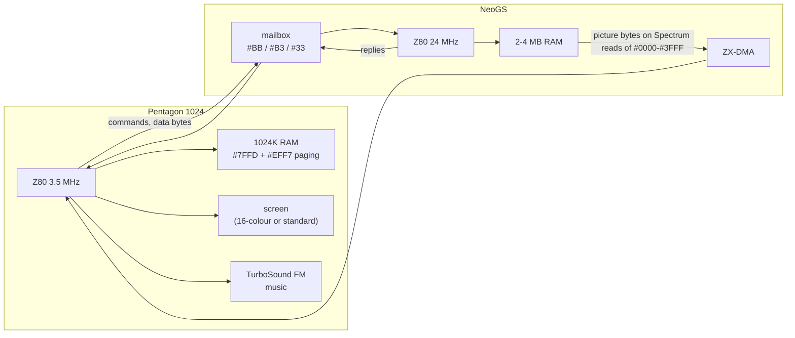

# 1. The machine: a Pentagon 1024 and a NeoGS

The Link runs on two computers at once. The Spectrum (a Pentagon 1024 at 3.5 MHz) shows the
pictures and plays the music; a second Z80 on the NeoGS sound card, at 24 MHz with up to 4 MB of
RAM, draws every picture. The two talk through the card's mailbox ports, and the pictures cross
from the card to the Spectrum through **ZX-DMA**, a NeoGS feature that lets the Spectrum read the
card's memory as if it were its own ROM. This chapter describes the hardware the rest of the series
relies on.

## 1.1 Why two processors

A frame of the rotator is 6,912 bytes of picture; the tunnel and the hedgehog are 16-colour
pictures of the same size. Computing one such picture on a 3.5 MHz Z80 takes many frames. The
NeoGS card has a Z80 at 24 MHz (about seven times faster), and nothing else to do in this demo:
The Link plays its music on the Spectrum's TurboSound FM, not on the card. So the work is split:

| | Spectrum (host) | NeoGS card |
|---|---|---|
| CPU | Z80, 3.5 MHz | Z80, 24 MHz |
| Memory used | 1024 KB, 16 KB pages at `#C000` | 2-4 MB, 16 KB pages in four windows |
| Job | upload the card's code and data; each frame, fetch the finished picture and put it on screen; music; timing | rotate, project, texture, sort; build the next picture in its own RAM |
| Output | the screen, the AY / FM chips | nothing audible: its DAC channels are silenced at start |

## 1.2 The Pentagon 1024: memory

The Spectrum 128's port `#7FFD` selects one of 8 RAM pages at `#C000` (bits 0-2), the screen
(bit 3: page 5 or page 7), the ROM (bit 4) and locks paging (bit 5). The Pentagon 1024 adds three
more page bits and a second control port:

- `#7FFD` bits 6, 7 and 5 become page bits 3, 4 and 5 when `#EFF7` bit 2 is 0 (the "1024K" mode;
  bit 5 then no longer locks). For a `#7FFD` value `v` the page at `#C000` is
  `(v & 7) | ((v & #C0) >> 3) | (v & #20)` - 64 pages of 16 KB.
- `#EFF7` bit 0 switches the 16-colour screen mode on (next section).

The demo writes every page as a `#7FFD` value with bit 4 set (48K BASIC ROM, so TR-DOS stays
reachable) and, where it shows a screen, bit 3 as needed. Its page plan, with every file and its
physical page, is in [the loader's README](../../../../disasm/demo/thelink/sjasm/loader/README.md)
section 2. The fixed windows matter too:

| Window | Page | Used by the demo for |
|---|---|---|
| `#0000`-`#3FFF` | ROM | **the ZX-DMA window**: reads here return card bytes (1.5) |
| `#4000`-`#7FFF` | 5 | screen 0; `GO` at `#7800`; the effects' ZX halves copy themselves to `#6000`/`#7800` |
| `#8000`-`#BFFF` | 2 | the main block, then the resident: IM 2 table `#BE00`, `timer` `#BF02`, the resident loop `#BF04`, the interrupt handler `#BFBF` |
| `#C000`-`#FFFF` | any | the effect's ZX half, the music player, screen 1 (page 7) |

## 1.3 The Pentagon 16-colour mode

With `#EFF7` bit 0 set, the Pentagon shows 256 x 192 pixels in 16 colours with no attribute clash.
The picture takes two RAM pages: page 5 with page 4 for screen 0, page 7 with page 6 for screen 1
(`#7FFD` bit 3 picks the pair; the partner is the page number with bit 0 flipped). Each page holds
two 8 KB halves at the usual screen addresses, `+#0000` and `+#2000`, which gives four byte planes
in ZX screen order; every byte packs **two adjacent pixels**, each a 4-bit colour index. In
unreal-ng's renderer (`core/src/emulator/video/alco/screenalco.cpp`) the left pixel is bits
6, 2, 1, 0 and the right pixel bits 7, 5, 4, 3. The demo's converters (`COLSTOBYTE` in
`instlpp.asm`, `TPICTOBMP` in `GSRBAR24.asm`) build bytes in this format from 4-bit colours.

Two consequences shape the effects:

- A 16-colour screen is 4 x 6,144 = 24,576 bytes across two pages. That is a lot to move each
  frame, so most effects draw a **2 x 2 chunky picture** (128 x 96 chunks) and convert it, or
  update only part of the screen.
- The demo's ZX halves write the screen with `PUSH`: the fastest way a Z80 has to store bytes
  (11 T-states for 2 bytes). Writing with the stack means interrupts can corrupt the picture;
  chapter [3](03-the-frame.md) shows how the interrupt handler avoids it.

Not every part uses the mode: the tunnel works only in the attributes of the standard screen, the
rotator in the standard bitmap.

## 1.4 The NeoGS card

NeoGS is NedoPC's FPGA version of the General Sound card (General Sound: a Z80 with its own RAM
and four 8-bit sound channels, driven from the Spectrum through a mailbox). The parts the demo uses:

| Part | Detail |
|---|---|
| CPU | Z80; the clock is chosen by `GSCFG0` (card port `#0F`) bits 5-4: 10 MHz after reset, 24 MHz with `#00` |
| Memory map | four 16 KB windows; `MPAG` (port `#00`) and, in the extended mode, `MPAGEX` (`#10`) select the pages at `#8000` and `#C000` |
| `GSCFG0` | bit 0 NOROM (all four windows RAM), bit 3 EXPAG (extended paging). The demo's card program writes `#09`: 24 MHz, RAM everywhere, extended paging |
| Page numbers | a page byte selects 16 KB `{d6..d0, d7}`: bit 7 is the lowest bit of the 16 KB page. So "the next 16 KB page" is `RLCA : INC A : RRCA`, and `+#80` is the other half of a 32 KB page - a pattern every effect repeats |
| Mailbox (Spectrum side) | `#BB` write: command (sets the command bit); `#B3` write: data (sets the data bit); `#BB` read: status (bit 7 data, bit 0 command); `#B3` read: the card's reply; `#33` write `#80`: reset the card |
| Mailbox (card side) | port `#01` read: the command; `#02` read: data; `#03` write: reply; `#04` read: status; `#05`: clear the command bit |
| Volumes | `VOL1`-`VOL8` (ports `#06`-`#09`, `#16`-`#19`): the demo sets all to 0 |

At reset the card runs its ROM firmware (from flash), which understands the standard General Sound
commands. The Link uses three of them to install its own program: `#18` / `#19` put a byte into
card memory (the author: "as in RIFF TRACKER"; 134 of them carry the program), and `#13` jumps to
it. From then on the
card runs the demo's code, the firmware is gone (`NOROM`), and the mailbox protocol is the demo's
own (chapter [3](03-the-frame.md)). A watchdog in every card effect jumps to `GSRESET`
when the Spectrum stops answering.

## 1.5 ZX-DMA: reading the card like ROM

ZX-DMA is the NeoGS feature the whole demo is built on. The card selects its ZX DMA module
(`DMA_MOD` = 1, port `#1B`), sets a 21-bit card address (`HAD`, `MAD`, `LAD`, ports `#1C`-`#1E`)
and sets bit 7 of `CST` (`#1F`). While it runs:

- every Spectrum **read** of `#0000`-`#3FFF` with ROM paged returns a byte of card RAM instead of
  ROM, and the card address moves on by one;
- every Spectrum **write** to `#0000`-`#3FFF` goes into card RAM, address moving on too;
- a read returns the byte fetched by the **previous** read: the first byte after a start is junk,
  and every effect throws it away ("первый байт неправильный" - "the first byte is wrong");
- if the card has not delivered the byte yet, the Spectrum is held with `/WAIT`.

Only the card can start or stop it. The Spectrum then moves bytes at full memory speed with
ordinary instructions:

| Direction | Spectrum code | Used for |
|---|---|---|
| Spectrum -> card | `LD HL,#C000 : LD DE,#0000 : LD BC,#4000 : LDIR` | uploading 20 pages of code and data at start ([2](02-the-start.md)) |
| card -> Spectrum | `LD D,(HL) : LD E,(HL) : PUSH DE` with `HL` pointing anywhere in `#0000`-`#3FFF` | fetching each frame's picture into the hidden screen ([3](03-the-frame.md)) |

The second line is the heart of the demo: 3,456 such triples move a whole 6,912-byte screen in a
little over one frame, the card having drawn it in its own memory. The address in `HL` does not
matter (only that it is in the ROM window), which the effects exploit: `H` and `L` double as page
numbers in some of the blit loops.

In unreal-ng the module is modelled from the FPGA's state machines
(`docs/inprogress/2026-09-19-general-sound/neogs-zxdma-design.md`); The Link is the program it was
verified with.

## 1.6 The music

The music, `thelinkm` (9,810 bytes, page 12, `#7FFD` = `#54`), is a TurboSound FM player and its
tune: init at `#C000`, play at `#C005`, called once a frame from the Spectrum's interrupt handler.
The card plays nothing: the demo silences its eight channels as the first thing its card program
does.

## Things to notice

- The card is used as a **graphics coprocessor**, not as a sound card. Nothing in the demo needs
  the card's DAC, sample memory or MP3 decoder.
- Pentagon 1024 paging and NeoGS ZX-DMA are both required. On a 512K Pentagon the page plan does
  not fit; on a classic General Sound there is no ZX-DMA (nor 24 MHz, nor extended
  paging), so no picture ever arrives. The release loader checks both before starting
  ([loader README](../../../../disasm/demo/thelink/sjasm/loader/README.md) section 4).
- The design note in unreal-ng's ZX-DMA document said "no known program uses it". The Link does,
  in both directions.

## Try it

- Boot `testdata/machines/pentagon1024sl/TheLink-sjasm.scl` in unreal-ng with a Pentagon 1024 and a
  NeoGS (the shipped Pentagon configuration has both). The status line's `NeoGS <->` indicator
  lights while ZX-DMA moves data: during the upload after the title, then every frame from the
  tunnel on.
- In the debugger, set a breakpoint on a `LD D,(HL)` of an effect's blit loop and step it: `D` gets
  card bytes, not ROM bytes, while the memory view of `#0000` still shows the ROM.
- On a classic GS (change the card in the configuration) the release disk stops at an error
  screen that says so; the author's disk (`TheLink.trd`) instead hangs after the intro.

Next: [2. The start](02-the-start.md).
