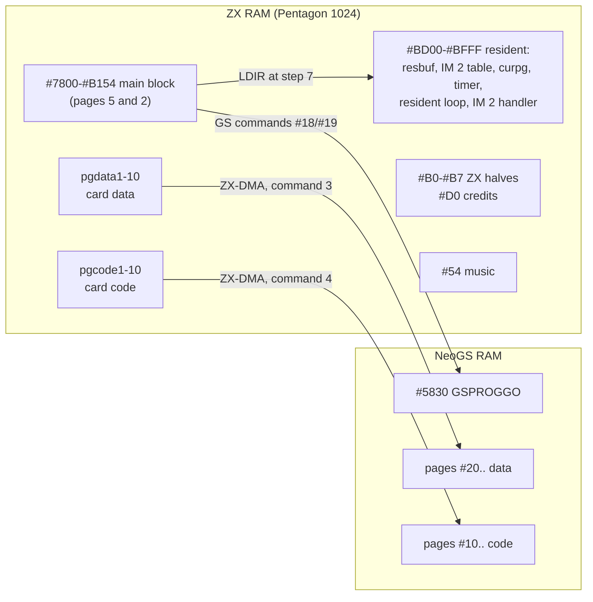
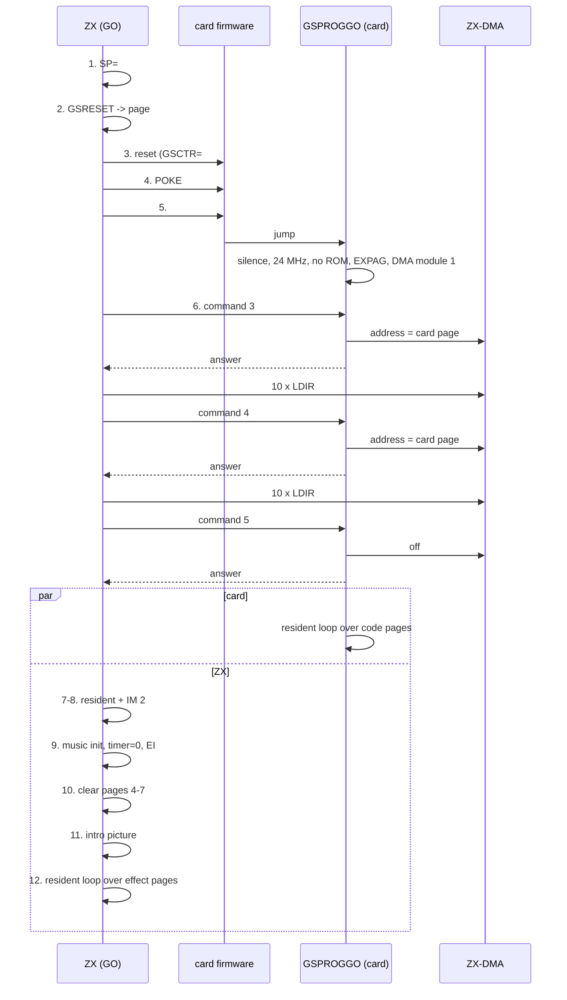
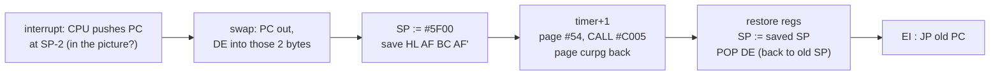

# 2. The start: `THELINK.asm`

`THELINK.asm` holds no effect at all. It is the demo's conductor: one block of code at `#7800`
that resets the NeoGS, gives it a small program of its own, pours 20 RAM pages into the card's
memory through ZX-DMA, starts the music and the intro picture, and then hands control to a
resident loop that calls the effects one after another, each with its own window of frames.
This chapter walks through that block from the first instruction to the credits.


The intro picture ("medieval", top left) and the credits screen are shown by the code in this
chapter; all the other parts are started by it.

Previous: [1. The machine](01-the-machine.md) - Pentagon 1024 paging, NeoGS, GS commands, ZX-DMA.
Next: [3. The frame](03-the-frame.md) - the per-frame handshake every effect shares.

Source: [`sjasm/src/THELINK.asm`](../../../../disasm/demo/thelink/sjasm/src/THELINK.asm) (annotated).
The page table with every file and its physical page is in
[sjasm/loader/README.md](../../../../disasm/demo/thelink/sjasm/loader/README.md) section 2; the
protocol overview in [README.md](../../../../disasm/demo/thelink/README.md) section 6.

## 2.1 A linker in assembler clothing

Every effect was assembled earlier from its own source into two binaries: a ZX half (`TUNNELZX`,
`ROTATEZX`, ...) and a card half (`TUNNELGS`, `ROTATEGS`, ...). `THELINK.asm` does three things:

1. assembles one block at `#7800` (`begin` .. `end`, 14,677 bytes): `GO`, two helpers, five
   blocks that `GO` copies to their run-time addresses, and the intro picture;
2. puts each binary or data file at `#C000` of its RAM page with `ORG #C000,<#7FFD value>` and
   `INCBIN` - a plain copy, no relocation;
3. adds the author's release tool (`m2hrust`, a Hrust packer) at the end. The demo never calls it.

On the author's disk ALASM did all of this at every start and then ran `GO`. In the sjasmplus
build only the block at `#7800` is saved (`SAVEBIN "thelink"`); the release loader loads the page
files itself and jumps to `GO`. Either way, memory at `GO` is the same.

What is inside the main block:

| Address | Label | Size | What | Runs at |
|---|---|---|---|---|
| `#7800` | `GO` | 456 | the start, steps 1-12 below | `#7800` |
| `#79C8` | `GSDMASENDPG`, `CL1800PG` | 47 | upload one page; clear one page | `#79C8` |
| `#79F7` | `WASGSPROG` | 134 | the card program `GSPROGGO` | card `#5830` |
| `#7A7D` | `WASZXRES` | 113 | ZX resident loop, `RESMOVEPAGE`, `zxtimings` | `#BF04` |
| `#7AEE` | `WASIMER` | 60 | IM 2 handler | `#BFBF` |
| `#7B2A` | `WASGSRESET` | 24 | card reset code | card, code page 10 |
| `#7B42` | `WASCREDITS` | 6,931 | credits code (19 bytes) + screen (6,912) | `#C000` of page `#D0` |
| `#9655` | `wasmedieval` | 6,912 | the intro picture | copied to `#4000` |
| `#B155` | `end` | | | |

The `WAS...` / `DISP` pairs are the usual way to assemble code for an address other than the
one it is stored at:

```asm
WASZXRES
        DISP ZXRESIDENT
ZXRESIDENTGO
...
        ENT
LENZXRES=$-WASZXRES
```

`GO` copies `LENZXRES` bytes from `WASZXRES` to `ZXRESIDENT` (`#BF04`), and the labels inside
already have their `#BFxx` values.

## 2.2 The page plan

The constants at the top of the file name every page by its `#7FFD` value. On a Pentagon 1024
the RAM page is `(v & 7) | ((v & #C0) >> 3) | (v & #20)`; bit 4 (48K ROM) is set in every value,
so TR-DOS stays callable whatever page is in.

| Name | `#7FFD` | Content | Goes to |
|---|---|---|---|
| `pgdata1`..`pgdata10` | `#90`-`#97` (no `#93`), `#11`, `#13`, `#14` | pictures and textures: `kishki`, `baba`, `mill`, `girl13`, `blugr` | card pages `#20` up (command 3) |
| `pgcode1`..`pgcode10` | `#52`, `#55`, `#30`-`#37` | card code: `ROTPREGS`, `ROBPREGS`, `TUNNELGS` ... `TEXGS`, then `GSRESET` | card pages `#10` up (command 4) |
| `pgeffects`..`+7` | `#B0`-`#B7` | the ZX halves: `TUNNELZX` ... `TEXZX` | run on the ZX at `#C000` |
| `pgeffects+#20` | `#D0` | the credits (copied by `GO`) | run on the ZX at `#C000` |
| `pgmusic` | `#54` | `thelinkm`, TurboSound FM music: init `#C000`, play `#C005` | IM 2 handler |

Two pages have no file: `pgcode10` gets `GSRESET` and `#D0` gets the credits, both copied there
by `GO`. The `ORG #C000,pgcode10` and `ORG #C000,pgeffects+#20` lines with nothing after them
are just the author's reminders.

One page needs padding: `baba.0` is 8 KB, and the line after it zero-fills the rest of the page.

```asm
        ORG #C000,pgdata3
        INCBIN "baba.0"
        DS (-$&#FFFF)           ;для маски (en: for the mask)
```

ALASM's `DS -$` means "up to `#10000`"; the converter spelled it out. The comment says the card
uses the second half "for the mask" (chapter 9).



## 2.3 Fixed addresses

Everything that must survive the effects lives in `#BD00`-`#BFFF`, at the top of page 2. The
effects' ZX halves use `#7800` up and the screens, never this area. Each effect source repeats
the same definitions (see `GSTUNNE4.asm`), because they were developed as standalone programs.

```asm
resbuf=#BD00
IMVEC=#BE00
curpg=#BF01
timer=#BF02
ZXRESIDENT=#BF04
IMER=#BFBF
outimstack=#5F00
```

| Address | Name | What |
|---|---|---|
| `#5F00` | `outimstack` | the IM 2 handler's own stack (grows down) |
| `#6000` | | `GO`'s stack |
| `#BD00` | `resbuf` | 256-byte buffer for `RESMOVEPAGE` |
| `#BE00`-`#BF00` | `IMVEC` | IM 2 vector table: 257 bytes of `#BF` |
| `#BF01` | `curpg` | the `#7FFD` value in use |
| `#BF02` | `timer` | frame counter, 16 bits |
| `#BF04`-`#BF74` | `ZXRESIDENT` | resident loop, `RESMOVEPAGE`, `zxtimings`, `ZXRESNEXTPG` |
| `#BFBF`-`#BFFA` | `IMER` | IM 2 handler |

`curpg` is what makes paging safe under interrupts. The macro every part uses writes it first:

```asm
        MACRO setpga
        LD (curpg),A
        LD BC,#7FFD
        OUT (C),A
        ENDM
```

The IM 2 handler pages the music in and then restores `curpg`. If an interrupt falls between the
`LD (curpg),A` and the `OUT`, the handler restores the new value - which the `OUT` was about to
select anyway.

## 2.4 `GO`, step by step



### Step 1: stack, one frame, black screen

```asm
GO
        LD SP,#6000
        EI
        HALT
        XOR A
        OUT (#FE),A
        LD HL,#5800
        LD DE,#5801
        LD BC,767
        LD (HL),L
        LDIR
```

The stack goes below the loader's area; `EI : HALT` waits for one frame under whatever IM 1 the
machine was in (this is the only thing `GO` needs from the ROM). `LD (HL),L` writes 0 because
`L` is 0 - a byte shorter than `LD (HL),0`. Then the same for `#D800`, which is where the story
of a bug starts (section 2.12).

### Step 2: copy the two run-time pages

```asm
        LD A,pgcode10
        setpga
        LD HL,WASGSRESET
        LD DE,#C000
        LD BC,LENGSRESET
        LDIR
        LD A,pgeffects+#20
        setpga
        LD HL,WASCREDITS
        ...
```

`GSRESET` (24 bytes) becomes the tenth card code page, uploaded with the others. The credits (19
bytes of code + a 6,912-byte screen) become the ZX's ninth "effect" page, `#D0`.

### Step 3: reset the card

```asm
        LD A,C_GRST
        OUT (GSCTR),A
        XOR A
        OUT (GSCOM),A           ;не помогает
        HALT
        HALT
        DI
```

`OUT (#33),#80` is the GS hardware reset. The author's comment on the next line, "не помогает",
means "does not help": writing 0 to the command register after the reset was an attempt that made
no difference, and it stayed. Two `HALT`s give the firmware two frames (40 ms) to come up. From
here to step 9 interrupts are off.

### Step 4: commands "for some reason"

```asm
;зачем-то POKE #4092,0
        LD DE,#4092
        SD E
        SC #18
        WC
        SD D
        WD
        SD 0
        SC #19
        WC
;зачем-то #38 (Load FX)
        SC #38
        WC
;зачем-то #D2 (Close Stream)
        SC #D2
        WC
```

"зачем-то" is "for some reason". The author copied a sequence that works and says honestly he
does not know why each part is there: a write of 0 to card address `#4092`, then the standard
commands `#38` and `#D2`. The macros come from `gsports.asm`:

| Macro | Does |
|---|---|
| `SD x` | `LD A,x : OUT (GSDAT),A` - data to the card |
| `SC x` | `LD A,x : OUT (GSCOM),A` - command to the card |
| `WC` | wait until the command bit clears (the card took the command) |
| `WD` | wait until the data bit clears (the card took the data) |
| `WN` | wait until the data bit is set (the card sent data) |
| `GD` | `IN A,(GSDAT)` - read it |

Command `#18` takes an address (low byte with the command, high byte after), `#19` writes the
data byte to it. Chapter 1 covers the GS command protocol.

### Step 5: the card program

```asm
        LD HL,WASGSPROG
        LD DE,GSPROG
        LD BC,LENGSPROG
;как в RIFF TRACKER
GSLOA20
        SD E
        SC #18
        WC
        SD D
        WD
        SD (HL)
        SC #19
        WC
        INC HL
        INC DE
        DEC BC
        LD A,B
        OR C
        JR NZ,GSLOA20
```

"как в RIFF TRACKER" - "as in RIFF TRACKER": the method comes from that tracker. Each of the 134
bytes costs a full address-and-write exchange, so it is slow per byte, but it needs nothing
but the firmware's standard commands. Then:

```asm
;зачем-то #F5 (Busy on)
        SC #F5
        WC
;#13 Jump to Address
        SD low GSPROGGO
        SC #13
        WC
        SD high GSPROGGO
        WD
```

`#F5` ("Busy on", again "for some reason"), then `#13`: jump to `#5830`. From this moment the
firmware's command loop no longer runs; the card is in the demo's own program, which polls the
command register itself.

### The card program, `GSPROGGO`

It runs at `#5830` in the card's RAM, with its stack just below (`GSSTACK=#5830`).

```asm
GSPROGGO
        DI
        LD SP,GSSTACK

        XOR A
        OUT (VOL1),A
        ...
        OUT (VOL8),A

        IN A,(GSCFG0)
        AND #FF-M_CKSEL0-M_CKSEL1-M_RAMRO
        OR C_24MHZ|M_NOROM|M_EXPAG
        OUT (GSCFG0),A

        LD A,1                  ;#8000: gspg1:0
        OUT (MPAG),A
        LD A,2                  ;#C000: gspg2:0
        OUT (MPAGEX),A

        LD A,1                  ;SET DMA MODULE #1
        OUT (DMA_MOD),A
```

All eight channels silent; the CPU to 24 MHz, RAM everywhere (`NOROM`), and extended
paging, where `MPAG` selects the 16 KB page at `#8000` and `MPAGEX` the one at `#C000`. The
author's notation `gspg1:0` means 32 KB page 1, half 0. DMA module 1 is ZX-DMA.

Then it waits for command 3 and points ZX-DMA at the first data page:

```asm
        LD E,3
        IN A,(ZXCMD)
        CP E
        JR NZ,$-3

        LD A,gspgdata
        RRCA
        LD D,A
        AND #C0
        LD H,A
        XOR D
        OUT (DMA_HAD),A
        LD A,H
        OUT (DMA_MAD),A
        XOR A
        OUT (DMA_LAD),A
        LD A,#80                ;TURN ON DMA MODE
        OUT (DMA_CST),A
        OUT (ZXDATWR),A         ;признак для ZX "DMA ON"
```

The card's page numbers in this demo carry the 16 KB half in bit 7 (more in chapter 3). `RRCA`
moves that half bit to bit 7 of the result; bits 7-6 go to `DMA_MAD` (address bits 15-14), bits
5-0 to `DMA_HAD`. For `gspgdata=#20`: `DMA_HAD=#10`, `DMA_MAD=0`, `DMA_LAD=0`. The write to
`ZXDATWR` sets the data bit: the comment says it is the "DMA ON" flag for the ZX.

Command 4 does the same for `gspgcode=#10` (`DMA_HAD=#08`). Command 5 switches the DMA off,
answers, and waits until the ZX has read the answer:

```asm
        XOR A                   ;TURN OFF DMA MODE
        OUT (DMA_CST),A         ;после этого ZX можно сбрасывать
        OUT (ZXDATWR),A         ;признак для ZX "DMA OFF"
        IN A,(ZXSTAT)
        RLCA
        JR C,$-3                ;ZX готов?
```

"после этого ZX можно сбрасывать" - "after this the ZX may be reset": once the DMA is off, a ZX
reset can no longer push garbage into card memory. "ZX готов?" - "ZX ready?".

### Step 6: the upload by ZX-DMA

```asm
        LD A,3
        OUT (GSCOM),A           ;вкл. DMA
;и ждем включения:
        WN
        GD
;
;шлем страницы данных в GS:
        LD A,pgdata1
        CALL GSDMASENDPG
        ...
```

"вкл. DMA" - "DMA on"; "и ждем включения" - "and wait until it is on"; "шлем страницы данных в
GS" - "send the data pages to the GS". The command goes straight to `GSCOM`, without `SC`/`WC`:
the card program reads `ZXCMD` and never clears the command bit, so `WC` would not return.
The answer is the data bit.

The whole transfer is one routine:

```asm
GSDMASENDPG
        setpga
        LD HL,#C000
        LD DE,#0000
        LD BC,#4000
        LDIR
        RET
```

The ZX writes into its own ROM area. Nothing changes on the ZX, but each write is taken by NeoGS's
ZX-DMA into card RAM at the next address. One page: 16,384 x 21 T = 344,064 T, about 4.8 frames
of 71,680 T. All 20 pages: about 6.9 million T, roughly two seconds with interrupts off.

Then command 4 ("новый адрес DMA" - "new DMA address"), the 10 code pages, and command 5 ("выкл.
DMA" - "DMA off"). The code pages land in card pages `#10`, `#90`, `#11`, `#91` ... `#94`: ten
consecutive 16 KB pieces of card memory.

### Steps 7 and 8: resident code and IM 2

```asm
        LD HL,WASZXRES
        LD DE,ZXRESIDENT
        LD BC,LENZXRES
        LDIR
        LD HL,WASIMER
        LD DE,IMER
        LD BC,LENIMER
        LDIR
        LD A,high IMVEC
        LD I,A
        LD H,A
        LD D,A
        LD BC,256
        LD L,C
        LD E,B
        LD (HL),low IMER
        LDIR
        IM 2
```

`I=#BE`. `HL=#BE00`, `DE=#BE01`, one byte written and 256 copied: `#BE00`-`#BF00` is all `#BF`.
Whatever byte is on the bus at the interrupt, the vector read from `#BExx`/`#BExx+1` is `#BFBF`.
That is why the handler sits at the odd-looking address `#BFBF`, and why `curpg` starts at
`#BF01`, right after the table.

### Step 9: music and the frame counter

```asm
        LD A,pgmusic
        setpga                  ;заполняет curpg
        CALL #C000

        LD HL,0
        LD (timer),HL
        EI
```

"заполняет curpg" - "fills curpg". The music is initialised with interrupts still off, the frame
counter is zeroed, and from the `EI` on every frame plays the music. Frame 0 of the demo's clock
is here.

### Step 10: clear pages 4-7

```asm
        LD A,#14
        CALL CL1800PG
        LD A,#15
        CALL CL1800PG
        LD A,#16
        CALL CL1800PG
        LD A,#17
        CALL CL1800PG
```

```asm
CL1800PG
        setpga
        LD HL,#C000
        CALL CL1800
        LD HL,#E000
CL1800
        LD D,H
        LD E,L
        INC E
        LD BC,#17FF
        LD (HL),L
        LDIR
        RET
```

`CL1800PG` zeroes `#C000`-`#D7FF` and `#E000`-`#F7FF` of a page: the pixel areas of the 16-colour
screen layout, which uses `#x000` and `#x000+#2000` of two pages. Pages 5 and 7 are the screens.
In page 5 the second area is `#6000`-`#77FF`, which stops exactly one byte short of `GO` at
`#7800` - the code clears the page it is running in without touching itself. Page 4 held
`blugr.2`, already on the card. Cost: 8 x 6,144 x 21 T, about 1 million T or 14 frames, with the
music playing.

### Step 11: the intro picture

```asm
        LD HL,wasmedieval
        LD DE,#4000
        LD BC,6144
        LDIR
        HALT
        LD BC,768
        LDIR
```

The pixels go in while the attributes are still black (step 1), then one frame, then the
attributes: the picture appears at once rather than being drawn line by line. `HL` and `DE` simply
continue after the first `LDIR`.

### Step 12: into the resident loop

```asm
        LD A,pgeffects
        LD HL,zxtimings
        JP ZXRESIDENTGO
```

`GO` is finished; nothing ever returns to it, and the effects reuse `#7800` up for their own code.

## 2.5 The ZX resident loop

```asm
ZXRESIDENTGO
ZXRES0
        setpga
        PUSH AF
        LD C,(HL)
        INC HL
        LD B,(HL)               ;время начала эффекта
        INC HL
        LD E,(HL)
        INC HL
        LD D,(HL)               ;время конца эффекта
        INC HL
        PUSH HL
        CALL #C000
        POP HL
        POP AF
        CALL ZXRESNEXTPG
        JP ZXRES0
...
ZXRESNEXTPG
        INC A
        BIT 3,A
        RET Z
        ADD A,#18
        RET
```

"время начала эффекта" / "время конца эффекта" - "the effect's start time" / "end time". Each
effect page is entered at `#C000` with `BC` = start frame and `DE` = end frame. `ZXRESNEXTPG`
steps `#B0`, `#B1` ... `#B7`; after `#B7`, `INC A` gives `#B8` (bit 3 set) and `ADD A,#18` gives
`#D0`, the credits page.

The ZX halves do the waiting themselves. `GSTUNNE4.asm` is typical: it keeps the end frame, polls
`timer` until the start frame, and quits when the end frame is reached (or SPACE is pressed):

```asm
        POP BC
ZXWAITSTART
        LD HL,(timer)
        OR A
        SBC HL,BC
        JR C,ZXWAITSTART
```

So the intro picture stays on the screen for 18 seconds simply because `TUNNELZX` is already
running and waiting for frame 896.

The resident also holds `RESMOVEPAGE`, a page-to-page copy through `resbuf`, for the effects:
`hedge12.asm` uses it (via its `MOVEPAGE` macro) to move `DEMON16`/`DEMON17` into pages `#16` and
`#17`. `THELINK.asm` defines the same macro but never invokes it.

## 2.6 `zxtimings`: the demo's score

```asm
zxtimings
        DW 896,896*2-14         ;tunnel
        DW 896*2,896*3-14       ;rotate
        DW 896*3,896*3+560      ;rotbar
        DW 896*4-28-80,896*4-28 ;mulbar
        DW 0,0
        DW 896*4,896*5-14       ;hedge
        DW 896*5,896*5+448-14   ;baba
        DW 896*5+448,896*6+448  ;tex
```

The unit is 896 frames, 17.92 s - most likely the length of a musical section (an assumption; the
music source is not on the disk). Most parts end 14 frames before the next one starts.

| Page | ZX half | Part | Start | End | Seconds |
|---|---|---|---|---|---|
| (`GO`) | | intro picture + music | 0 | 895 | 0.00 - 17.90 |
| `#B0` | `TUNNELZX` | tunnel | 896 | 1778 | 17.92 - 35.56 |
| `#B1` | `ROTATEZX` | rotator (the logo) | 1792 | 2674 | 35.84 - 53.48 |
| `#B2` | `ROTBARZX` | rotating bars | 2688 | 3248 | 53.76 - 64.96 |
| `#B3` | `MULBARZX` | multi-bars (80 frames) | 3476 | 3556 | 69.52 - 71.12 |
| `#B4` | `HEDGEZX1` | (none: copies a picture) | 0 | 0 | - |
| `#B5` | `HEDGEZX2` | hedgehog (the dragon) | 3584 | 4466 | 71.68 - 89.32 |
| `#B6` | `BABAZX` | girl and mill | 4480 | 4914 | 89.60 - 98.28 |
| `#B7` | `TEXZX` | textured face | 4928 | 5824 | 98.56 - 116.48 |
| `#D0` | credits | credits screen | (garbage) | (garbage) | from 116.48 |

Two rows need a word:

- `#B4` gets `0,0`. `HEDGEZX1` is not an effect: it copies the dragon picture `DEMON16` into page
  `#16` with `MOVEPAGE` and returns, ignoring `BC`/`DE` (see `hedge12.asm`). The dragon runs from
  `#B5`.
- The table has 8 entries, but the loop runs 9 pages. The ninth, `#D0`, reads the next four
  bytes after the table - the code of `ZXRESNEXTPG` (`INC A`, `BIT 3,A`, `RET Z`) - as its start
  and end frame. The credits code never looks at `BC`/`DE`, so it does not matter.

Between the rotating bars (end 3248) and the multi-bars (start 3476) there are 228 frames, 4.6 s.
`MULBARZX` is entered right away and sits in its `ZXWAITSTART` loop, which draws nothing, so the
last rotating-bars picture stays on screen.

## 2.7 The card's resident loop

The card does the same with its code pages, without any timing of its own:

```asm
        LD A,gspgcode

GSRESIDENTGO
GSRES0
        OUT (MPAGEX),A
        PUSH AF
        CALL #C000
        POP AF
        RLCA
        INC A
        RRCA
        JP GSRES0
```

`RLCA : INC A : RRCA` increments a page number whose low bit is kept in bit 7: `#10`, `#90`,
`#11`, `#91`, `#12`, `#92`, `#13`, `#93`, `#14`, `#94` - the ten pages the DMA filled, in order:

| Card page | Code | ZX partner |
|---|---|---|
| `#10` | `ROTPREGS` (rotator precalc) | - (runs during the intro) |
| `#90` | `ROBPREGS` (rotating bars precalc) | - (runs during the intro) |
| `#11` | `TUNNELGS` | `TUNNELZX` |
| `#91` | `ROTATEGS` | `ROTATEZX` |
| `#12` | `ROTBARGS` | `ROTBARZX` |
| `#92` | `MULBARGS` | `MULBARZX` |
| `#13` | `HEDGEGS` | `HEDGEZX2` |
| `#93` | `BABAGS` | `BABAZX` |
| `#14` | `TEXGS` | `TEXZX` |
| `#94` | `GSRESET` | (credits) |

The two sides never share a clock. They stay in step because each card effect returns only when
the ZX tells it to (command 2 at the end of a ZX half; chapter 3). The precalcs fill the 18
seconds of the intro: while the ZX shows a static picture, the card computes tables for the
rotator and the bars.

## 2.8 The IM 2 handler

```asm
WASIMER
        DISP IMER
        EX DE,HL
        EX (SP),HL              ;пишем DE вместо адреса возврата
        LD (outimjp),HL
        LD (outimsp),SP
        LD SP,outimstack
        PUSH DE                 ;hl до прерывания
        PUSH AF
        PUSH BC
        EX AF,AF'
        PUSH AF
        LD HL,(timer)
        INC HL
        LD (timer),HL
        LD A,(curpg)
        AND #18
        OR pgmusic
        LD BC,#7FFD
        OUT (C),A
        CALL #C005
        LD A,(curpg)
        LD BC,#7FFD
        OUT (C),A
        POP AF
        EX AF,AF'
        POP BC
        POP AF
        POP HL
outimsp=$+1
        LD SP,0
        POP DE
        EI
outimjp=$+1
        JP 0
        ENT
```

The effects move picture data with the stack: `SP` points into a screen and `PUSH` writes two
bytes at a time. An ordinary handler would push its registers into the picture. This one touches
only the two bytes the CPU itself pushed:

1. `EX DE,HL` / `EX (SP),HL`: the return address comes into `HL`, and the interrupted `DE` takes
   its place on the interrupted stack ("пишем DE вместо адреса возврата" - "write DE in place of
   the return address"); the interrupted `HL` is now in `DE` ("hl до прерывания" - "HL from
   before the interrupt").
2. The return address and `SP` go into the operands of the last two instructions
   (self-modifying code); `SP` moves to its own stack at `#5F00`.
3. The frame counter, the music: `curpg AND #18` keeps bit 3 (which screen is shown) and bit 4
   (ROM); `OR #54` selects the music page. `CALL #C005` plays one frame; `curpg` goes back.
4. Restore, `LD SP,<old SP>`, `POP DE` (from where the return address was), `EI`, `JP <return>`.

The interrupted stack sees exactly the CPU's own 2-byte push, and gets the same `DE` value back.
Chapter 3 shows how the effects go one step further and replace the vectors during their inner
loop.



## 2.9 Music

`thelinkm` (9,810 bytes, page `#54`) is a TurboSound FM player with its tune: `#C000` initialises,
`#C005` plays one frame. `GO` calls the init in step 9; after that only the IM 2 handler (or the
effects, which call `IMER` themselves; chapter 3) touches it. The player source is not on the
author's disk; this chapter treats it as a black box. `GSPROGGO` zeroes the volumes of the card's eight
channels: the music comes from the TurboSound FM, and the NeoGS works as a graphics coprocessor.

## 2.10 Credits

```asm
WASCREDITS
        DISP #C000
        LD HL,credits
        LD DE,#4000
        LD BC,#1800
        LDIR
        HALT
        LD BC,#300
        LDIR
        JR $
credits
        INCBIN "credits"
        ENT
```

The same trick as the intro: pixels, one frame, attributes. Then `JR $`. The demo ends here by
design; interrupts are on, so the music goes on playing.

## 2.11 `GSRESET`

```asm
WASGSRESET
        DISP #C000
        LD HL,GSRESET
        LD DE,#5C00
        LD B,1
        PUSH DE
        LDIR
        RET
GSRESET
        XOR A                   ;TURN OFF DMA MODE
        OUT (DMA_CST),A
        IN A,(GSCFG0)
        AND #FF-M_CKSEL0-M_CKSEL1-M_RAMRO-M_NOROM-M_EXPAG
        OR C_10MHZ
        OUT (GSCFG0),A
        RST 0
        ENT
```

The card reaches its tenth code page after `TEXGS` returns. Turning the ROM back on would pull
the code out from under itself (ROM appears everywhere except `#4000`-`#7FFF`), so it first
copies itself to `#5C00` and jumps there with `PUSH DE : ... : RET`. Then DMA off, 10 MHz, ROM on,
normal paging, `RST 0`: the card's firmware starts again as after power-on. `LD B,1` with `C`
left over copies 256-511 bytes, more than the 12 bytes of `GSRESET` - harmless.

The effects' card halves have their own copy of this code and jump to it when the ZX stops
answering for 65,536 polls (chapter 3).

## 2.12 Things to notice

- **A missing `OUT` and the music.** Step 1 continues:

  ```asm
          LD A,#17
          LD HL,#D800
          LD DE,#D801
          LD BC,767
          LD (HL),L
          LDIR
  ```

  `A` is loaded with `#17` (page 7, screen 1) and never written to `#7FFD`; the next use of `A`
  reloads it. The clear meant for screen 1's attributes hits whatever page is at `#C000`. After
  the ALASM start that is a page nothing uses. The release loader, however, loaded the music last
  and jumped to `GO` with page `#54` still at `#C000`: the clear zeroed `#1800`-`#1AFF` of
  `thelinkm`, 733 non-zero bytes of the player. The picture was identical frame for frame, so the
  screen comparison missed it; comparing the page with the file found it. The loader now selects
  `#17` itself before `JP GO`
  ([loader/README.md](../../../../disasm/demo/thelink/sjasm/loader/README.md) section 4). The
  effects confirm the intent: `GSTUNNE4.asm` starts with exactly `LD A,#17 : setpga` before
  clearing `#D800`.
- **The hidden ninth entry.** `zxtimings` has 8 entries for 9 pages; the credits page reads
  `ZXRESNEXTPG`'s code bytes as its timings and ignores them (section 2.6).
- **The author's honesty.** "зачем-то" ("for some reason") four times, "не помогает" ("does not
  help") once: the start sequence is partly cargo, kept because it works.
- **The IM 2 handler costs the interrupted stack 2 bytes, not 10.** That is what lets the effects
  run with `SP` inside a screen (section 2.8).
- **`CL1800PG` clears the page `GO` runs in** and stops one byte before `GO` (section 2.4, step 10).
- **The vector table is 257 bytes** so that any bus value, even `#FF`, gives `#BFBF`.
- **Two clocks, no shared timing.** The ZX keeps the frame counter; the card simply runs its pages
  in order and is held in step by the commands.
- **Unused code:** the `MOVEPAGE` macro in this file is never invoked; `m2hrust` is assembled but
  never called (chapter 11); `DB 'THE LINKB'` at `#5CDD` is the file name m2hrust would save the
  packed release under.

## 2.13 Try it

- Boot `testdata/machines/pentagon1024sl/TheLink-sjasm.scl` on a Pentagon 1024 with NeoGS (TR-DOS,
  Enter). About 27 s of loading under the title, then `GO`.
- Breakpoint at `#7800`: step through the upload. At command 3/4/5 watch the card's `GSCFG0`
  become `#09` (24 MHz, NOROM, EXPAG) and the DMA status in the NeoGS view.
- After `GO`, look at `#BE00`-`#BFFF` in the memory viewer: 257 bytes of `#BF`, `curpg` at
  `#BF01`, `timer` at `#BF02` counting up, the resident code at `#BF04`.
- Watch `timer` (`#BF02`, 16 bits) against the table in section 2.6: the tunnel starts at 896
  (`#0380`), the credits after 5824 (`#16C0`).
- `curpg` (`#BF01`) shows the running ZX half: `#B0` ... `#B7`, then `#D0`.
- Page `#54` (RAM page 12) at `#D800` (offset `#1800`): with the current loader it holds the
  player's data, not zeros.
- Breakpoint at `#BFBF` to see the handler; note `SP` on entry during an effect - it points into
  a screen.
- SPACE ends the current part early, at least in the tunnel (`GSTUNNE4.asm` tests it next to the
  end-frame check).
