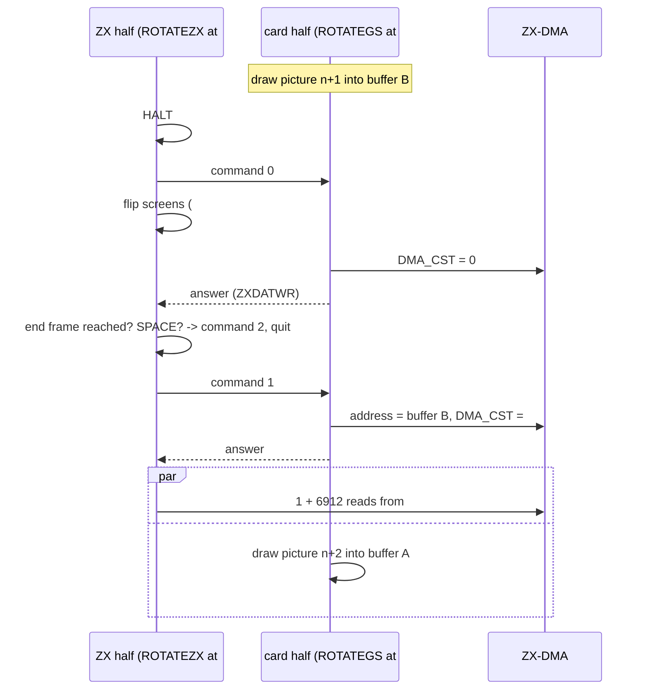
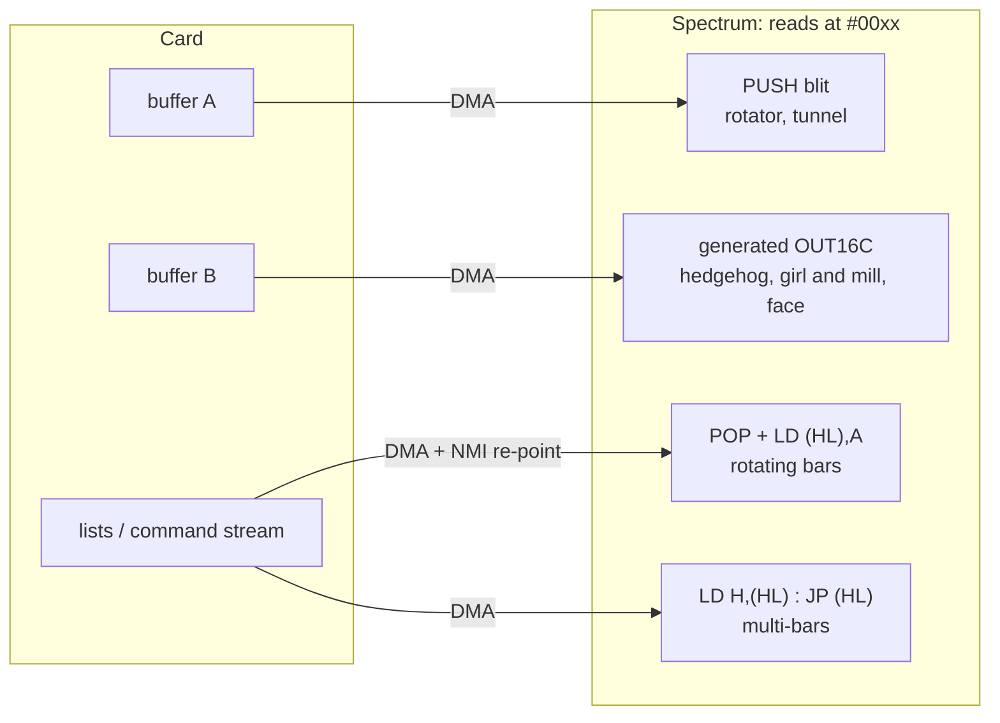

# 3. The frame: one picture from the card to the screen

Every effect in The Link runs as two programs, one on each Z80, which meet once per picture.
The card draws into one of two buffers. The Spectrum shows one screen and fills the other by
reading the card's finished buffer through ZX-DMA: `LD D,(HL) : LD E,(HL) : PUSH DE`, with `HL`
pointing into the ROM area. This chapter describes that shared handshake, using the rotator
(`GSROTAT7.asm`) as the main example, and then lists where each part departs from it.

Previous: [2. The start](02-the-start.md) - next: [4. Tunnel](04-tunnel.md). The hardware (the
mailbox ports, ZX-DMA, card page numbers) is introduced in [1. The machine](01-the-machine.md);
the README of the analysis has the short version
([section 6](../../../../disasm/demo/thelink/README.md)).

## 3.1 Two loops, one picture

At its start, an effect's ZX half sits in the Spectrum's resident loop (`CALL #C000` of an effect
page, with the start and end frame in `BC` and `DE`). Its card half sits in the card's resident
loop (`CALL #C000` of a code page). Neither calls the other. They meet at the mailbox, using three
command values the Spectrum writes to `GSCOM` (`#BB`):

| Command | Spectrum means | Card does |
|---|---|---|
| `0` | "the last picture is on screen; stop the DMA" | `DMA_CST` = 0, answers (or takes the timer byte, 3.8) |
| `1` | "send me the next picture" | points the DMA at the buffer it just finished, `DMA_CST` = `#80`, answers |
| `2` | "the effect is over" | `RET` to its resident loop: the next code page runs |

The card answers by writing any byte to `ZXDATWR` (card port `#03`). That sets the data bit
the Spectrum polls with `WN` and clears with `GD`. These macros, from `gsports.asm`, appear in
every unit:

| Macro | Code | Meaning |
|---|---|---|
| `SC n` | `LD A,n : OUT (GSCOM),A` | send command |
| `SD n` | `LD A,n : OUT (GSDAT),A` | send data byte |
| `WC` | `IN A,(GSCOM) : RRCA : JR C,..` | wait until the card has taken the command |
| `WD` | `IN A,(GSCOM) : RLCA : JR C,..` | wait until the card has read the data byte |
| `WN` | `IN A,(GSCOM) : RLCA : JR NC,..` | wait for the card's answer (data bit set) |
| `GD` | `IN A,(GSDAT)` | read the answer (clears the data bit) |

The card does not use the command bit at all. It reads the command **value** from `ZXCMD`
(card port `#01`), which holds the last byte the Spectrum wrote to `GSCOM` until the next one.
"Wait for command 0" means "wait until `ZXCMD` reads 0".



The two sides keep each other in step: the card cannot start a new picture in buffer A until the
Spectrum has finished reading it, which the Spectrum signals with the next command 0. Neither
side has a clock for the other; the frame counter `timer` (`#BF02`) lives only on the Spectrum.

## 3.2 The card side

The card's loop in the rotator (`GSROTAT7.asm`, `GSLOOP`) draws, stamps the logo, and then:

```asm
;GS ожидает конец кадра у ZX
        LD HL,0
        LD DE,1
GSWAIT0 ADD HL,DE
;JP C,GSRESET
        IN A,(ZXCMD)
        OR A
        JR NZ,GSWAIT0           ;48t

        XOR A                   ;TURN OFF DMA MODE
        OUT (DMA_CST),A
;после этого ZX можно сбрасывать
        OUT (ZXDATWR),A         ;признак для ZX "DMA OFF"
;GS ожидает обнуления (ZX запросит данные)
        LD HL,0
        LD DE,1
GSWAIT1 ADD HL,DE
        JP C,GSRESET
        IN A,(ZXCMD)
        OR A
        JR Z,GSWAIT1
        DEC A
        RET NZ                  ;QUIT
```

The author's comments: "GS ожидает конец кадра у ZX" - "the GS waits for the end of the frame on
the ZX"; "после этого ZX можно сбрасывать" - "after this the ZX may be reset"; "признак для ZX" -
"the sign for the ZX"; "GS ожидает обнуления (ZX запросит данные)" - "the GS waits for the zeroing
(the ZX will request data)". The code actually waits for a **non-zero** command there: `1`
continues, anything else (`2`) returns from the effect.

Then the DMA address is set to the finished buffer and the DMA started:

```asm
        XOR A
        OUT (DMA_HAD),A
        LD A,(gsdrawscr)
        OR A
        LD A,high GSSCR1
        JR Z,$+4
        LD A,high GSSCR2
        OUT (DMA_MAD),A
        XOR A
        OUT (DMA_LAD),A
        LD A,#80                ;TURN ON DMA MODE
        OUT (DMA_CST),A
        OUT (ZXDATWR),A         ;признак для ZX "DMA ON"
        JP GSLOOP
```

`gsdrawscr` is the operand of the `LD A,1` at the top of `GSLOOP`. The loop flips it with
`XOR 1` and stores it back (self-modifying code), so buffers `GSSCR1` (`#0000`) and `GSSCR2`
(`#2000`) alternate. The DMA is therefore **on** only between command 1 and the next command 0,
while the Spectrum reads. That is the point of "after this the ZX may be reset": with the DMA
off, a Spectrum reset reads the real ROM again.

## 3.3 The Spectrum side

`ROTATEZX` copies itself to `#7800` and runs `BIGLOOP` there; it needs `#C000` free for the screen
pages. The loop, with the author's comments:

```asm
BIGLOOP
        HALT
;даем знать GS'у, что кадр готов
;и DMA надо выключить:
        XOR A
        OUT (GSCOM),A

        LD A,#1D^#17
        XOR #1D                 ;видим scr1, рисуем scr0
        LD ($-1),A
        setpga
;теперь видим scr0, рисуем scr1

;и ждем выключения:
        WN
        GD
zxendtime=$+1
        LD DE,0
        LD HL,(timer)
        OR A
        SBC HL,DE
        JP NC,QUIT
        LD A,#7F
        IN A,(#FE)
        RRA                     ;space
        JP NC,QUIT              ;можно жать RESET
;даем знать GS'у, что надо включить DMA
        LD A,1
        OUT (GSCOM),A
;и ждем включения:
        WN
        GD
```

Translations: "let the GS know that the frame is ready and the DMA must be switched off"; "we see
scr1, we draw scr0" / "now we see scr0, we draw scr1"; "and wait until it is off"; "one may press
RESET"; "let the GS know that it must switch the DMA on"; "and wait until it is on".

**The screen flip.** `LD ($-1),A` stores into the byte just before itself, which is the operand of
`XOR #1D`, not of `LD A`. `A` is `#1D^#17` = `#0A` every time, and the operand alternates between
`#17` and `#1D`:

| `#7FFD` | Shown screen | Page at `#C000` | The Spectrum writes |
|---|---|---|---|
| `#17` | screen 0 (RAM 5) | RAM 7 (screen 1) | screen 1 at `#C000` |
| `#1D` | screen 1 (RAM 7) | RAM 5 (screen 0) | screen 0 at `#C000` |

So the screen at `#C000` is always the hidden one. Bit 4 (48K ROM) is set in both values: the
ROM must be paged in for the reads to go to the card (3.4). `setpga` also stores the value in
`curpg` (`#BF01`), which the interrupt handler restores after the music (3.6).

**The end.** The end frame was put into `zxendtime`'s operand at entry. `QUIT` sends command 2,
pages screen 0 in, blacks out its attributes, sets `#EFF7` = 0, and returns to the resident loop.
Command 2 is sent only after command 0 has been answered. At that point the card is in `GSWAIT1`,
the only place that reacts to it.

## 3.4 The fetch: reading the card as ROM

```asm
        DI
        LD (PUSHKASP),SP
        LD H,0
        LD A,(HL)               ;1ST BYTE DISCARDED
        LD B,128
        LD SP,#D800
PUSHKA0
        DUP #18
        LD D,(HL)
        LD E,(HL)
        PUSH DE
        EDUP
        DJNZ PUSHKA0
        LD B,24
        LD SP,#DB00
PUSHKA1
        DUP 16
        LD D,(HL)
        LD E,(HL)
        PUSH DE
        EDUP
        DJNZ PUSHKA1
PUSHKASP=$+1
        LD SP,0
        EI
```

Three ideas meet here.

**Any address in `#0000`-`#3FFF` will do.** While the card's DMA runs, every Spectrum read in the
ROM window returns the next card byte, whatever the address. `LD H,0` is enough; `L` is whatever
it was. Some units use this freedom: in the 16-colour parts `HL` holds two `#7FFD` values at once
(3.8).

**The first byte is stale.** ZX-DMA answers a read with the byte fetched by the *previous* read,
and starts fetching the next one. The first read after the DMA starts gets an old latch value.
Every unit throws it away. In the rotator it is `LD A,(HL) ;1ST BYTE DISCARDED`; elsewhere the
comment is "первый байт неверен" - "the first byte is wrong". unreal-ng models the same latch
(`NeoGSZxDma::onRead`: "The byte fetched by the previous read; this read starts the next fetch").

**The stack is the write pointer.** `PUSH DE` stores two bytes in 11 T-states and moves the pointer
itself. The blit pushes downwards, so the stream arrives in reverse. The card stores its picture
**byte-reversed**: card offset `c` holds ZX screen byte `#17FF-c`, and the attributes follow
reversed at `#1800`. The first stream byte goes into `D`, which `PUSH DE` puts at the higher
address, `#D7FF`, the last pixel byte of the screen. 128 x 24 pairs fill `#C000`-`#D7FF`, then
24 x 16 pairs fill the attributes `#D800`-`#DAFF` from `#DB00` down.

The cost, counted from the instructions (7 + 7 + 11 = 25 T-states per pair):

| | T-states |
|---|---|
| pixels: 128 x (24 x 25 + 13) | 78,464 |
| attributes: 24 x (16 x 25 + 13) | 9,912 |
| total, plus a few dozen for set-up | about 88,400 |
| one Pentagon frame (320 lines x 224) | 71,680 |

At 3.5 MHz the rotator's copy is longer than one frame, and it runs with interrupts disabled.
The rotator therefore shows a new picture every second frame (the regression test
`NeoGSTheLink_Test` checks exactly that). The author also writes `#EFF7` = 0 with the comment
`;turbo`: on his Pentagon 1024SL bit 4 of `#EFF7` = 0 means turbo on. unreal-ng does not model
that turbo, so the copy runs at 3.5 MHz there. Not confirmed here: whether the frame interrupt
that falls inside the `DI` is lost at 3.5 MHz, which would slow `timer` down during the rotator.

ZX-DMA also adds wait states when the card has not yet delivered a byte. The table counts none.

## 3.5 Card page numbers and the DMA address

The card has 2 MB of RAM in 16 KB pages, seen through four windows. With `GSCFG0` = `#09`
(24 MHz, `NOROM`, `EXPAG`):

| Card window | Content |
|---|---|
| `#0000`-`#3FFF` | RAM page 0 |
| `#4000`-`#7FFF` | RAM page 3 (fixed) |
| `#8000`-`#BFFF` | `MPAG` (port `#00`) |
| `#C000`-`#FFFF` | `MPAGEX` (port `#10`) |

A value `v` written to `MPAG` or `MPAGEX` selects 16 KB page `rotl(v)`: bits 6-0 of `v` are page
bits 7-1, and bit 7 of `v` is page bit 0 (unreal-ng: `NeoGSMemory::writeMpag`, "rotate left").
The author thinks of `v` as a 32 KB block plus a half: his comments say `gspg1:0` for "block 1,
half 0". Two idioms follow, both found in every unit:

```asm
        LD A,GSpgrlscr          ; a 32 KB block number
        OUT (MPAG),A            ; first half at #8000
        RLCA
        INC A
        RRCA
        OUT (MPAGEX),A          ; second half at #C000: the whole block at #8000-#FFFF
```

`RLCA : INC A : RRCA` is "the next 16 KB page" in this notation. For a block number below `#80`
it simply sets bit 7. The card's resident loop uses it to walk its code pages: `#10`, `#90`,
`#11`, `#91`, ... ([2.7](02-the-start.md)).

The DMA address is a plain card address in `DMA_HAD` (bits 16 and up), `DMA_MAD` (bits 8-15)
and `DMA_LAD` (bits 0-7). To point it at a page `v`, the units use one fixed sequence
(`GSPROGGO`, `baba4.asm`, `hedge12.asm`, `TEX28.asm`):

```asm
        LD A,gspgdata
        RRCA
        LD D,A
        AND #C0
        LD H,A
        XOR D
        OUT (DMA_HAD),A
        LD A,H
        OUT (DMA_MAD),A
        XOR A
        OUT (DMA_LAD),A
```

After `RRCA`, bits 5-0 are `v` bits 6-1 (address bits 21-16). Bit 7 is `v` bit 0 (address bit
15) and bit 6 is `v` bit 7 (address bit 14). The `AND #C0` / `XOR` pair splits them between
`HAD` and `MAD`. So the DMA address is `rotl(v) * #4000`, the same page `MPAG` would map:

| `v` | 16 KB page | Card address | `HAD` | `MAD` | Used for |
|---|---|---|---|---|---|
| `#20` | `#40` | `#100000` | `#10` | `#00` | `gspgdata`: the data upload (command 3) |
| `#10` | `#20` | `#080000` | `#08` | `#00` | `gspgcode`: the code upload (command 4) |
| `#90` | `#21` | `#084000` | `#08` | `#40` | the second code page (`ROBPREGS` in the demo) |

For a buffer in the card's low 32 KB the address follows from the window. Window `#0000`-`#3FFF`
is page 0, so card CPU address = DMA address: the rotator writes `HAD` = 0, `MAD` = `#00` / `#20`.
Window `#4000`-`#7FFF` is page 3, so CPU `#4000` is DMA `#00C000`. The tunnel adds `#80` to
`MAD` for its buffers at `#4000` / `#4C00`. The rotating bars set bit 15 of a list address in
that window, with the author's note `;pg1:1` ("block 1, half 1" = page 3).

## 3.6 Interrupts while `SP` is a write pointer

During a `PUSH` blit, `SP` points into a screen. An interrupt makes the CPU push the return address
at `SP-2`, which is screen memory, and any handler that pushed registers would write more of them
there. The parts solve this in three ways.

**1. Keep interrupts off.** The rotator and the tunnel blit inside `DI` ... `EI`. That is simple,
but limits the copy to what fits between two interrupts (see the T-state table in 3.4).

**2. Make the interrupt harmless.** The IM 2 handler at `#BFBF` (`IMER`, installed by `GO`;
[2.8](02-the-start.md)) touches only the word the CPU pushed. It also runs on its own stack at
`#5F00`:

```asm
        EX DE,HL
        EX (SP),HL              ;пишем DE вместо адреса возврата
        LD (outimjp),HL
        LD (outimsp),SP
        LD SP,outimstack
        PUSH DE                 ;hl до прерывания
        ...
outimsp=$+1
        LD SP,0
        POP DE
        EI
outimjp=$+1
        JP 0
```

"пишем DE вместо адреса возврата" - "we write DE instead of the return address"; "hl до
прерывания" - "HL from before the interrupt". The return address leaves the stack into the
operand of the final `JP`. The interrupted `DE` takes its place, and `POP DE` reads it back at the
end. The 16-colour parts copy with interrupts **on**: girl and mill's copy takes more than four
frames, so it has to. The author states the rule next to their blit generator (`MKOUT16C` in
`hedge12.asm` and `baba4.asm`):

```
;копируем из NGS линейный буфер 16C на экран      (copy the linear 16-colour buffer from the NGS to the screen)
;снизу вверх                                      (bottom up)
;обработчик прерывания должен класть в стек DE вместо адреса   (the interrupt handler must put DE on the stack
;возврата                                                      instead of the return address)
```

Why `DE` and not any value: in `LD D,(HL) : LD E,(HL) : PUSH DE`, the two bytes below `SP` are
where the next `PUSH DE` will write. If the interrupt comes between `LD E,(HL)` and `PUSH DE`,
they already hold the right pair. In every other position the blit overwrites them later, because
it works bottom-up, towards lower addresses. One case is left: the end of a run that starts on a
256-byte boundary. There the word below `SP` is outside the area. For it the generator replaces
the last `PUSH DE` by `LD (nn),DE`, which keeps `SP` two bytes higher. An interrupt then writes
`DE` over the two bytes `LD (nn),DE` stores, which is the same value
("у посл. линий третей надо LD (..),DE вместо последнего PUSH" - "the last lines of the thirds
need `LD (..),DE` instead of the last `PUSH`"). [9. Girl and mill](09-girl-and-mill.md) section 7
walks through it.

The handler also switches to the music page and back to `curpg`. That is why every page switch
inside a blit first writes `curpg`: the generated `OUT16C` code is `LD (curpg),A : OUT (C),A`.

**3. Replace the vector.** The table at `#BE00` gives `#BFBF` for any bus value. The two parts
that swap the vector patch only the word at `IMVEC+#FF` (`#BEFF`): they rely on the bus reading
`#FF` during the interrupt acknowledge, as it does on a Pentagon.

- Multi-bars writes `#5F5F` there each frame, pointing at a `RET`. Interrupts during its command
  stream do nothing. The stream's last command, `CMDENDFRAME`, calls `IMER` itself (frame counter
  and music) once per loop. `QUIT` restores the table.
- Rotating bars points it at `VIEWBARIM` while reading the last of its four lists with interrupts
  on. The frame interrupt *ends* that list: `VIEWBARIM` restores `SP` and the vector and jumps into
  `IMER`, which returns to `VIEWBAR`'s caller.

## 3.7 Timeouts and `GSRESET`

Only one wait in the whole protocol has a timeout: the card's wait for command 1 or 2
(`GSWAIT1`). Its loop is `ADD HL,DE` (11) + `JP C` (10) + `IN A,(n)` (11) + `OR A` (4) + `JR Z`
(12) = 48 T-states. 65,536 polls are 3,145,728 card T-states: 131 ms at 24 MHz, between six and
seven Spectrum frames. When `HL` wraps, `JP C,GSRESET`:

```asm
GSRESET
        XOR A                   ;TURN OFF DMA MODE
        OUT (DMA_CST),A
        IN A,(GSCFG0)
        AND #FF-M_CKSEL0-M_CKSEL1-M_RAMRO-M_NOROM-M_EXPAG
        OR C_10MHZ
        OUT (GSCFG0),A
        RST 0
```

DMA off, 10 MHz, ROM back, normal paging, `RST 0`: the card's firmware starts as after power-on.
This is how the card recovers when the Spectrum is reset in the middle of an effect ("можно жать
RESET" - "one may press RESET", next to the SPACE check). Every effect carries its own copy, and
the card's resident loop ends in one ([2.11](02-the-start.md)).

The other waits have no timeout:

- the card's wait for command 0 (`GSWAIT0`, or `WAITER0` in `hedge12.asm` / `TEX28.asm`): the
  `JP C,GSRESET` is commented out in every unit. The `;48t` the author left on that loop counts
  the `JP`; without it the loop is 38 T-states.
- the Spectrum's `WN` / `WD`: on a card that never answers, the Spectrum waits for ever. On a
  classic General Sound (no ZX-DMA, no extended paging) the demo hangs at the first effect for
  exactly this reason ([README section 8](../../../../disasm/demo/thelink/README.md)).

## 3.8 How the parts differ

All seven parts keep commands 0/1/2, the `GSWAIT1` timeout and `GSRESET`. What changes is the
data in the stream, and how the Spectrum stores it.

| Part | Stream | Spectrum side | Interrupts during the read |
|---|---|---|---|
| Tunnel (`GSTUNNE4`) | 3,072 attribute bytes | after command 1: `HALT`, a delay to the first screen line, then 24 rows x 4 x 32 bytes into the **attributes** of both screens, switching the shown screen every two lines with `OUT (C),A` | `DI` |
| Rotator (`GSROTAT7`) | 6,912 bytes, the whole screen, reversed | `HALT` at the top; 3,456 `PUSH`es into the hidden screen | `DI` |
| Rotating bars (`GSRBAR24`) | a header and four lists of (address, byte) records | `POP` the counts with `SP` at `#00xx`; before each list an NMI to the card (`FORCENMI`, `OUT (GSCTR),#40`) makes the card's handler at `#0066` re-point the DMA; one dummy read per list | `DI` for three lists; the fourth ends at the frame interrupt (`VIEWBARIM`) |
| Multi-bars (`GSMULBA3`) | a **program**: command bytes with operands | `LD H,(HL) : JP (HL)` dispatches on the high byte of a page-aligned handler; the handlers fill or clear rows with `PUSH`, waste a scan line, or wait an exact time and switch the shown screen mid-frame | on, vector -> `RET`; `#EFF7` = `#10` ("noturbo"), because the card counts the stream's T-states |
| Hedgehog (`hedge12`) | 16-colour picture, 7,168 reads | no `HALT`; generated `OUT16C`; per 16 bytes read, 14 stored; no dummy read (comment: "первый байт неверен (попадет в D)" - "the first byte is wrong (would go to D)", and that first `D` is never stored) | on, `DE` rule |
| Girl and mill (`baba4`) | 16-colour screen, 24,576 bytes | no `HALT`; no screen flip: always pages 6 and 7; generated `OUT16C`, 12,288 `PUSH`es; `HL` = `#1E1F` is both the read address and the two pages (`H` = `#7FFD` `#1E`, page 6; `L` = `#1F`, page 7) | on, `DE` rule |
| Textured face (`TEX28`) | 16-colour picture, 16,384 bytes (lines 32-159) | `HALT` at the top; generated `OUT16C`; `HL` = `#1617` / `#1C1D` | on, `DE` rule |

Two more differences in the handshake itself:

- **The timer byte.** In the hedgehog, girl and mill and the face, the Spectrum sends the low byte
  of `timer` with command 0 (`OUT (GSDAT),A`). The card reads it from `ZXDATRD` after stopping the
  DMA, and animates by the number of frames that passed (girl and mill moves at most 5 steps per
  picture). Those cards do not answer command 0 (`;OUT (ZXDATWR),A` is commented out). The
  Spectrum waits with `WD` ("пока не примет" - "until it takes it") instead of `WN : GD`.
- **The pace.** The tunnel and the rotator `HALT` once per loop; the face too. The hedgehog and
  girl and mill do not (`;HALT` is commented out): they run as fast as the card answers. Multi-bars
  has no `HALT` at the top either, but it `HALT`s before starting its stream, so its stream
  starts at the same point of every frame.



## 3.9 Budgets

| | Spectrum | Card |
|---|---|---|
| clock | 3.5 MHz | 24 MHz |
| T-states per Spectrum frame | 71,680 | about 491,500 |
| one read + store, `PUSH` blit | 12.5 T per byte | - |
| a full 6,912-byte screen | about 88,000 T (1.2 frames) | - |
| a full 16-colour screen (24,576 bytes) | about 307,000 T (4.3 frames) | - |

The card has about seven times the cycles, which is what makes the split pay. The Spectrum's side
of a frame is mostly the copy: the tunnel, which moves 3,072 bytes, shows a new picture every
frame; the rotator, with 6,912, every second frame.

## Things to notice

- **The Spectrum never waits with a timeout.** Every recovery path is on the card. A dead card
  hangs the Spectrum in `WN`; a dead Spectrum resets the card after 131 ms.
- **`ZXCMD` is a register, not a queue.** The card polls the last value written. Command 0 can be
  "seen" twice without harm, and `QUIT` does not need to wait for anything after sending 2.
- **The flip patches the wrong-looking operand.** `LD ($-1),A` after `XOR #1D` rewrites the `XOR`'s
  operand, not the `LD A`'s. The same three lines are in the rotator, rotating bars, hedgehog and
  the face.
- **"первый байт неверен"** ("the first byte is wrong") is the ZX-DMA read latch, not a bug. The
  hedgehog's blit drops its first pair for its own reasons, so it can skip the dummy read.
- **The timeout comment is stale.** `;48t` on `GSWAIT0` counts a `JP C,GSRESET` that is commented
  out in every unit.
- **The interrupt handler's 2-byte footprint** lets three parts run their copies with interrupts
  on, at a cost of one rule ("put `DE` there") and one patch (`LD (nn),DE` at 256-byte boundaries).
- **The DMA addresses of the low card RAM are not linear.** CPU `#4000` is card address `#C000`
  (page 3). The tunnel and the bars both carry the correction.

## Try it

- Boot `testdata/machines/pentagon1024sl/TheLink-sjasm.scl` on a Pentagon 1024 with a NeoGS. The rotator
  runs while `timer` (`#BF02`, 16 bits) is 1792-2674 (`#0700`-`#0A72`); `curpg` (`#BF01`) is `#B1`
  while `ROTATEZX` runs, and its loop is at `#7800`+.
- Breakpoint on the `LD A,(HL)` before the blit (`1ST BYTE DISCARDED`). Step over it: `A` is the
  stale latch value. The next `LD D,(HL)` brings the first picture byte, which `PUSH DE` puts at
  `#D7FF` (the bottom-right byte of the hidden screen).
- Watch the bytes at `#BF01` while stepping `BIGLOOP`: `curpg` alternates `#17` / `#1D`.
- In the Qt debugger's "Device memory" view (region `neogs.ram`), card addresses `#0000` and
  `#2000` hold the rotator's two buffers, reversed: the logo's attributes sit at `#1800` / `#3800`
  read backwards.
- Press SPACE during an effect: the part ends at once, and the next one starts at its own start
  frame (or immediately, if that frame has passed).
- Set a breakpoint at `#BFBF` during the girl and mill (frames 4480-4914): `SP` on entry points
  into a 16-colour screen page, and the word at `SP` after the handler's `EX (SP),HL` equals `DE`.

Next: [4. Tunnel](04-tunnel.md).
