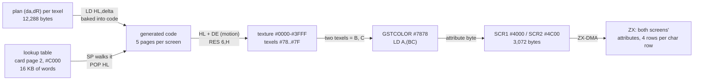
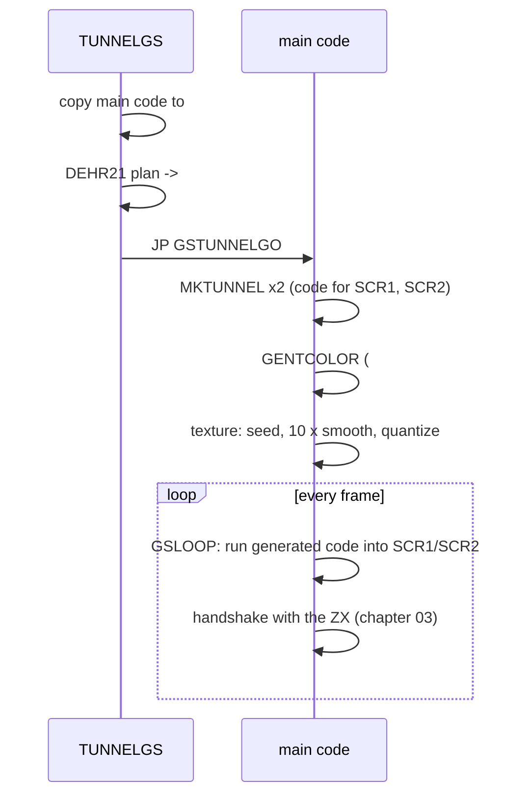
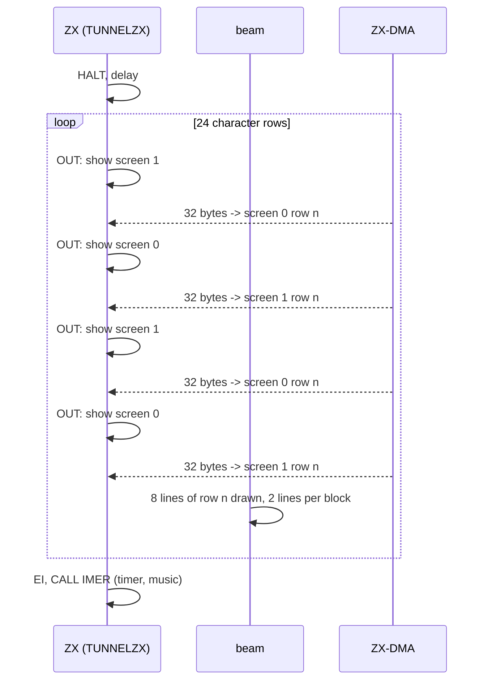

# 04. The tunnel (`GSTUNNE4`)

The first effect of The Link: a textured tunnel that moves towards the viewer and turns,
drawn in attributes only, 32 x 96 cells of two colours each, a new picture every frame.
The NeoGS does all the work: it runs about 67 KB of code it generated itself and samples a
plasma texture through a lookup table. The ZX only copies the finished 3,072 bytes into its
attribute areas, flipping screens every two scan lines.


Previous: [03. The frame](03-the-frame.md) - next: [05. The rotator](05-rotator.md).
Source: [`GSTUNNE4.asm`](../../../../disasm/demo/thelink/sjasm/src/GSTUNNE4.asm) (annotated; the
comments without `en:` are the author's).

## 1. What the unit builds

`GSTUNNE4.asm` assembles two objects (its `ObjTab` at the end; `SAVEBIN` in the sjasmplus build):

| Object | Bytes | Assembled at | In the demo | Runs on |
|---|---|---|---|---|
| `TUNNELZX` | 489 | `#C000`, `#7FFD` = `pgeffects` (`#B0`, RAM page 48) | the same page, the first ZX effect page | ZX, copies itself to `#7800` |
| `TUNNELGS` | 14,222 | `#C000`, `#7FFD` = `pgcode1` (`#52` in this unit) | `THELINK.asm` puts it in `#7FFD` page `#30`, card code page 3 | card, at `#C000` (MPAGEX) |

Both are `#C000`-based and are copied without relocation, so the page they are assembled in does
not matter. The rest of the unit - `begin`..`end` at `#7800` - is a **test bed** that is never
saved: an older copy of the start that chapter [02](02-the-start.md) describes, which uploads one
data page and one code page, has a single `zxtimings` entry (`DW 896,896*2-20`) and an effect
page `pgeffects+1` that contains only `JR $`. In ALASM the author could `RUN` the unit and watch
the tunnel alone. This chapter is about the two objects.

Of `TUNNELGS`'s 14,222 bytes, most is packed data: `torusr.p` (10,397 bytes) and `dplan2r.p`
(3,160 bytes). The code is 665 bytes: the start-up and `DEHR21` (217 bytes) and the main code copied to `#5900` (448 bytes).

## 2. The idea

A tunnel is the classic "lookup" effect. For every screen pixel you precompute *where in the
texture* it looks: a texture coordinate (u, v), where u runs around the tunnel (the angle) and v
along it (the depth, roughly 1/r). Drawing a frame is then only

```
pixel(x, y) = texture[u(x, y) + du, v(x, y) + dv]
```

and changing `du` and `dv` each frame turns the tunnel and flies through it. No multiplication at
run time - just one add and one fetch per pixel.

The Link does that with three tables and one twist:

| Data | Size | Where (card) | What |
|---|---|---|---|
| the **lookup table** (`torusr.p`) | 16,384 bytes unpacked | card page `GSpglookup` = 2, seen at `#C000` | words: texture addresses |
| the **plan** (`dplan2r.p`) | 12,288 bytes unpacked | `#0000`, temporary | per texel a word `(da, dR)`: a step through the lookup table |
| the **texture** | 16,384 bytes | `#0000-#3FFF` | a plasma, 8 levels, computed at start |

The twist is the plan. It does not hold a texture coordinate per pixel. It holds a **delta**: how
far to move a pointer through the lookup table to reach the entry of the next texel. The pointer
is the stack pointer, so one `POP HL` reads the entry and moves on. The names in the author's
comments, `da` and `dR`, suggest the two bytes of each delta are a step in angle and in radius;
the lookup table is named after a torus. How these two files were generated is not on the
disk (no BASIC or source writes them), so their exact geometry is not known; the code below only
shows how they are used.

The output resolution is set by the ZX side (section 6): 32 columns by 96 rows of attribute
cells, each cell showing two texels (paper on the left 4 pixels, ink on the right 4). That is
6,144 texels: 3,072 bytes per frame, and 6,144 x 2 bytes = 12,288 bytes of plan.



## 3. Card memory

While the tunnel runs the card uses (card CPU addresses; the card runs with `GSCFG0` = 24 MHz,
NOROM, EXPAG: RAM everywhere, two 16K windows at `#8000` and `#C000`):

| Address | Content |
|---|---|
| `#0000-#3FFF` | first the unpacked plan (`GSPLAN2RTMP`), then the texture |
| `#4000-#4BFF` | `GSSCR1`, frame buffer 1 (3,072 bytes) |
| `#4C00-#57FF` | `GSSCR2`, frame buffer 2 |
| `#5800-#582F` | card stack (`GSSTACK` = `#5830`, growing down) |
| `#5830` | `GSPROG`, the card's resident program from [chapter 02](02-the-start.md) |
| `#5900` | `GSTUNNELCODE`, the tunnel's main code (copied there, 448 bytes) |
| `#7878-#7F7F` | `GSTCOLOR`, 8 x 8 texel-pair -> attribute table (rows of 8 bytes at `#xx78`) |
| `#8000-#BFFF` (MPAG) | the generated code: pages `#82,#03,#83,#04,#84` for SCR1, `#06,#86,#07,#87,#08` for SCR2 |
| `#C000-#FFFF` (MPAGEX) | first `TUNNELGS` itself, then card page 2: the lookup table |

The card's page numbers have the 16K half in bit 7: the linear 16K page is `RLCA` of the value,
and the next page is `RLCA : INC A : RRCA` ([chapter 03](03-the-frame.md)). The author's comment on
`GSpgprog1` lists `#82,03,83,04,85`; the sequence the code actually produces ends with `#84`.
Linear, the two code areas are 16K pages 5-9 and 12-16, 80 KB each.

## 4. Start-up on the card

The card's resident loop maps `TUNNELGS` at `#C000` and `CALL`s it. The first thing the effect
does is move its own main code out of the `#C000` window, because it needs that window for the
lookup table:

```
        ORG #C000,pgcode1
        LD HL,WASGSTUNNELCODE
        LD DE,GSTUNNELCODE      ; #5900
        LD BC,LENGSTUNNELCODE
        LDIR

        LD HL,wasplan2r
        LD DE,GSPLAN2RTMP       ;временно
        CALL DEHR21
        LD A,GSpglookup
        OUT (MPAG),A
        LD HL,wastorus
        LD DE,#8000
        CALL DEHR21
        JP GSTUNNELGO
```

(`временно` = "temporarily".) The plan goes to `#0000`; the lookup table is unpacked through the
`#8000` window into card page 2 and later read through the `#C000` window, where `GSTUNNELGO`
maps the same page with `OUT (MPAGEX),A`.

### 4.1 DEHR21: the Hrust 2.1 depacker

`DEHR21` (HL = packed, DE = destination) is a standard Hrust 2.1 depacker, 181 bytes. The
packed block starts with a header:

| Offset | Bytes | `torusr.p` | `dplan2r.p` |
|---|---|---|---|
| 0 | `"hr21"` | `hr21` | `hr21` |
| 4 | unpacked length | `#4000` | `#3000` |
| 6 | packed length | `#2895` | `#0C50` |
| 8 | the last 6 bytes of the output | | |
| 14 | the bit stream | | |

The six tail bytes are pushed on the stack before the depacking and written last, after the
`Hquit` marker - the usual Hrust arrangement that allows depacking in place over the packed
data. Register use:

- main set: `HL` = packed stream, `C` = bit buffer (`SLA C : CALL Z,CHL` takes the next bit and
  reloads `C` from `(HL)` when it runs empty), `D`/`E` = the constants `#10` and `#03`;
- alternate set: `DE'` = output, `HL'` = back-reference source (`LD H,-1 : LD L,A : ADD HL,DE`),
  `BC'` = count for `LDIR`.

A detail: the end of `Hquit` falls through into `CHL`, which reads one byte more and executes the
`RET` that ends `DEHR21`. Harmless. The labels end
in `__L1` because the converter turned ALASM's `LOCAL` block into unique names.

## 5. The main code (`GSTUNNELGO`)



### 5.1 MKTUNNEL: generating the drawing code

The inner loop is not a loop: `MKTUNNEL` turns the plan into straight-line code. Input: `A` = the
first card page for the code (mapped at `#8000` through MPAG), `BC` = the screen buffer. For every
screen byte it emits 22 bytes:

```
        LD HL,delta1            ; 21 da dR   - from the plan
        ADD HL,SP               ; 39         \
        LD SP,HL                ; F9          |  TUNNELCODESAMPLE
        POP HL                  ; E1          |  (copied from the source)
        ADD HL,DE               ; 19          |
        RES 6,H                 ; CB B4      /
        LD C,(HL)               ; 4E         first texel
        LD HL,delta2            ; 21 da dR
        ADD HL,SP : LD SP,HL : POP HL : ADD HL,DE : RES 6,H
        LD B,(HL)               ; 46         second texel
        LD A,(BC)               ; 0A         the attribute for the pair
        LD (screen),A           ; 32 lo hi   BC of the generator, counting up
```

The generator writes the opcodes itself (`LD (HL),33` for `LD HL,nn`, `#4E`, `#46`, `#0A`, `#32`)
and copies the five-instruction sample `TUNNELCODESAMPLE`:

```
TUNNELCODESAMPLE
        ADD HL,SP
        LD SP,HL
        POP HL
        ADD HL,DE
        RES 6,H
TUNNELCODESAMPLELEN=$-TUNNELCODESAMPLE
```

How one texel is fetched:

1. `LD HL,delta : ADD HL,SP : LD SP,HL` - move the lookup pointer by the plan's delta. The delta
   already accounts for the 2 bytes the previous `POP` advanced.
2. `POP HL` - read the lookup entry: a texture address.
3. `ADD HL,DE` - add the frame's motion (`DE`, set once per frame).
4. `RES 6,H` - wrap into `#0000-#3FFF`, the texture.
5. `LD C,(HL)` - the texel.

When the output address reaches `#BFxx`, the generator ends the page with

```
        LD A,nextpage           ; 3E pg
        OUT (MPAG),A            ; D3 00
        JP #8000                ; C3 00 80
```

and continues in the next page (it switches the page itself as well, `OUT (MPAG),A`, so it keeps
writing at `#8000`). After the last of the 3,072 bytes it emits `JP (IX)`: the caller puts the
return address `GSTUNNELQ` in `IX`. 3,072 x 22 = 67,584 bytes per screen, five 16K pages; two
copies, one per frame buffer, because the screen address is part of the code. The plan is read
twice (once per copy) and is not needed after that, so its memory becomes the texture
(`;теперь можно класть текстуру в #0000` = "now the texture can be put at #0000").

**The budget.** One screen byte costs 10+11+6+10+11+8+7 = 63 t per texel, twice, plus 7+13 for
the store: 146 t. 3,072 bytes = 448,512 t. At 24 MHz a 50 Hz frame is 480,000 t, so the drawing
takes about 93% of a frame before page switches, the handshake and the cycles ZX-DMA takes. The
demo still shows a new tunnel picture every frame (the regression test in
[README](../../../../disasm/demo/thelink/README.md) section 9 checks exactly that); there is no
time left for anything else on the card.

### 5.2 GENTCOLOR: two texels, one attribute

Texels are the values `#78..#7F`. The first texel goes to `C`, the second to `B`, so `BC` is an
address in `#7878..#7F7F`, and `LD A,(BC)` turns the pair into an attribute in one instruction.
`GENTCOLOR` fills that 8 x 8 table (64 bytes spread over 8 pages of 256, at `#xx78-#xx7F`):

- pass 1, "строим левые пиксели - зависят от L" (build the left pixels - they depend on L):
  `(H, L)` = `TCOLORS[L - #78]` - ink and BRIGHT;
- pass 2, "строим правые пиксели - зависят от H" (build the right pixels - they depend on H): adds
  `TCOLORS[H - #78] * 8` - paper - and handles BRIGHT, which is per cell:

```
;bright+nobright=nobright+nobright
;отсюда следует:
;если нужен bright, то он уже есть в (HL)
;если его нет в (DE), то он не нужен
```

"Bright + no bright = no bright + no bright. Hence: if bright is needed, it is already in (HL); if
it is not in (DE), it is not needed." A cell is bright only if both texels are.

The palette, darkest to brightest, with two earlier tries left commented out:

```
TCOLORS
;DB 0,1,64+1,5,7,64+7,64+6,64+4
;DB 0,1,64+1,2,3,5,6,7
        DB 1,1,64+1,2,3,5,7,7
```

Blue, blue, bright blue, red, magenta, cyan, white, white.

On the ZX every pixel byte is `#0F`, so in each cell the left 4 pixels show paper (the second
texel, `B`) and the right 4 show ink (the first texel, `C`). The author's comments call `C` the
left pixel (`;левый пикс.=LSB`, "left pixel = low byte") - in screen terms it ends up on the right.
In a tunnel nobody can tell.

### 5.3 The texture: plasma from noise

The texture is computed, not loaded. Three loops over `#0000-#3FFF`:

1. **Seed** (`GSPLASMPRE0`): each byte = a mix of the byte already there (the used plan) and the
   byte of the lookup table at `#C000+`: `RLCA, ADD (HL), RLCA, XOR H, RLCA, RLCA`. The leftovers of
   two tables make the noise.
2. **Smooth** (`GSPLASM`, 10 passes): each byte becomes roughly the average of itself, its right
   neighbour and the byte 256 further on (wrapping with `RES 6,H`), with the carries of `ADC` and
   `RRA` as extra noise (`;+noise`). Ten passes give soft blobs.
3. **Quantize** (`GSPLASM1`): `texel = (byte >> 5) + #78` - 8 levels, ready to be used as
   `B` or `C`.

### 5.4 GSLOOP: one frame

```
GSLOOP
gsdrawscr=$+1
        LD A,1                  ;рисуем в SCR2
        XOR 1
        LD (gsdrawscr),A        ;теперь рисуем в SCR1
;потом дадим его ZX'у
        LD (GSTUNNELSP),SP
        LD IX,GSTUNNELQ
        LD A,GSpgprog1
        JR Z,$+4
        LD A,GSpgprog2
        OUT (MPAG),A
```

("drawing into SCR2" / "now drawing into SCR1" / "later we give it to the ZX".) `gsdrawscr` is a
self-modified operand that flips between 0 and 1; the zero flag of `XOR 1` picks the code pages
of the target buffer. Then the motion:

| Variable | Per frame | Use |
|---|---|---|
| `GSdVU` (`DE`) | `E += 5` | added to every texture address: the low byte scrolls the texture |
| `GSangle` (16-bit) | `-= 64` (`GSSPEED` = `#C0`, sign-extended in `B`) | |
| `D` | `= -(angle high) & #3F` | high-byte offset into the texture |
| `L` of the start pointer | `= (angle * 4) high, even` | where in the lookup table the walk begins |

```
        LD HL,GSLOOKUP          ; #C000
        AND #FE
        LD L,A
        LD (GSdVU),DE
        LD SP,HL
        JP #8000
```

`SP` = `#C000 + L`: the generated code starts walking the lookup table there. The card runs with
interrupts off (the resident program did `DI`), so the stack pointer can be used as a data
pointer. The code ends with `JP (IX)` at `GSTUNNELQ`, which restores `SP` and does the frame
handshake from [chapter 03](03-the-frame.md): wait for command 0, DMA off, wait for 1 (or 2 to
quit, or 65,536 polls -> `GSRESET`), then point the DMA at the buffer just drawn - card `#4000` or
`#4C00`, DMA middle byte `high GSSCR1+#80` - and start the next frame.

**Dead code.** Between `GSSPEED` and `GSangle` sits an `IF 0` block: a "rhythm" that changed the
speed at random (`GSRND`, a `seed*17 + 20981` generator, and an optional `gsspeedtime` hold).
It is switched off, so the speed is constant and `GSRND` is assembled but never called. Two
commented lines show yet another try: `;ADD A,32 ;правильное округление` ("correct rounding").

## 6. The ZX half (`TUNNELZX`)

### 6.1 Start and end

The resident loop `CALL`s `#C000` of page `#B0` with `BC` = start frame and `DE` = end frame
(896 and 1778 in the demo). The stub pushes both and copies the real code to `#7800`
(`TUNNELCODE`), because the effect needs the `#C000` window for screen 1:

```
        PUSH BC
        PUSH DE
        LD HL,WASTUNNELCODE
        LD DE,TUNNELCODE
        LD BC,LENTUNNELCODE
        LDIR
        JP TUNNELCODE
```

At `#7800` it stores the end frame in the operand of `zxendtime` (self-modifying code), waits for
the start frame, then:

- pages in `#17` (RAM page 7, screen 1, at `#C000`);
- clears the attributes of both screens and fills the pixels of both with `#0F`;
- writes `#10` to `#EFF7` ("noturbo" in the author's words - on his Pentagon 1024SL);
- fills the IM 2 table with `#5F` and puts `EI : RET` at `#5F5F` (`LD HL,#C9FB : LD (#5F5F),HL`).

That last step matters: from now on an interrupt does nothing but end a `HALT`. The frame counter
and the music are not driven by the interrupt any more; the loop calls the normal handler
`IMER` itself, once per frame, after the blit (`CALL IMER`). `IMER` was written to be safe for
that: it takes its return address from the stack like any `CALL` target and returns with
`EI : JP`.

`QUIT` undoes it: command 2 to the card, the IM 2 table back to `#BF`, screen 0, its attributes
cleared, `#EFF7` = 0, `RET` to the resident loop. It runs when the timer passes the end frame or
when SPACE is pressed (`;можно жать RESET` - "you may press RESET").

### 6.2 BIGLOOP: 3,072 bytes into two screens

After the handshake (command 0, command 1, [chapter 03](03-the-frame.md)) the loop waits for the
beam:

```
        HALT
        LD HL,#0299             ;298..A
        DEC HL
        LD A,H
        OR L
        JR NZ,$-3
        DI
        LD (PUSHKASP),SP
;LD H,0 ;уже 0
        LD A,(HL)               ;1ST BYTE DISCARDED
```

`#299` x 26 t is about 17,300 t, about 77 lines: the paper starts about 80 lines after the
interrupt on a Pentagon. The note `298..A` is the author's; probably the delay values that work
are `#298`..`#29A`. When the loop ends, `HL` = 0 (`уже 0` = "already 0"), so every `LD r,(HL)` from
now on is a ZX-DMA read of the next byte the card prepared. The first read is thrown away.

Then the multicolour loop. The setup:

```
        LD BC,#7FFD
        EXX
        LD B,24
        LD DE,32
loopmcscr=$+3
        LD IX,#5820             ;линия 0: видим scr1, рисуем scr0
        LD A,IXH
        XOR #80
        LD IYH,A
        LD IYL,E                ;#20
        RLA
        SBC A,A
        AND 8
        OR #17                  ;тот же экран, что в IY
```

("line 0: we see scr1, we draw scr0"; "the same screen as in IY".) `IX` = `#5820`, the end of
attribute row 0 of screen 0; `IY` = `#D820`, the same row of screen 1 (page 7 at `#C000`); `A` =
`#1F`, the `#7FFD` value that shows screen 1. `PUSH` writes downwards, so `SP` = `IX` fills
`#5800-#581F`.

Each character row (`PUSHKA0`, 24 times) is four blocks:

| Block | `SP` | Writes | Shown while writing |
|---|---|---|---|
| 1 | `IX` | screen 0, row n | screen 1 |
| 2 | `IY` | screen 1, row n | screen 0 (just written) |
| 3 | `IX` (then `IX += 32`) | screen 0, row n again | screen 1 |
| 4 | `IY` (then `IY += 32`) | screen 1, row n again | screen 0 |

Each block is `DUP 16 : LD D,(HL) : LD E,(HL) : PUSH DE : EDUP` - 16 x 25 = 400 t, 32 bytes -
plus the `OUT (C),A` that flips the shown screen and some register juggling, about 448 t: two
scan lines. So every attribute row is rewritten four times while the beam crosses its 8 lines,
alternately in the two screens, and the screen shown is always the one written just before.
Each 8-line character row shows four different colour rows: 24 x 4 = 96 rows of 32 cells. The
numbers in the comments (`;51 ;+0`, `;37 ;-11`, `;52 ;-7`, `;52 ;-3`) are the author's t-state
bookkeeping between the `OUT`s.

The blit costs 96 x about 450 t = about 43,000 t of the Pentagon's 71,680 t frame; with the
handshake, the wait for the beam and `IMER` (the music) it fits in one frame.



The order of bytes in the card's buffer follows from this: 96 groups of 32, each written by
`PUSH` from right to left.

## 7. Things to notice

- **The code is the data.** The plan is baked into the operands of 2 x 67,584 bytes of generated
  code; the screen address too. That is why there are two copies, one per buffer.
- **SP as a table walker.** `ADD HL,SP : LD SP,HL : POP HL` moves a pointer by a delta and reads
  through it in 27 t. Possible only because the card never takes an interrupt.
- **`LD A,(BC)` as a 2D lookup.** Texels are `#78..#7F`, so a pair in `B` and `C` is the address of
  their attribute.
- **Memory recycled.** The plan's 12 KB at `#0000` are read twice, then mixed into the noise seed
  of the texture that overwrites them.
- **Interrupts reduced to a beam sync.** The ZX half points IM 2 at `EI : RET` and calls the
  handler itself; the timer then counts loop passes (one per frame when the card keeps up).
- **The author's doubts in the test bed.** "`;не помогает`" ("does not help") on an
  `OUT (GSCOM),A` after the card reset; "`;зачем-то POKE #4092,0`", "`;зачем-то #38 (Load FX)`",
  "`;зачем-то #D2 (Close Stream)`", "`;зачем-то #F5 (Busy on)`" ("for some reason ...") - the card
  start was copied "`;как в RIFF TRACKER`" ("as in RIFF TRACKER") without knowing why each step
  was there.
- **A typo in a comment**: `GSpgprog1 ;16K*5: #82,03,83,04,85` - the fifth page is `#84`.
- **Dead code**: the `IF 0` speed rhythm and `GSRND`; the `GSSETPGA` and `MOVEPAGE` macros (unused
  here); the `LD HL,0 / LD DE,1` before `GSWAIT0`, whose timeout is commented out;
  `;LD (loopmcscr),A` - the label `loopmcscr` exists for a per-frame screen alternation that was
  dropped.
- **The depacker's tail**: `Hquit` falls through into `CHL` and ends on its `RET`.

## 8. Try it

1. In unreal-ng, Pentagon 1024 with NeoGS, insert `testdata/machines/pentagon1024sl/TheLink-sjasm.scl`
   and boot it (TR-DOS, Enter). After the loading, the intro picture stays for 896 frames.
2. The tunnel runs while the timer at `#BF02` (16 bits) is in 896..1778 (`zxtimings`:
   `DW 896,896*2-14` in `THELINK.asm`; the test bed in `GSTUNNE4.asm` uses `-20`).
3. ZX side, in the debugger:
   - code at `#7800` (`TUNNELCODE`); `#C000` holds RAM page 7 (`#7FFD` = `#17`/`#1F`), not page
     `#B0`;
   - the IM 2 table at `#BE00` is all `#5F`, `#5F5F` holds `FB C9`;
   - the attributes at `#5800` (page 5) and `#D800` (page 7) change every frame, the pixels are
     all `#0F`;
   - a breakpoint at `PUSHKA0` shows `HL` = 0 and `SP` = `IX`/`IY` in the attribute areas.
4. Card side: `GSCFG0` = `#09`; `TUNNELGS` is the third code page uploaded, at card page `#11`
   (linear 16K page 34; the code pages start at `#10`, after `ROTPREGS` and `ROBPREGS`). While
   the tunnel runs, if you inspect card RAM: the texture at `#0000`, the buffers at `#4000` and
   `#4C00`, the colour table at `#7878`, the generated code in 16K pages 5-9 and 12-16.
5. Press SPACE during the tunnel: `QUIT` ends it early. The rotator then waits for its own start
   frame, 1792.

Related: the page plan and the upload - [02. The start](02-the-start.md) and
[README](../../../../disasm/demo/thelink/README.md) sections 5-6; the frame handshake -
[03. The frame](03-the-frame.md); the conversion of this unit (`low`, `SAVEBIN`, `JR` for `JNZ`) -
[sjasm/README.md](../../../../disasm/demo/thelink/sjasm/README.md).
