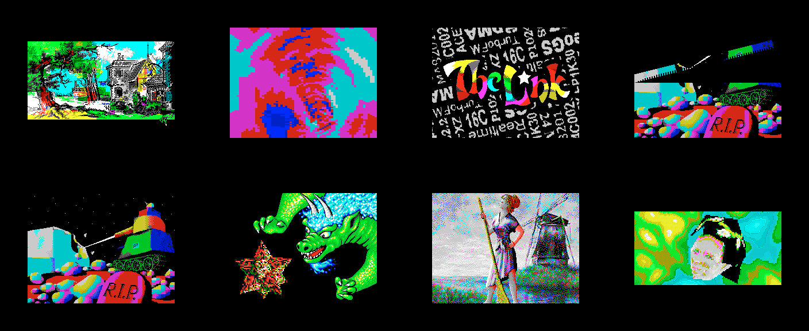
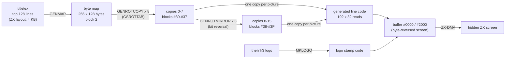

# 5. The rotator

A two-colour texture fills the whole screen. It turns and slides sideways, and The Link's logo
stays fixed in front of it. The card draws every picture. It never rotates a single pixel at run
time: a precalc made 16 pre-rotated copies of the texture, in which every byte already holds 8
pixels sampled along one direction. One generated routine per picture then reads 32 such bytes
per screen line. The Spectrum only copies the result (chapter 3). Source: `GSROTAT7.asm`.



Previous: [4. Tunnel](04-tunnel.md) - next: [6. Rotating bars](06-rotating-bars.md). The
per-frame handshake, the DMA reads and the card page numbers are in [3. The frame](03-the-frame.md);
this chapter uses them without repeating them.

## 5.1 What the unit builds

`GSROTAT7.asm` assembles three objects, each at `#C000` of a page. `THELINK.asm` later `INCBIN`s
them into its own pages:

| Object | Size | Runs on | In the demo | Job |
|---|---|---|---|---|
| `ROTPREGS` | 4,564 | card | `#7FFD` `#52`, card code page `#10` (the first) | precalc: 16 rotated copies of the texture |
| `ROTATEGS` | 8,261 | card | `#7FFD` `#31`, card code page `#91` (the fourth) | the effect: one picture per loop |
| `ROTATEZX` | 311 | Spectrum | `#7FFD` `#B1`, the second effect page | handshake, copy, screen flip |

Each object starts with a short copier and then runs from a fixed address. On the card the code
moves to `#5900`, because it remaps `#8000`-`#FFFF` while it works and would otherwise page itself
out. On the Spectrum it moves to `#7800`, because it needs `#C000` for the screens.

`ROTPREGS` is the first card code page, so the card runs it right after the upload, during the
intro picture, long before the rotator starts. `ROTATEGS` is entered when the tunnel's card half returns (command 2,
frame 1778). The Spectrum's `ROTATEZX` starts at frame 1792 and stops at frame 2674 (`zxtimings`
in `THELINK.asm`).

The file also holds the author's stand-alone test bench (5.9), which is assembled but not saved.

## 5.2 The idea

To rotate a picture, sample the texture along a tilted grid. For screen pixel `(sx, sy)`:

```
X = X0 + sx * cos a - sy * sin a
Y = Y0 + sx * sin a + sy * cos a
```

Done per pixel, that is 49,152 samples per picture: too many even for the card. The ZX screen
stores 8 pixels per byte, so the rotator works per **byte**. One read must deliver 8 pixels that
already lie along the direction `a`. That needs a texture in which, for every texel position and
every direction, the 8 pixels starting there are packed into one byte. Two steps make it:

1. **A byte map** (`GENMAP`). The 256 x 128-pixel texture becomes 256 x 128 *bytes*. The byte at
   `(line, x)` holds the 8 pixels ending just before pixel `x` of that line, so any pixel position
   can be read as a byte. 32 KB.
2. **Rotated copies** (`GENROTCOPY`, `GENROTMIRROR`). For 16 directions, a 32 KB map whose byte at
   `(line, x)` holds 8 pixels sampled along that direction, starting near `(line, x)`. 16 x 32 KB
   = 512 KB, the top quarter of the card's 2 MB.

At run time a picture is 192 lines x 32 bytes. Moving one byte to the right on screen moves the
sampling point 8 pixels along `(cos a, sin a)`. Moving one line down moves it 1 pixel along
`(-sin a, cos a)`. The card reads one byte per step from the copy closest to `a`. `HL` holds the
point as `H` = line, `L` = x, so the read is `LD D,(HL)`.

The texture wraps both ways: `L` wraps at 256 by itself, and `H` is kept in `#80`-`#FF` with
`OR #80`, so the line wraps at 128. The rotated screen tiles the texture.



## 5.3 Card memory

Card CPU addresses, with `GSCFG0` = `#09`. Block numbers are the author's 32 KB blocks
(`MPAG` value; [3.5](03-the-frame.md)); the 16 KB page is `rotl(block)`.

| Where | What | Who |
|---|---|---|
| `#0000`-`#1AFF` | `GSSCR1`: screen buffer 1 (6,912 bytes, byte-reversed) | `ROTATEGS` |
| `#1B00`-`#1C7F` | `GSTDHL`: 192 line addresses for buffer 1 | `ROTATEGS` |
| `#1C80`-`#1DFF` | `GSTDHL2`: the same for buffer 2 | `ROTATEGS` |
| `#1B00`, `#1C00` | during the precalc: `GSGENROTBUF` (one 256-byte line), `GSTMIRROR` (bit reversal) | `ROTPREGS` |
| `#2000`-`#3AFF` | `GSSCR2`: screen buffer 2 | `ROTATEGS` |
| `#3D00`-`#3F00` | `GSLDI256`: 256 x `LDI` + `RET`, generated | `ROTPREGS` |
| `#4000`-`#4FFF` | the texture (precalc); then `GSGENPROG`, the generated line code (330 bytes) | both |
| `#5830` | the card program `GSPROG`; the stack grows down from here | `GO` |
| `#5900`-`#5ABA` | `ROTPREGS` code (443 bytes) | `ROTPREGS` |
| `#5900`-`#5DFF` | `ROTATEGS` code (1,280 bytes), `GSTSIN` at `#5C00` | `ROTATEGS` |
| `#7D00`-`#7FFF` | `GSLOGO`: the logo's attributes, reversed | `ROTATEGS` |
| block 4, `#8000`-`#97FF` | the logo's pixels, reversed | `ROTATEGS` |
| block 4, `#9800`+ | `GSLOGOPROG`: the two generated logo stampers | `ROTATEGS` |
| block 2 (16 KB pages 4, 5) | the byte map | `ROTPREGS` |
| blocks `#30`-`#3F` (16 KB pages `#60`-`#7F`) | the 16 rotated copies, 32 KB each | `ROTPREGS` writes, `ROTATEGS` reads |

The buffers are byte-reversed because the Spectrum writes the DMA stream with `PUSH` from the top
of the screen down ([3.4](03-the-frame.md)). Card offset `c` holds ZX screen byte `#17FF-c`.
Everything the card writes into a buffer takes that into account: the logo is reversed when it
is unpacked, and the line table runs from the bottom of the ZX screen up.

## 5.4 The precalc: `ROTPREGS`

```asm
        LD HL,WASGSROTPRECODE
        LD DE,GSROTPRECODE
        LD BC,LENGSROTPRECODE
        LDIR

        LD HL,wasscr
        LD DE,#4000
        LD BC,#1000
        LDIR
        JP GSROTPREGO
```

The code goes to `#5900` and the texture to `#4000`. The texture is `INCBIN "titletex",0,#1000`:
the first 4 KB of a ZX screen, i.e. its top 128 lines in the usual ZX order.

### `GSLDI256`

With `genldi` = 1 (the release setting), the routine is built at run time instead of being
assembled: 256 times `#ED #A0` (`LDI`), then `#C9`. That keeps 512 bytes out of the object. It
copies the 256-byte line buffer into a copy, 16 T-states per byte.

### `GENMAP`: pixels to bytes

"делает из экрана сдвинутые копии, чтобы HL=YX" - "makes shifted copies out of the screen, so that
HL = YX".

```asm
GENMAP0
        PUSH HL
        LD A,L
        ADD A,31
        LD L,A
        LD A,(HL)
        POP HL
        PUSH HL
GENMAP1
;A=байт левее (картинка будет сдвинута на 8 вправо)
        LD C,(HL)
        INC L
        DUP 8
        LD (DE),A
        RL C
        RLA
        INC E
        EDUP
        JR NZ,GENMAP1
```

"A = the byte to the left (the picture will be shifted 8 to the right)". `A` is an 8-pixel
window. It starts as the line's last byte, so the line wraps. For each source byte `C`, the loop
stores the window, then shifts the next pixel of `C` in, 8 times. 32 source bytes give 256
windows: output byte `x` = pixels `x-8` .. `x-1`. The output line `n` is at `#FF00 - n*256` in
block 2 (`DEC D` per line): the map is upside down in memory. `GSDHL` steps `HL` down one line
in ZX screen order.

### `GSROTTAB`: eight sampling patterns

"координаты битов в порядке 7..0" - "coordinates of the bits in the order 7..0". Each pattern is 8
words `#yyxx`: a line offset and an x offset (signed bytes) for bits 7 down to 0. The author drew
each one. The first:

```asm
;        . 2 1 0
;7 6 5 4
        DW #01FC
        DW #01FD
        DW #01FE
        DW #01FF
        DW #0000
        DW #0001
        DW #0002
        DW #0003
```

Bits 3-0 lie on the anchor's line (x offsets 0 to +3), bits 7-4 one line away (x offsets -4 to
-1): a shallow slope drawn as two steps. Patterns 4 and 5 are nearly vertical (two columns one
pixel apart). Pattern 8 is pattern
1's mirror image (`0 1 2 3 .` above `4 5 6 7`). Over the eight patterns the sampling direction
turns through half a circle. Their exact angles are not stated in the source.

### `GENROTCOPY`: one rotated copy

For each of 128 lines and each of the 8 bits:

```asm
GENROTBITS
        LD E,(HL)
        INC HL
        LD A,(HL)
        EXX
        ADD A,D
        EXX
        LD D,A
        INC HL
        PUSH HL
        SET 7,D
;копируем 7-е биты в буфер
        LD HL,GSGENROTBUF
GENROT1
        DUP 8
        LD A,(DE)
        RLA
        RL (HL)
        INC E
        INC L
        EDUP
        JP NZ,GENROT1
```

"copy the 7th bits into the buffer". `DE` walks the byte map along line `y + dy`, starting at
`x = dx`. Bit 7 of map byte `x+dx` is a single pixel, and `RL (HL)` shifts it into buffer byte
`x`. After 8 passes, one per pattern entry, buffer byte `x` holds the 8 samples. The line is then
copied into the target block with `GSLDI256`. Source and target share the `#8000`-`#FFFF`
window, so the blocks are switched twice per line.

### `GENROTMIRROR`: the other half-circle

`GSTMIRROR` is built first: byte `n` = `n` with its bits reversed (`RLC L : RRA`, 8 times). Copy
`8+k` is copy `k` passed through that table. It holds the same 8 samples in the opposite order,
which gives the opposite direction. That is cheaper than 8 more `GENROTCOPY` runs: 41 T-states
per byte instead of about 270.

### Cost

Counted from the inner loops, ignoring per-line overhead:

| Step | T-states (card) |
|---|---|
| `GENMAP`: 128 x 256 x 23 | about 0.75 million |
| `GENROTCOPY`: 8 copies x 128 lines x 8 bits x 256 x 34, + `LDI` | about 75 million |
| `GENROTMIRROR`: 8 x 128 x 256 x 41, + `LDI` | about 15 million |
| total | about 91 million: under 4 seconds at 24 MHz |

That fits the 18-second intro easily, together with the rotating bars' precalc that runs after
it.

## 5.5 `ROTATEGS`: set-up

```asm
        LD A,GSpglogo
        OUT (MPAG),A

        LD HL,waslogo
        LD DE,GSLOGO+#1B00
        LD BC,#1B00
GSGET1  LD A,(HL)
        INC HL
        DEC DE
        LD (DE),A
        DEC BC
        LD A,B
        OR C
        JR NZ,GSGET1
```

The logo (`thelink$`, a full 6,912-byte ZX screen) is copied **backwards** to `#7D00`-`#97FF`.
Its attributes land at `#7D00`-`#7FFF` and its pixels from `#8000`, in block 4: the same
reversed layout as the buffers. The 768 attribute bytes go once into both buffers (`#1800` and
`#3800`). The rotator's colours are therefore the logo's attributes, fixed for the whole effect.

`thelink$` is also the picture the release loader shows while it loads
([loader README](../../../../disasm/demo/thelink/sjasm/loader/README.md)).

Then `GSROTATEGO` builds:

- two logo stampers with `MKLOGO` (5.7), one per buffer;
- the two line tables with `GENDHL`: 192 words each, the address + 1 of each line's first byte.
  The generated code sets `SP` there and pushes downwards. `DE` starts at buffer + `#1F` and steps
  like a ZX "next line down". In the reversed buffer that walks the ZX screen from line 191 up to
  line 0.

## 5.6 One picture: `GSEFFECT`

### The angle and the copy

```asm
GSEFFECT
        LD HL,GSangle
        INC (HL)
        LD A,(HL)
        RRA
        RRA
        RRA
        RRA
        CPL
;ADD A,8
        AND 15
        ADD A,GSpgcopy1
        OUT (MPAG),A
        RLCA
        INC A
        RRCA
        OUT (MPAGEX),A
GSangle=$+1
        LD HL,GSTSIN
```

The angle `a` (0-255 for a full turn) is the low byte of the operand of `LD HL,GSTSIN`.
`INC (HL)` turns the picture by 1/256 of a circle, self-modifying the instruction it is about to
run. Copy `15 - a/16` is mapped at `#8000`-`#FFFF`. The commented-out `;ADD A,8` would have
picked the opposite copy. One turn takes 256 pictures, about 10 seconds at 25 pictures a second.
The effect lasts 882 frames, so the logo's background turns a little less than twice.

`GSTSIN` is `sin32768`: 256 low bytes, then 256 high bytes of `32768 * SIN(n/256*2*PI)`, aligned
to 256 so that `INC H` moves from a low byte to its high byte. `cos a` is read as `sin(64-a)`
(`LD A,64 : SUB L`). The entry at 64 (90 degrees) is `#7FFF`, not `#8000`, which would read as
-32768 ([sjasm/README.md](../../../../disasm/demo/thelink/sjasm/README.md), "Tables").

### Fixed point

All positions are 8.8 fixed point: `IX` = X, `IY` = Y, integer parts in `IXH` / `IYH`.

| Step | Value | How |
|---|---|---|
| per screen byte (8 pixels) | `(cos a, sin a) * 8` | `sin32768 / 16` (4 x `SRA : RR`) |
| per screen line (1 pixel) | `(-sin a, cos a) * 1` | `sin32768 * 2 / 256`, sign-extended |
| start of the picture | centre - 128 px along the line - 96 px along the column | `CENTERX`, `CENTERY` and 3 or 4 subtractions of the 32-pixel vectors |

"коррекция центра" - "centre correction". `CENTERY` is a constant `#80`; nothing writes it.
`CENTERX` moves every picture:

```asm
GSmovephase=$+1
        LD HL,GSTSIN
        INC L
        INC L
        INC L
        LD (GSmovephase),HL
        ...                     ; DE = sin(phase) / 16
        LD HL,500
        ADD HL,DE
        LD DE,(CENTERX)
        ADD HL,DE
        LD (CENTERX),HL
```

Each picture the centre moves by `500 + sin(phase)/16` in 8.8: about 2 pixels, plus or minus 8.
The phase advances by 3 of 256, so the speed swings back and forth over about 85 pictures
(3.4 seconds). Sometimes the texture slides one way, sometimes briefly the other.

### `MKROT`: the generated line

The step from byte to byte is the same on every line of a picture. Only the start point
differs. So `MKROT` writes the code for one line once per picture, with the steps as immediate
operands:

```
        LD D,(HL)                         ; byte 0
        LD A,L : SUB n1 : LD L,A          ; x step
        LD A,H : SUB m1 : OR C : LD H,A   ; line step, kept in #80-#FF (C = #80)
        LD E,(HL) : PUSH DE               ; byte 1, store bytes 0-1
        LD A,L : SUB n2 : LD L,A
        ...
        LD E,(HL) : PUSH DE               ; byte 31
        JP GSROTOK
```

The author's own outline: "генератор ... генератор ест 9275 тактов" - "generator ... the generator
eats 9275 T-states". His outline ends with `JP (IX)`, but the code writes `JP GSROTOK`.

The `n` and `m` are not constants. `MKROT` adds the 8.8 step to `IX` / `IY` 32 times and writes
the change of the integer part each time (`LD A,IXH ... ADD IX,BC ... SUB IXH`). The rounding
error does not grow along the line. The start fractions are set to `#80` (one half) for rounding.
Only the differences matter here, so the integer parts of `IX` / `IY` at that point are
irrelevant.

```asm
MKR0
        BIT 0,B
        LD (HL),#56             ;ld d,(hl)
        JR Z,$+7
        LD (HL),#5E             ;ld e,(hl)
        INC HL
        LD (HL),#D5             ;push de
        INC HL
        LD (mkrENDHL),HL
```

The `JR Z,$+7` trick writes `#56` (`LD D,(HL)`) for even `B` and, for odd `B`, overwrites it with
`#5E` (`LD E,(HL)`) and adds `#D5` (`PUSH DE`). `mkrENDHL` remembers where the last load/push
ended; the step code after the 32nd byte is overwritten there by `JP GSROTOK` (`#C3`).

### The line loop

```asm
ROT0    EX AF,AF'
        LD SP,HL
        EXX
        POP HL
        LD SP,HL
        LD A,IXH
        LD L,A
        LD A,IYH
        OR C
        LD H,A                  ;HL=YX
        JP GSGENPROG
GSROTOK EXX
        ADD IX,DE
        ADD IY,BC
        INC L
        INC HL
        EX AF,AF'
        DEC A
        JP NZ,ROT0
```

`SP` does two jobs: `POP HL` reads the line address from `GSTDHL`, and `LD SP,HL` makes it the
write pointer for the generated `PUSH`es. `HL'` keeps the table pointer between lines, `A'` the
line count, `DE` / `BC` (one set) the line-to-line step, and `C` (the other set) the `#80` mask.
The routine saves `SP` in `GSEFFECTSP` first and restores it at the end. The card runs with
interrupts off, so nothing else uses the stack meanwhile.

### Cost per picture

| Item | T-states (card) |
|---|---|
| generated line: 32 x 7 (loads) + 31 x 34 (steps) + 16 x 11 (`PUSH`) + 10 (`JP`) | about 1,460 |
| `ROT0` per line | about 145 |
| 192 lines | about 308,000 |
| `MKROT` (author's figure) | 9,275 |
| the logo stamper, the handshake | not counted |
| one Spectrum frame at 24 MHz | about 491,500 |

By this count the card needs about two thirds of a Spectrum frame per picture, plus the logo and
the stalls ZX-DMA causes while the Spectrum reads. The Spectrum's copy alone takes about 1.2
frames at 3.5 MHz ([3.4](03-the-frame.md)). The analysis README says "the card needs about two ZX
frames per picture". These counts point at the Spectrum's copy as the limit; the split was not
measured here.

## 5.7 The logo: `MKLOGO`

The logo is not drawn as a picture. It is turned into code, once per buffer. The author's
description:

```
;DE=образец экрана                    (DE = the sample screen)
;HX=смещение рабочего экрана относительно DE   (HX = offset of the working screen relative to DE)
;LX=высота                            (LX = height)
;если атрибут 7, то все 0 затереть (байт из лого прямо в AND)
                                      (if the attribute is 7, clear all the 0 bits:
                                       the logo byte goes straight into AND)
;иначе прямо пишем байты              (otherwise write the bytes directly)
```

`IX` carries two parameters at once: `LD IX,GSSCR1-(GSLOGO+#300)+#C0`. The low byte of
`GSSCR1-(GSLOGO+#300)` is 0, so `IXH` is the buffer's offset and `IXL` = `#C0` = 192 lines.

For each line, `MKLOGO` first finds the leftmost column that has logo content ("находим начало
линии" - "find the start of the line"). A column has content if its attribute is not 7, or if its
pixel byte is not `#FF`. Then it emits:

| Logo cell | Emitted code | T-states |
|---|---|---|
| line start | `LD HL,addr` | 10 |
| attribute 7, byte `#FF` | nothing | - |
| attribute 7, other byte `n` | `LD A,(HL) : AND n : LD (HL),A` | 21 |
| any other attribute | `LD (HL),n` | 10 |
| after each byte | `INC L` | 4 |

Trailing `INC L`s after the last written byte are dropped (`MLOGHL`), and a line without content
produces nothing. The opcodes are written partly as characters: `'~'` (`#7E`, `LD A,(HL)`), `'w'`
(`#77`, `LD (HL),A`), `','` (`#2C`, `INC L`). "можно ускорить через RES" - "could be sped up with
RES".

So cells with attribute 7 are a mask: where the logo has a 0 bit, the rotating background is
cleared; where it has 1, the background shows through. Coloured cells are plain logo bytes. Because
`GSEFFECT` maps a texture copy at `#8000`, `GSLOOP` maps block 4 back before it calls the stamper
(`GSLOGOPROG`, or the second one at `gslogoprog2`).

## 5.8 The card loop

```asm
GSLOOP
gsdrawscr=$+1
        LD A,1                  ;рисуем в SCR2
        XOR 1
        LD (gsdrawscr),A        ;теперь рисуем в SCR1
;потом дадим его ZX'у
        CALL GSEFFECT
        ...                     ; map block 4, call the stamper for this buffer
        ...                     ; the handshake (chapter 3)
        JP GSLOOP
```

"рисуем в SCR2" - "drawing into SCR2"; "теперь рисуем в SCR1" - "now drawing into SCR1"; "потом
дадим его ZX'у" - "then we give it to the ZX". After drawing, the loop waits for command 0, stops
the DMA, and waits for 1 (or 2, which returns from the effect). It then points the DMA at
`#0000` or `#2000` and starts it. [3.2](03-the-frame.md) quotes that part in full.

## 5.9 The Spectrum half: `ROTATEZX`

```asm
        PUSH BC
        PUSH DE
        LD HL,WASROTATECODE
        LD DE,ROTATECODE
        LD BC,LENROTATECODE
        LDIR
        JP ROTATECODE
```

At `#7800`, it takes the end frame into `zxendtime` and waits until `timer` reaches the start
frame. It then pages `#17`, clears the attributes of both screens to 0 (black on black, so nothing
shows until the first picture arrives), and writes `#EFF7` = 0 (`;turbo`, 3.4). `BIGLOOP` is the
loop [3.3](03-the-frame.md) walks through: `HALT`, command 0, flip, wait, end check, command 1,
wait, one dropped byte, 3,456 `PUSH`es. `QUIT` sends command 2, shows screen 0 with black
attributes, writes `#EFF7` = 0 and returns to the resident loop.

`ROTATEZX` is only 311 bytes. All of the effect's logic is on the card.

## 5.10 The test bench

The first block, `begin` .. `end` at `#7800`, is not part of any object. It is a cut-down copy of
`THELINK.asm`'s `GO` ([chapter 2](02-the-start.md)), which the author ran from ALASM to watch the
rotator alone. It resets the card, sends `GSPROG` with GS commands `#18`/`#19` and starts it with
`#13`. It uploads one data page (`#50`, nothing the rotator uses) and the two code pages by
ZX-DMA. Then it installs the resident loop and the IM 2 handler, starts the music, and runs effect
page `#B0` from frame 896 to 1772. Page `#B1` holds `JR $`, to stop after the effect. The four
"зачем-то" ("for some reason") GS commands and "не помогает" ("does not help") are the same as in
the demo's start ([2.4](02-the-start.md)).

The build switches at the top select variants:

| Switch | Release | Effect when set |
|---|---|---|
| `genldi` | 1 | generate `GSLDI256` at `#3D00` (0: assemble 256 x `LDI` into the code) |
| `zx` | 0 | copies of 64 lines at `#C000` instead of 128 at `#8000` |
| `counter` | 0 | the card prints a 5-digit number into each picture (`GS12345`, font `GSDIGGFX`) |
| `dump` | 0 | with `counter`: prints the bytes of `GSLDI256` |
| `border` | 0 | the Spectrum's border shows the loop timing |

## Things to notice

- **Rotation without rotating pixels.** The only per-pixel work happens once, in the precalc. At
  run time the card reads a byte and adds two constants: 41 T-states per 8 pixels.
- **Mixed precision.** The step from byte to byte uses the exact angle (256 steps per turn). The 8
  pixels inside a byte come from the nearest of 16 pre-rotated directions.
- **Code as data, twice.** The line code is generated every picture (`MKROT`), and the logo is
  generated code (`MKLOGO`). The opcodes are spelled `#56`, `#5E`, `#D5`, `'~'`, `'w'`, `','`.
- **Leftover copy.** `ROTATEGS` starts with `LD HL,wasscr : LD DE,#4000 : LD BC,#1000 : LDIR`.
  `wasscr` is a label of `ROTPREGS`, so this copies unrelated bytes from `ROTATEGS`'s own page to
  card `#4000`. It is harmless: `#4000` is `GSGENPROG`, which `MKROT` fills before anything runs
  there.
- **A stale outline.** `MKROT`'s comment ends with `JP (IX)`; the code writes `JP GSROTOK`.
- **Carry not cleared.** The centre correction starts with `SBC HL,DE` and no `OR A` before it.
  The carry left by the shifts can make the start point 1/256 pixel off, which is invisible.
- **Only X moves.** `CENTERY` is never written.
- **No timeout for command 0** on the card (`;JP C,GSRESET` commented out); the wait for command
  1 has one ([3.7](03-the-frame.md)).
- **The logo file doubles as the loader's title.** The release loader shows `thelink$` while it
  loads; in the demo it is the rotator's overlay.

## Try it

- Boot `testdata/machines/pentagon1024sl/TheLink-sjasm.scl` (Pentagon 1024 + NeoGS). The rotator runs
  while `timer` (`#BF02`) is 1792-2674, about 36-53 s after the intro starts.
- `curpg` (`#BF01`) alternates `#17` / `#1D` once per picture. The ZX half's code is at `#7800`
  (page 5); the object itself is in `#7FFD` page `#B1` (RAM page 49) at `#C000`.
- Breakpoint at the `LD A,(HL)` marked `1ST BYTE DISCARDED`, then step a few `LD D,(HL)` /
  `LD E,(HL)` / `PUSH DE`: the bytes appear at `#D7FF`, `#D7FE`, ... of the hidden screen.
- In the debugger's "Device memory" view (region `neogs.ram`):
  - card `#0000` / `#2000`: the two buffers. Read backwards from `#1AFF`, they are a ZX screen.
  - 16 KB pages `#60`-`#7F` (offsets `#180000`-`#1FFFFF`): the 16 rotated copies, made during
    the intro.
  - The generated line code lives in the card's fixed RAM at CPU `#4000`, which is 16 KB page 3
    (offset `#C000`). Disassemble it there to see the `LD D,(HL)` / `SUB n` pattern with this
    picture's step values.
- Count the pictures: the screen changes every second frame (`NeoGSTheLink_Test`,
  `DemoAssemblesItselfAndRunsItsCardRenderedEffects`).
- Press SPACE during the rotator: `ROTATEZX` sends command 2 and the card returns from `GSLOOP`.
  The rotating bars then start at their own frame, 2688.

Next: [6. Rotating bars](06-rotating-bars.md).
