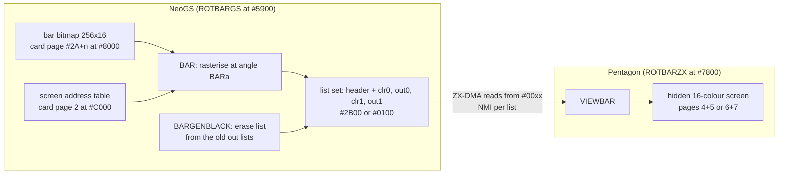
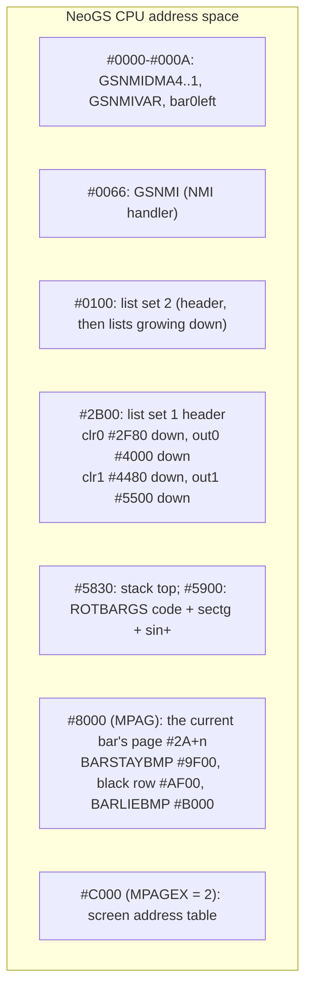
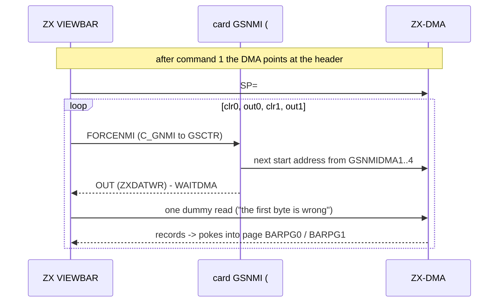
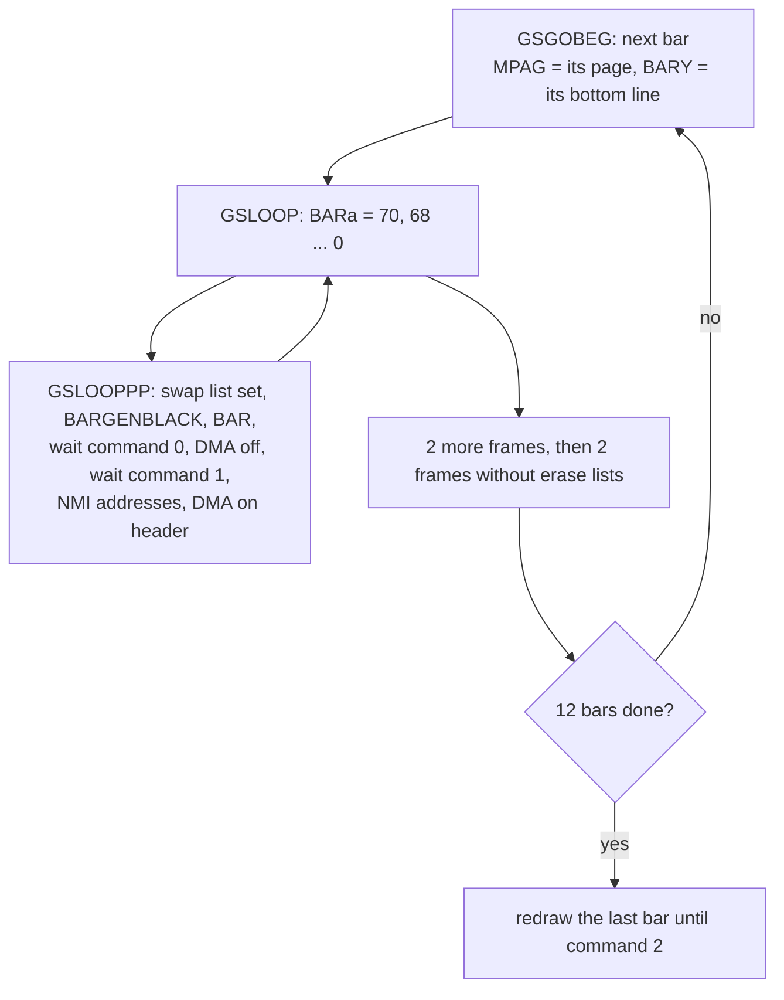

# 6. Rotating bars

The fourth part of The Link builds a picture out of 12 bars. Each bar is a 16-line strip of the
picture `gameover`. It swings down about one of its lower corners and lands in place, and the
bars build the picture from the bottom up. The card computes which screen bytes change. The ZX
reads that list back through ZX-DMA and pokes the bytes into a 16-colour screen.


Sources: [`GSRBAR24.asm`](../../../../disasm/demo/thelink/sjasm/src/GSRBAR24.asm) (the effect, the
precalc, the ZX half) and [`GSRBARP3.asm`](../../../../disasm/demo/thelink/sjasm/src/GSRBARP3.asm)
(the bar rasteriser, included into the card half). Previous chapter: [5. Rotator](05-rotator.md).
Next: [7. Multi-bars](07-multi-bars.md). The command handshake every effect shares (commands 0/1/2,
DMA reads from `#00xx`, timeouts, `GSRESET`) is in [3. The frame](03-the-frame.md). This chapter
covers only what the bars do differently.

## 6.1 What you see

- The screen starts black, in Pentagon 16-colour mode.
- The bottom bar (picture lines 176-191) appears tilted, pivoting on its lower left corner. It
  turns down to horizontal by a small step every frame.
- When it lies flat, the next bar (lines 160-175) does the same about the lower **right** corner.
  The corners alternate up the screen.
- After 12 bars the whole picture is on screen. The ZX then copies the ordinary 6912-byte version
  of the same picture to screen 0 and switches 16-colour mode off. The picture stays, and
  [multi-bars](07-multi-bars.md) cuts it up.

In the demo the part runs from frame 2688 to 3248 of `timer`: 560 frames, 11.2 s (`zxtimings` in
`THELINK.asm`; [README section 6](../../../../disasm/demo/thelink/README.md#6-the-zx-and-the-card)).

## 6.2 Why it is split this way

The rotator ([chapter 5](05-rotator.md)) has the card draw a whole picture, and the ZX reads 6912
bytes every frame. That does not work here, for two reasons:

1. The 16-colour screen is 24576 bytes: 4 areas of `#1800`. Reading all of it through ZX-DMA
   every frame would cost far more than a frame.
2. Only a small part of the screen changes. One bar moves, and the bars already in place do not.

So the card does not send a picture. It sends a **list of changes**: "write this byte at this
address". It also sends a list of addresses to set to black, so the ZX can erase the bar it drew
two frames earlier in the same screen buffer. The ZX applies the lists with stack tricks, at
17-35 T-states per byte (section 6.7).



## 6.3 The 16-colour screen

The Pentagon 1024SL's 16-colour mode is switched on by `#EFF7` bit 0. The machine side is in
[chapter 1](01-the-machine.md). This effect uses the mode as follows:

| | Screen 0 | Screen 1 |
|---|---|---|
| RAM pages | 4 and 5 | 6 and 7 |
| `#7FFD` while the other one is shown | `#1C` / `#1D` | `#1E` / `#1F` |
| Pixel areas (page at `#C000`) | `#C000-#D7FF`, `#E000-#F7FF` of each page | same |

A line is 256 pixels, 2 pixels per byte, so 128 bytes (X = 0..127). The card's address table
(`GENBARSCRADDR` in `GSRBAR24.asm`) decodes X like this:

- X bit 0: the RAM page. The two pages are the two lists, 0 and 1.
- X bit 1: the `#C000` half or the `#E000` half of that page.
- X / 4: the column (0..31) inside the usual ZX screen layout.

Each group of 4 bytes along a line therefore lands in 4 different places, at the same ZX-layout
address.

Colours come from the ordinary picture. Each picture pixel takes the ink or paper of its
attribute, plus bright, as a 4-bit colour, and becomes one 16-colour byte holding that pixel
twice. So the bar texture is 256 bytes wide for 256 picture pixels, and the effect shows the
picture at its original resolution. The bit order inside a byte comes from a 256-byte table,
`TPICTOBMP`. The author describes it as `;%lrlrlrlr->rlrrrlll`: the bits of the left and right
pixel interleaved go in, the hardware's order comes out (`GENPICTOBMP`).

The ZX half turns the mode on after clearing all four pages:

```
        LD A,1 ;16C
        LD BC,#EFF7
        OUT (C),A
```

At the end (`QUIT`) it writes 0 to `#EFF7`, after copying the 6912-byte `gameover` into screen 0
(`;то же, что видим, но 6912` - "the same as what we see, but 6912").

Screen flipping uses an odd piece of self-modifying code (`BIGLOOP`):

```
        LD A,#17^#1D
        XOR #1D                 ;видим scr1, рисуем scr0
        LD ($-1),A              ;теперь видим scr0, рисуем scr1
```

`LD ($-1),A` writes A into the operand of the `XOR` just before it. The `XOR` operand is always
the last value, so A alternates between `#0A XOR #1D` = `#17` and `#0A XOR #17` = `#1D`:

- `#17` shows screen 0 and puts page 7 at `#C000`.
- `#1D` shows screen 1 and puts page 5 at `#C000`.

`BARPG1` gets that value and `BARPG0` gets that value minus 1 (page 6 or page 4). These are the
two pages of the hidden screen. (The comments: "we see scr1, draw scr0" / "now we see scr0, draw
scr1".)

## 6.4 Objects and pages

| Object | Size | Page in this source | Page in the demo | Runs at |
|---|---|---|---|---|
| `ROTBARZX` | 7936 | `#B0` (`pgeffects`) | `#B2` (RAM 50) | ZX `#7800` (copies itself) |
| `ROBPREGS` | 7520 | `#52` (`pgcode1`) | `#55` (RAM 13), card code page 2 | card `#5900` |
| `ROTBARGS` | 3854 | `#55` (`pgcode2`) | `#32` (RAM 34), card code page 5 | card `#5900` |

The page numbers in `GSRBAR24.asm` belong to its own test start, the block at `#7800`. That block
is a cut-down copy of `GO` from `THELINK.asm`: it resets the card, uploads one data page and these
two code pages, starts the music and runs effect page `#B0` from frame 8 to 568. Page `#B1` holds
only `JR $`. The block is not part of any object. The demo's real page plan is in
[sjasm/loader/README.md section 2](../../../../disasm/demo/thelink/sjasm/loader/README.md#2-the-memory-image-at-go).

Each object starts at `#C000` of its page and first copies its real code elsewhere. Both card
objects use the same card address, `#5900`, because the card runs its code pages one after the
other: the precalc runs long before the effect. 6912 bytes of each of `ROBPREGS` and `ROTBARZX`
are the picture `gameover` itself.

Card memory while `ROTBARGS` runs:



List set 2 sits at `BARdata - bardatadelta` = `#2B00 - #2A00`, so its lists start at `#0580`,
`#1600`, `#1A80` and `#2B00`.

## 6.5 The precalc, ROBPREGS

`ROBPREGS` runs once, early, in the card's loop over its code pages. In the demo that is right
after the upload, long before the bars are on screen. It does three things:

1. It copies the picture to `#8000` of card page `#2A` (`MPAG`).
2. It builds `TPICTOBMP` (`GENPICTOBMP`).
3. For each of the 12 bars, it maps the bar's own card page at `#C000` (`MPAGEX`) and converts
   the bar's 16 picture lines into two 256x16 bitmaps:
   - `BARLIEBMP` for the "lying" case (`PICTOBARLIE`), stored row by row;
   - `BARSTAYBMP` for the "standing" case (`PICTOBARSTAY`), laid out column by column.

   Every other bar is built mirrored, because `bar0left` toggles here exactly as in the effect.

The bar pages are `#2A` and the 11 after it. "After" uses the card's page numbering, where bit 7
is the lowest bit of the 16K page index:

```
        LD A,C
        OUT (MPAGEX),A
        RLCA
        INC A
        RRCA
        LD C,A
```

`RLCA : INC A : RRCA` gives `#2A`, `#AA`, `#2B`, `#AB`, ...: 12 consecutive 16K pages
([chapter 3](03-the-frame.md) explains the numbering).

The precalc starts at `HL = #10C0+BARPIC`, the address of picture line 176. That is the top of
the bottom bar. Each next bar is 16 lines up (`L - 64`, borrowing into the previous third).

`PICTOBARLIE` and `PICTOBARSTAY` were ALASM macros that glue a suffix into their labels
(`PICTOBAR0\0`). sjasmplus cannot do that, so the converter expanded each one twice, as `...LEFT`
and `...RIGHT`. The original macro text is kept as comments
([sjasm/README.md](../../../../disasm/demo/thelink/sjasm/README.md)).

## 6.6 The bar rasteriser, BAR

### The angle

`BARa` is a byte. 0..127 covers 0..PI/4 from horizontal, and 128..255 covers PI/4..PI/2. It
lives as the low byte of an immediate operand:

```
BARa=$+1                        ;0..127 = 0..pi/4
        LD DE,BARSECTG+127
        SET 7,E
        LD A,(DE)               ;256*tg a
```

`BARSECTG` is page-aligned (`DS low (-$)`), so `DE` points straight into the table at entry `a`.
The tables are the ones the author's BASIC computed. `tables.py` recomputes them
([sjasm/README.md](../../../../disasm/demo/thelink/sjasm/README.md)):

| Table | Bytes | Content |
|---|---|---|
| `sectg` | 256 | `128/COS a` for a = 0..127 (= 0..PI/4), then `256*TAN a` |
| `sin+` | 256 | `127*SIN((n+.5)/256*2*PI)`: no entry is exactly 0 |

### Four cases

`BAR` dispatches on the angle:

```
        LD A,(BARa)
        ADD A,A
        JP C,BARSTAY
BARLIE
        JP Z,BARHORIZ
        ...
        OR A
        JP M,BARDIAG
```

| Case | When | How |
|---|---|---|
| `BARHORIZ` | a = 0 | straight copy of the 16 texture rows, bottom row first |
| `BARLIE` | 0 < a < 128 and `256*TAN a` < 128 | one pass per texture row; X steps 1, Y steps -TAN a |
| `BARDIAG` | `256*TAN a` >= 128 (TAN a >= 1/2, a > 26.6 deg) | `BARLIE` in 2x2 chunks: every other line, two texels per record |
| `BARSTAY` | a >= 128 (nearly vertical) | one pass per texture row; Y steps -1, X steps COT a, from `BARSTAYBMP` |

The author's notes for "nearly lying" (`BARLIE`):

> `;рисуем косо от статичного угла: h/cos a проходов (строк`
> `;текстуры) по l*cos a пикселей (слева направо по текстуре)`
>
> "draw obliquely from the static corner: h/cos a passes (texture rows) of l*cos a pixels each
> (left to right along the texture)"

and, for the start of each pass:

> `;чтобы не было дыр, надо начинать строки в правильных фазах`
>
> "to avoid holes the rows must start in the right phases". If X did not move in its integer
> part from one row to the next, the old Y phase is kept, `Y=Yold-1`. Otherwise one step is
> subtracted: `Y=Yold-1-dY`.

That rule is why the bar has no gaps between its texture rows at any angle. It is the scan-line
equivalent of drawing a rotated rectangle by its rows without holes.

### Only BARLIE and BARHORIZ run

The effect drives the angle like this (`GSGOBEG` in `GSRBAR24.asm`):

```
        LD A,70                 ;254
        LD (BARa),A
GSLOOP
        CALL GSLOOPPP
        LD HL,BARa
        LD A,(HL)
        SUB 2                   ;3 не успеет стереть
        LD (HL),A
        JR NC,GSLOOP
```

The angle goes 70, 68, ..., 0. That is 36 frames per bar. 70 is about 24.6 degrees, and
`sectg[128+70]` = `256*TAN` = 117 < 128. So:

- `BARSTAY` (a >= 128) is never reached;
- `BARDIAG` (TAN entry >= 128) is never reached;
- the `BARSTAYBMP` bitmaps that the precalc builds for all 12 bars are never read.

About half of the lines of `GSRBARP3.asm` (about 1,500 of 2,970 before annotation) are the `BARDIAG` and `BARSTAY` cases. The
comment `;254` at the start value suggests the bars once started almost upright and fell through
all four cases. Whether that version was ever shown is not known.

The other comment, `;3 не успеет стереть` ("3 would not manage to erase"), connects to the erase
lists in 6.7: with a step of 3 the erasing falls behind and leaves traces.

### Coordinates and registers

The rasteriser is a tight loop over both register sets. Its register map (`BARLIELINE`) is:

| Register | Meaning |
|---|---|
| `IX` | Y in 8.8 fixed point, inverted: `IXH` = `#C0 \| (63 - line in the third)` |
| `IYH` | the third: `#00`, `#08`, `#10`, `#18` |
| `E`, `A'` | X (integer, fraction) |
| `BC` | `-dY*2` |
| `HL` | list 0 write pointer (`out0`) |
| `SP` | list 1 write pointer (`out1`) |
| `D'` | V: the texture row (high byte of an address in the bar page) |
| `HL'`, `BC'` | U and dU (texel = `H'`) |
| `IYL` | pixels left in the pass (counts up to 0) |

Y is kept inverted with `#C0` set. One `ADD IX,BC` steps Y, and the carry out of IX means "crossed
into the next third up". The handler for that case is `LD IXH,#C0 : IYH - 8`. The author on it:
`;сдвиг по Y - запарно обрабатывать переход через 64` ("shift in Y - crossing 64 is a pain to
handle").

`(IXH, X)` is a direct address into the screen address table at `#C000`.

### The records

Both lists are written **downwards**. List 0 is written with HL:

```
        MACRO BARe0ADR
        LD A,(DE)               ;e0=0
        OR IYH
        DEC HL
        LD (HL),A               ;HSB
        INC E
        LD A,(DE)
        DEC L
        LD (HL),A               ;LSB
        DEC E
        ENDM
```

followed by `DEC L : LD (HL),A : DEC L` for the pixel byte. List 1 is written with the stack:

```
        MACRO BARe1ADR
        LD A,(DE)               ;e0=0
        OR IYH
        PUSH AF                 ;HSB
        INC SP
        ...
```

`PUSH AF : INC SP` stores the single byte A. A plain `PUSH AF` then stores the pixel byte (and F).

Either way, a record read **upwards** is `F-or-gap, pixel byte, address low, address high`. That
is exactly what `POP AF : POP HL` returns on the ZX. Off-screen pixels produce no record. Each pass
ends with one texel from the texture's edge (`...ADDBYTE`, from U = 0, 1 or 255) and a few black
pixels.

`BARQ` closes the frame. It stores into the list set's header the record counts
`(start - end) / 4` and the lowest address of each list, which is where the DMA will start.

| Header offset | Content |
|---|---|
| +0, +2, +4, +6 | record counts: clr0, out0, clr1, out1 (the ZX POPs these) |
| +9, +11 | "form" of clr / out (0 = 1-pixel records, 1 = 2x2) - no longer read by the ZX |
| +12 ... +18 | start address of clr0, out0, clr1, out1 |

The list room fits the worst case exactly. A flat bar is 16 lines x 128 bytes = 2048 records,
1024 per list. 1024 x 4 bytes = `#1000`, the room the author gave `out0` and `out1`
(`;растет вниз (#1000+)`, "grows down").

The author warns in `BAR`, where it picks the list set:

```
        LD HL,BARout0
        LD SP,BARout1           ;неполную альтернативу нельзя - NMI!
```

"a partial alternative is not allowed - NMI!". Both branches set HL and SP fully. Setting a default
first and overriding it would leave SP briefly pointing into the other list set. The card's NMI
handler pushes onto SP, and NMIs arrive at any time while the ZX reads the other set. That
explanation is our reading of the comment.

### Erasing: BARGENBLACK

Before `BAR` overwrites a list set, `BARGENBLACK` turns that set's old `out` lists into `clr`
lists: addresses only, 2 bytes each, written with `PUSH DE`. The old lists are what this buffer
drew two frames ago, on the same ZX screen, so these addresses are the pixels to blacken first.

Only half of the old records are used:

```
        SRL D
        RR E                    ;DE=N=число записей (!=0) сгенерировать
```

`;(берем из источника последние сгенерированные - начало стека)` - "(take from the source the most
recently generated ones - the start of the stack)". The code makes this plain, but not why half is
enough. The step of 2 per frame and the "3 would not manage to erase" comment suggest the author
tuned the two together.

At the end of each bar, the effect draws two frames with the `clr` counts set to 0
(`;печатаем непропечатавшееся`, "print what did not get printed"). This fills in both screens with
the bar in its final place.

## 6.7 The ZX side: VIEWBAR

One frame on the ZX is: command 0, flip screens, wait; check the end frame and the Space key;
command 1, wait; `VIEWBAR` (see [chapter 3](03-the-frame.md) for the handshake). `VIEWBAR` reads 5
DMA streams:



The card's NMI handler (21 bytes, copied to `#0066`):

```
GSNMI
        PUSH AF
        PUSH HL
        LD HL,(GSNMIVAR)        ;8/6/4/2
        DEC L
        LD A,(HL)
        OUT (DMA_MAD),A
        DEC L
        LD A,(HL)
        OUT (DMA_LAD),A
        LD (GSNMIVAR),HL
        OUT (ZXDATWR),A         ;признак для ZX "DMA ON"
        POP HL
        POP AF
        RET
```

Before starting the DMA, the card converts each list's start address. An address in `#4000-#7FFF`
of the card CPU gets bit 15 for the DMA (`SET 7,H ;pg1:1`).

The ZX blitters are unrolled loops entered in the middle (Duff's device). The routine patches the
offset of a `JR $` in front of the loop. `BARVIEW1S` (list `out0`) is:

```
        LD (BARVIEW10S-1),A
        ...
        JR $
BARVIEW10S
        DUP 32
        POP AF
        POP HL
        LD (HL),A
        EDUP
        DJNZ BARVIEW10S
```

| List | Routine | Per record | T-states per record |
|---|---|---|---|
| clr0, clr1 | `BARVIEWBLACK1`: `POP HL : LD (HL),D` (D = 0) | 2 bytes | 17 |
| out0 | `BARVIEW1S`: `POP AF : POP HL : LD (HL),A` | 4 bytes | 27 |
| out1 | `BARVIEW1`: `LD A,(HL)` x2, `LD E,(HL)`, `LD D,(HL)`, `LD (DE),A` | 4 bytes | 35 |

A ZX read from `#0000-#3FFF` returns the next DMA byte whatever the address. So SP or HL only has
to stay in the ROM area. In the author's words: `;данные <12K, поэтому точное HL=0 не надо` ("the
data is < 12K, so an exact HL = 0 is not needed").

The worst case is a flat bar with 1024 records per out list: 1024 x 27 + 1024 x 35 = 63,488
T-states. A Pentagon frame is 71,680 T-states, and the clr lists, the handshake and the music
still need their share. So the last list can run into the next frame interrupt. These figures are
instruction counts, not a measurement, and any extra cost of DMA reads is not counted.

### The frame exit by interrupt

This is the most unusual part of the effect. The first three lists run with `DI`, because SP
points into the ROM area: an interrupt there would push its return address into the DMA. Before
the last list, `VIEWBAR` restores SP and enables interrupts. It then reads `out1` with `LD r,(HL)`
instead of `POP`, and it never returns normally:

```
VIEWBAR
        DI
        LD (VIEWBARSP),SP
        LD HL,VIEWBARIM
        LD (IMVEC+#FF),HL
        ...
VIEWBARSP=$+1
        LD SP,0
        EI
        JP BARVIEW1
VIEWBARQ
        JR VIEWBARQ
VIEWBARIM
        LD SP,(VIEWBARSP)
        LD HL,IMER
        LD (IMVEC+#FF),HL
        JP (HL)                 ;делает EI
```

- `BARVIEW1` ends with `JP (IX)`, which is `VIEWBARQ`, an endless loop.
- The frame interrupt is the only way out. It reads the IM 2 vector at `IMVEC+#FF` (the Pentagon's
  idle bus gives `#FF`), which `VIEWBAR` pointed at `VIEWBARIM`.
- `VIEWBARIM` throws the interrupted address away by reloading SP with the value from `VIEWBAR`'s
  entry. The top of the stack is now the return address of `CALL VIEWBAR`.
- It puts the normal handler `IMER` back in the vector and jumps to it.
- `IMER` counts the frame, plays the music and returns to `BIGLOOP`.

So the interrupt does two jobs. If the list is long, it cuts the drawing off at the frame boundary.
If the list is short, it ends the wait. Either way `BIGLOOP` starts exactly at the frame interrupt,
and it needs no `HALT`.

The resident `IMER` (`#BFBF`) is built for this kind of code. It runs on its own stack at `#5F00`,
returns with `JP`, and writes the interrupted DE over the return address it was pushed with
(`;пишем DE вместо адреса возврата`, "write DE in place of the return address"). Even code that
fills memory with `PUSH DE` survives an interrupt. [Chapter 3](03-the-frame.md) covers the handler.

## 6.8 The card's frame loop



Each bar takes 36 + 2 + 2 = 40 card frames, so 12 bars take 480 frames. The demo gives the part
560 ZX frames. If the card keeps one frame per ZX frame, the picture is complete with 80 frames
(1.6 s) left. The card then redraws the last bar until the ZX sends command 2.

## Things to notice

- **Half the rasteriser is dead.** Start angle 70 means only `BARLIE` and `BARHORIZ` run. The
  following are assembled but never used:
  - `BARDIAG` and `BARSTAY`;
  - the 12 `BARSTAYBMP` bitmaps the precalc builds;
  - the ZX's 2x2 blitters `BARVIEW2` and `BARVIEWBLACK2` (their selection by the "form" byte is
    commented out in `VIEWBAR`).
- **GSQUIT is only safe at the end.** On a command other than 1 the card does
  `GSQUIT: POP AF : RET`. This drops `GSLOOPPP`'s return address and returns to the card's page
  loop. That is right from the final loop. Inside the bar loop, `GSGOBEG`'s `PUSH DE : PUSH HL`
  are still on the stack, so an early command 2 would `RET` into the bar data. On the ZX, command 2
  comes early only if Space is pressed: `;можно жать RESET` ("one may press RESET"). In the demo
  the end frame comes after the bars are done.
- **The black row.** `BARLIEBMP` needs a black row before it (`;а перед ним строка черного`, "and a
  black row before it"). The precalc clears it at `#AF00` in the `#8000` window. That window is
  page `#2A` every time, not the bar's own page at `#EF00`. Only the unused `BARDIAG` reads that
  row (`DEC D`).
- **The command wait says the opposite of what it does.** The comment over the wait for command 1
  is `;GS ожидает обнуления (ZX запросит данные)` ("the GS waits for the zeroing"), but the loop
  waits for a non-zero command.
- **The ritual at start.** The test start sends the card `POKE #4092,0`, `#38` (Load FX), `#D2`
  (Close Stream) and `#F5` (Busy on). Each comes with the comment `;зачем-то` ("for some reason"),
  and the reset command with `;не помогает` ("does not help"). These are the author's notes from
  getting the card to start reliably.
- **An open question.** `;+1 почему-то оставляет след между 129/127` ("+1 for some reason leaves
  a trace between 129/127"), in `BARDIAGLINE`: a fix found by trying.
- **Measurements.** At the top of `GSRBARP3.asm`: `BARSTAY (a=#8E): 394808`, `BARLIE (a=#1A):
  503004`, `BARLIE (a=#12): 507682`. The unit is not stated. If they are card clock cycles, one
  `BAR` call is about one ZX frame of the 24 MHz card (480,000 cycles).
- **The flip.** `LD ($-1),A` patches the operand of the instruction before it (6.3).

## Try it

1. Boot `testdata/machines/pentagon1024sl/TheLink-sjasm.scl` on a Pentagon 1024 with NeoGS (TR-DOS,
   Enter). The bars run from `timer` (`#BF02`) = 2688 to 3248, about 54 s after the intro starts.
2. ZX side, while the part runs:
   - `#7FFD` page `#B2` (RAM 50) holds `ROTBARZX`, and its code runs at `#7800`.
   - `#EFF7` = 1.
   - Watch `#7FFD` alternate between `#17` and `#1D` from frame to frame.
   - A breakpoint at `VIEWBARIM` hits once per frame, in the IM 2 handler path.
3. Card side, in the NeoGS memory view:
   - `ROTBARGS` at `#5900`.
   - The list headers at `#2B00` and `#0100`: four record counts, then the start addresses.
   - `bar0left` at `#000A` flips with every bar.
   - The NMI pointers at `#0000-#0008`.
   - The bar pages are card pages `#2A`, `#AA`, `#2B`, ... (`MPAG` while the effect runs).
4. Stop at a frame and read `BARa`, the low byte of the operand at the `BARa` label in
   `GSRBARP3.asm`. It goes down by 2 per frame from 70 to 0.
5. To see the dead cases, change `LD A,70` in `GSGOBEG` to a larger value (up to 254). Then
   rebuild with [`build.py`](../../../../disasm/demo/thelink/sjasm/build.py). The build will refuse
   the sha256, so this is an experiment only.
