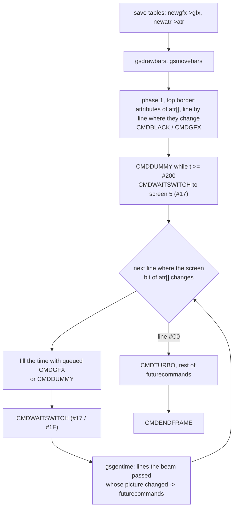
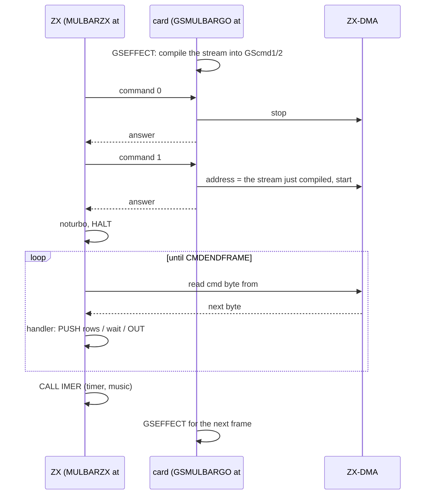
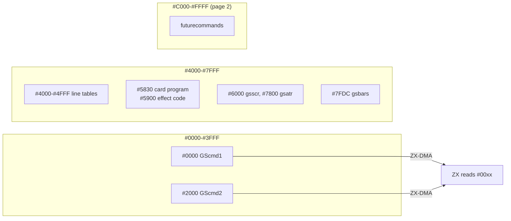

# 7. Multi-bars - a program the card writes for the ZX every frame

Multi-bars is the 80-frame transition between the rotating bars and the hedgehog. The picture on the screen is cut
into twelve horizontal bars, 16 pixel lines each. Starting with the bottom bar, the bars fall one after another,
speeding up as they go, until the screen is black. Unlike the other parts, the card does not send a finished
picture. Each frame it compiles a short **program** of commands, and the ZX runs it as it reads it. Some of these
commands are timed to the t-state and switch the displayed screen in the middle of the frame.

Source: `docs/disasm/demo/thelink/sjasm/src/GSMULBA3.asm` (annotated). Objects: `MULBARZX` (ZX half) and `MULBARGS`
(card half). In the overview picture [`parts.png`](../../../../disasm/demo/thelink/parts.png) it is the first
picture of the bottom row.

Previous: [6. Rotating bars](06-rotating-bars.md) - next: [8. Hedgehog](08-hedgehog.md) - index: [README](README.md)

---

## 1. What it has to do

The effect looks simple: rectangles of an existing picture slide down. On a ZX Spectrum two things make it hard:

1. **Attributes.** A bar boundary moves one pixel line at a time, but an attribute covers 8 lines. If a bar edge
   is in the middle of a character row, the top part of that row needs the attributes of one picture row and the
   bottom part those of another. One screen cannot show that.
2. **Bandwidth.** A full screen copy through ZX-DMA is 6,912 reads. The [rotator](05-rotator.md) needs about two
   frames per picture. Here most of the screen is either unchanged from the last frame or black. Copying it all would
   waste the frame.

The author's answer:

- Use **both** ZX screens (page 5 at `#4000` and page 7 at `#C000`) in the same frame and switch the displayed one
  with `OUT (#7FFD)` on exactly the lines where the attributes have to change inside a character row. Each screen
  holds one set of attributes for that row.
- Send only what changed: the attribute rows, and the pixel lines whose source line in the picture changed since
  the last frame. Clear empty rows with `PUSH` of zeroes, without reading any data.
- Let the **card** plan all of this. It knows where the bars are and it counts t-states. The ZX is a dumb executor
  of a command stream.

## 2. Two halves, two objects

| Object | `#7FFD` page in the release | Size | Runs at | What |
|---|---|---|---|---|
| `MULBARGS` | `#33` (RAM page 35, card code 6) | 7,826 bytes | card `#C000`, copies itself to card `#5900` | the bar logic and the command compiler; carries the picture `gameover` (6,912 bytes) |
| `MULBARZX` | `#B3` (RAM page 51) | 1,563 bytes | ZX `#C000`, copies itself to `#7800` | the frame loop and six command handlers |

(Sizes and pages from [sjasm/loader/README.md](../../../../disasm/demo/thelink/sjasm/loader/README.md) section 2.)

Both halves move their code out of `#C000` first, for the same reason: the effect needs that window for something
else.

- The ZX needs page 7 (the second screen) at `#C000` for the whole effect, so `MULBARZX` copies its body to
  `MULBARCODE` = `#7800`. The `GO` block there is no longer needed once the resident loop runs.
- The card needs `#C000` for its queue page `GSpgfuture` (card page 2), so `MULBARGS` copies its code to
  `GSMULBARCODE` = `#5900` and the picture to `gsscr` = `#6000`.

```asm
        ORG #C000,pgcode1
pgmulbargs=pgcode1
        LD HL,WASGSMULBARCODE
        LD DE,GSMULBARCODE
        LD BC,LENGSMULBARCODE
        LDIR
        ...
        LD HL,wasscr            ; INCBIN "gameover"
        LD DE,gsscr
        LD BC,#1B00
        LDIR
        JP GSMULBARGO
```

`GSMULBA3.asm` also contains a full stand-alone test bench: a copy of the demo's `GO`, with the card program, the
upload, IM 2 and the resident loop. Its timing table runs the effect at frames 8..88, and a `JR $` in the next effect
page stops it afterwards. None of this is saved: `ObjTab` and the `SAVEBIN` block write only the two objects. In the
real demo `THELINK.asm` runs the effect from `896*4-28-80` to `896*4-28`, that is frames **3476 to 3556**. The
start-up is [chapter 2](02-the-start.md).

## 3. The card's model of the screen

### 3.1 The bars

`gsbars` (`#8000-36` = `#7FDC` in card memory) is twelve 3-byte records:

| Byte | Author's comment | Meaning |
|---|---|---|
| 0 | `dy` | current speed in lines per frame; 0 = standing |
| 1 | `Y бара` (bar Y) | top line of the bar on the screen |
| 2 | `Y графики бара` (bar picture Y) | first line of the picture shown in the bar |

At the start bar *n* has Y = picture Y = `n*16`: the bars put the picture together unchanged. Only the bottom bar
gets `dy = 1` (`;нижний бар запускаем сразу (dy=1):` - "start the bottom bar at once").

`gsmovebars` moves them once per frame:

- a moving bar: `dy++`, `y += dy`. When `y >= #C0` it is stopped at `#C0` (below the paper) with `dy = 0`;
- a standing bar starts (`dy = 1`) when the bar below it has `dy = 5`.

So the fall is accelerated: 1, 2, 3, ... lines per frame. The bars leave in a cascade from the bottom up, each one
starting about four frames after the bar below. The author's comment says 4, but the code compares with 5:

```asm
;иначе (dy=0): если dy(n+1)=4, то dy=1
        ...
        LD A,(HL)               ;можем читать вне таблицы, но не пишем
        ...
        CP 5                    ;4
        JR NZ,$+3
        INC (HL)                ;если dy(n+1)=4, то dy=1
```

("otherwise (dy=0): if dy(n+1)=4, then dy=1"; "we may read outside the table, but do not write".) Stopped bars at
`#C0` are also "restarted" by this rule, but they stop again at once. The comment at the top of the routine says so:
`y=#C0 (т.к. остановленные перезапускаются)` - "y=#C0 (because stopped bars are restarted)".

### 3.2 Per-line tables

The screen state is not kept as pixels. For every one of the 192 screen lines the card stores the address of the line
of its picture copy that is visible there, or 0 for black. Each table is two 256-byte pages, low bytes and high
bytes, indexed by the line number in `IXL`:

| Table | Card address | Per line |
|---|---|---|
| `newgfx` | `#4000`/`#4100` | address in `gsscr` of the picture line shown at this line in the **new** frame, 0 = none |
| `gfx` | `#4200`/`#4300` | the same for the previous frame |
| `newatr` | `#4400`/`#4500` | address in `gsatr` (`#7800`) of its attribute row |
| `atr` | `#4600`/`#4700` | the same for the previous frame |
| `gstdhlGS` | `#4C00`/`#4D00` | line -> address of the line in `gsscr` |
| `gstdhlZX` | `#4E00`/`#4F00` | line -> ZX screen address (`#4000`-`#57FF`); `;концы строк` - "line ends", because 32 is added later |

The code moves between the tables by changing `IXH` (`INC IXH`, `ADD A,4`, `SUB 6`), so one `IXL` is one line in
all of them.

`gsscr` is at `#6000`, below `#8000`, as the author requires (`;<#8000 и кратно #800` - "below #8000 and a multiple
of #800"). Every address in the tables then has bit 7 of the high byte free. `gsdrawbars` uses that bit to record
**which ZX screen the line belongs to**: 0 = screen 5 (`#4000`), 1 = screen 7 (`#C000`).

### 3.3 Choosing the screen of each line

`gsdrawbars` clears `newgfx` and `newatr` and "draws" every bar: 16 table entries from its `Y`, pointing at its
picture lines. Then it walks the lines from the top:

```asm
;если curatr!=newatr[line], то curscr=curscr xor #8000
;(источник графики тот же,
;этот бит при копировании будет игнорироваться)
        ...
        SBC HL,DE
        JR Z,gsgensetscreensswapq
        LD A,IXL
        AND 7
        JR Z,gsgensetscreensswapq ;не надо перекл.каждое знакоместо
        LD A,B
        XOR C                   ;#80
        LD B,A                  ;'(curscr xor #8000)
```

"if curatr != newatr[line], then curscr = curscr xor #8000 (the graphics source is the same; this bit is ignored
when copying)"; "no need to switch at every character cell".

So the screen flips only where the attribute source changes **inside** a character row (line & 7 != 0). At a row
boundary the new row simply gets its own attributes in the current screen. Both `newgfx` and `newatr` of the line get
the bit, so the pixels and the attributes of the line go to the screen that is displayed at that line. A sentinel
`newatr[#C0]` with the opposite bit stops the search for the next switch at the bottom of the paper.

The picture in `gsscr` is mirrored first. `GSSCRFLIP` swaps the bytes of each 32-byte row end for end, for 192
pixel lines and 24 attribute rows. The reason is the ZX side: it writes a row with `PUSH`, from the row's end
downwards, so the first byte it receives lands at the right edge.

## 4. The command stream

### 4.1 Dispatch by high byte

The ZX half has six handlers. Each starts on a 256-byte boundary, and the command byte is the high byte of its
address:

```asm
        DS low (-$)
CMDBLACK=high $
        LD H,L
        LD E,(HL)
        ...
```

The frame starts with `HL = 0`:

```asm
        LD HL,0
        LD A,#17
        OUT (C),A
        LD A,(HL)               ;1ST BYTE DISCARDED
        LD H,(HL)
        JP (HL)
```

Every read from `#0000`-`#3FFF` is answered by ZX-DMA with the next byte of the card's buffer
([chapter 3](03-the-frame.md)). The first read after the DMA start is thrown away (`1ST BYTE DISCARDED`, as in the
tunnel and the rotator), and the stream proper starts with the second. `LD H,(HL)` loads a command byte, `L` is still 0, and `JP (HL)` enters the handler
at offset 0. The handler's first instruction `LD H,L` sets `HL` back to `#0000` for its own operand reads. Its last
two instructions are again `LD H,(HL) : JP (HL)`. There is no loop and no table: the stream itself chains the
handlers. This is a threaded interpreter, and its program counter is the card's DMA pointer.

### 4.2 The commands and their cost

Pentagon timings: one line = 224 t-states. Each `CMD*TIME` constant below includes the 11 t-states of the
dispatch at the end of the handler (`LD H,(HL)` 7 + `JP (HL)` 4).

| Command | Bytes in the stream | ZX does | t-states | Constant |
|---|---|---|---|---|
| `CMDBLACK` | cmd, lo, hi | `SP` = row end, 16 x `PUSH HL` (HL = 0): 32 zero bytes | 32 + 16*11 + 11 = 219 | `CMDBLACKTIME=204+15` |
| `CMDGFX` | cmd, lo, hi, 32 data | `SP` = row end, 16 x `LD D,(HL) : LD E,(HL) : PUSH DE` | 32 + 16*25 + 11 = 443 | `CMDGFXTIME=428+15` |
| `CMDDUMMY` | cmd | 19 x `ADD HL,HL` (HL stays 0): one line of nothing | 4 + 19*11 + 11 = 224 | `CMDDUMMYTIME=209+15` |
| `CMDWAITSWITCH` | cmd, jr, out | wait `n` x 4 t-states, then `OUT (C),A` to `#7FFD` | 66 + 4*n | `32+19+15` in the code |
| `CMDTURBO` | cmd | `OUT (#EFF7),0`: turbo on, `BC = #7FFD` again | - | untimed |
| `CMDENDFRAME` | cmd | `JP ENDFRAME` | - | - |

The address bytes of `CMDBLACK` and `CMDGFX` are the address of the row's **end** (start + 32), because `PUSH`
pre-decrements. Bit 7 set in the high byte selects screen 7: `#40`-`#57` becomes `#C0`-`#D7`, attributes
`#58`-`#5A` become `#D8`-`#DA`.

### 4.3 CMDWAITSWITCH: a delay with 4-t-state resolution

```asm
        DS low (-$)
CMDWAITSWITCH=high $
        LD H,L
        LD A,(HL)
        LD ($+4),A
        JR $
        DS 127
        LD A,(HL)
        OUT (C),A
        LD H,(HL)
        JP (HL)
```

The first operand is written into the displacement of `JR $`, so the jump lands somewhere inside 127 zero bytes,
which are `NOP`s. With displacement `d` the ZX executes `127 - d` NOPs. The card wants `n` = remaining time / 4 NOPs
and sends `d = 127 - n`. The second operand goes to `#7FFD`: `#17` shows screen 5, `#1F` shows screen 7. Both keep
page 7 at `#C000` and the 48K ROM.

The card computes `n` like this (from `gsgenwaitswitch`):

```asm
        SRL H
        RR L
        SRL H
        RR L
        INC L                   ;иначе можем получить остаток времени 1..3 такта
        LD A,127
        SUB L
```

("otherwise we may get a remainder of 1..3 t-states".) It then computes the real cost back,
`4*n + 66`, so the time keeping does not drift.

`BC` is `#7FFD` throughout the stream. The frame loop sets it before the first command, and only `CMDTURBO` changes
it, setting it back after its `OUT`.

## 5. Compiling a frame: GSEFFECT

The card compiles frame N+1 while the ZX runs frame N. `GSEFFECT` first saves the current tables (`newgfx` -> `gfx`,
`newatr` -> `atr`), then redraws and moves the bars into `new*`. Then it writes the stream into `GScmd1` (`#0000`) or
`GScmd2` (`#2000`), alternating through the self-modified `gscommands`. The time `t` it tracks is in ZX t-states
from the interrupt.



### 5.1 Phase 1: the attributes, in the top border

The budget is the top border: `224*80-timedefect` t-states (`timedefect = 164`). 80 lines is the Pentagon's distance
from the interrupt to the first paper line. The source does not explain the 164 t-states correction. It probably
covers the interrupt and the ZX code between `HALT` and the first command, but this is not confirmed.

```asm
;выводим все атрибуты atr[line] (не newatr!!!) в начале кадра:
```

"output all attributes atr[line] (not newatr!!!) at the start of the frame". For every line where the attribute
source changes, and at every character row start, the card emits a command for the attribute row of that line in that
line's screen. An empty source gives `CMDBLACK`, which needs no data. Otherwise it gives `CMDGFX` with the 32 attribute
bytes. Each command is subtracted from `t`.

Why `atr` and not `newatr`: the pixels of the new state are written **during** this frame (5.3), behind the beam. They
are first seen in the next frame, so the attributes that go with them must also arrive at the next frame's border.
Everything visible in a frame is the state compiled one frame earlier: pixels written behind the beam, attributes in
the border, and the screen switches, which are computed from `atr` as well.

The rest of the border is filled with `CMDDUMMY` (224 each) while `t >= #200`, then one `CMDWAITSWITCH` with the
remainder and `#17`. That `OUT` happens at the start of the paper and shows screen 5.

### 5.2 Phase 2: the paper, switch by switch

The author's comments describe the loop:

```asm
;цикл мультиколора
;сейчас мы в начале 0-й строки графического экрана
;реально (для запаса времени) в конце предыдущей:
```

"multicolour loop; now we are at the start of line 0 of the graphics screen; really (for a time margin) at the end of
the previous one".

The state is two counters: `counter`, the time used since the paper began, and `tswitch`, the time of the next
switch. `gsgenfindswitch` scans `atr[]` forward from the current line, adding 224 per line, until bit 7 differs
from the current screen. Then `gsgenifwehavetime` checks the gap:

```asm
;есть время до переключения?
;tswitch-counter>=428+15(+32+19+15 (добавка для CMDWAITSWITCH))
```

"is there time before the switch? tswitch - counter >= 428+15 (+32+19+15, the addition for CMDWAITSWITCH)". In
practice the test is whether at least `#200` t-states remain after the 66 of the wait command:

- if yes, it emits the next command from the **futurecommands** queue (a `CMDGFX`, 443 t-states) or a `CMDDUMMY`
  when the queue is empty, adds its time, and checks again;
- if no, it emits `CMDWAITSWITCH` with the exact remainder and the other screen, flips `curscr`, and finds the next
  switch.

Two `JP C,$` guard against a negative gap: the card stops on the spot if a switch would already be late. The ZX
then waits for the card's answer to command 0 for ever (`WN` has no timeout), so the demo stops there. This looks
like a debugging stop rather than a recovery path.

### 5.3 futurecommands: writing behind the beam

Every time the counter moves forward (`gsgentime`), the lines the beam has passed are checked. When `newgfx[line]`
differs from `gfx[line]`, the line shows a different picture line in the new state, and a `CMDGFX` for it is appended
to the queue `futurecommands`. The queue is at card `#C000`, page `GSpgfuture` = 2, ends with a 0 byte, and its
read pointer is kept on the card's stack. The write goes to the line's screen, and the beam has already passed it,
so there is no tearing.

Lines that became empty are skipped:

```asm
        ADD A,A
        JR Z,gsgentimegfxok     ;пустая графика => пустые атрибуты
;они тогда будут уже отрисованы
```

"empty graphics => empty attributes; they will already be drawn". The pixels stay, but the next border makes their
attributes 0 (black ink on black paper).

The queue is how the card uses the time between switches. Queued writes are spent as filler instead of
`CMDDUMMY`.

### 5.4 Phase 3: the tail in turbo

After line `#C0` there is nothing to time. The card writes `CMDTURBO`, copies the rest of the queue, and ends with
`CMDENDFRAME`:

```asm
        LD A,CMDTURBO
        LD (DE),A
        INC DE
gsdogen0
        LD A,(HL)
        OR A
        JR Z,gsdogenq
        ...
        LD BC,CMDGFXLEN
        LDIR
        JR gsdogen0
gsdogenq
;команда "закончить кадр":
        LD A,CMDENDFRAME
        LD (DE),A
        RET                     ;конец генератора кадра
```

("the 'end frame' command"; "end of the frame generator".) `CMDTURBO` writes 0 to `#EFF7`. On the author's
Pentagon 1024SL bit 4 = 0 is turbo on, so the remaining `CMDGFX` run faster. Before the next frame the ZX writes
`#10` to `#EFF7` again, because all of the card's timing assumes 3.5 MHz.

## 6. One frame on the ZX

```asm
BIGLOOP
        XOR A
        OUT (GSCOM),A
        WN
        GD
        ...
        LD A,1
        OUT (GSCOM),A
        WN
        GD
        LD BC,#EFF7
        LD A,#10
        OUT (C),A               ;noturbo
        LD HL,#5F5F
        LD BC,#7FFD
        HALT
        LD (IMVEC+#FF),HL
        LD (PUSHKASP),SP
        LD HL,0
        LD A,#17
        OUT (C),A
        LD A,(HL)               ;1ST BYTE DISCARDED
        LD H,(HL)
        JP (HL)
ENDFRAME
PUSHKASP=$+1
        LD SP,0
        CALL IMER               ;делает EI
        JP BIGLOOP
```



### 6.1 How this differs from the common frame (chapter 3)

[Chapter 3](03-the-frame.md) describes the handshake that the tunnel, rotator and the others share. Multi-bars keeps
commands 0, 1 and 2 and the answers through `ZXDATWR`. Several things are different:

| Common frame | Multi-bars |
|---|---|
| The ZX reads a fixed amount, a picture of 6,912 bytes, with `LD D,(HL) : LD E,(HL) : PUSH DE`. | The ZX reads a variable-length **program** and executes it. Its length depends on how much changed. |
| One screen is shown, and the hidden screen is flipped in once per frame. | Both screens are shown in the same frame. `#7FFD` is written several times per frame, at times the card computed. |
| The IM 2 handler runs from the interrupt. | The vector for bus value `#FF` (`IMVEC+#FF` = `#BEFF`/`#BF00`) is pointed at `#5F5F`, where a `RET` was put, so the interrupt does nothing. The music and `timer` run from a direct `CALL IMER` after the stream, so no handler runs in the middle of the timed stream. |
| Turbo on for the whole effect (for example `GSROTAT7.asm`). | Turbo off for the timed part, `CMDTURBO` for the untimed tail. |
| The ZX code runs from its effect page at `#C000`. | It runs from `#7800`, because page 7 holds `#C000`. |
| The card: two picture buffers. | The card: two command buffers, `GScmd1` `#0000` and `GScmd2` `#2000`. |

The card's frame loop `GSLOOP` waits for command 0 without a timeout (`;JP C,GSRESET` commented out, the same as in
`GSROTAT7.asm`). It waits for the next command with a 65,536-poll timeout to `GSRESET`. Any command except 1 ends
the effect (`DEC A : RET NZ`) and returns to the card's resident loop.

### 6.2 Start and end

The ZX entry (`#C000` of page `#B3`) gets the start frame in `BC` and the end frame in `DE` from the resident loop.
It stores the end frame into `zxendtime` (self-modified), waits for the start frame, selects `#17` (page 7 at `#C000`)
and copies `#4000` to `#C000`. Both screens now hold the picture left by the rotating bars. The card's copy of that
picture is `gameover`. The ZX and the card must agree on it without ever comparing: the card only sends changes.

`QUIT` (the end frame, or Space: `;можно жать RESET` - "one may press RESET") sends command 2, restores the IM 2
table, selects `#10` (page 0, screen 5), blacks out the attributes, turns turbo back on and returns to the resident
loop.

## 7. Card memory during the effect



The DMA address is set to `HAD = 0, MAD = high byte of the buffer, LAD = 0`, the same numbers as the CPU address
the card writes to. With the ROM off (`M_NOROM`) the card sees RAM at `#0000`, so this is consistent. How the NeoGS
maps window 0 is covered in [chapter 1](01-the-machine.md).

## Things to notice

- **The stream is the program.** Handlers addressed by their own high byte, `LD H,(HL) : JP (HL)` at the end of each:
  dispatch costs 11 t-states and needs no table, no loop counter and no stack.
- **The card does the counting.** Every `CMD*TIME` is exact (`219`, `443`, `224`, `66 + 4n`). The card simulates
  the ZX's beam position to the t-state, 50 times a second, for a CPU it cannot see.
- **Mid-frame screen switching as multicolour.** Two attribute sets per character row, chosen by the line at which
  `#7FFD` bit 3 changes. The author calls it `цикл мультиколора` ("the multicolour loop").
- **Rows mirrored once, at the start.** `GSSCRFLIP` reverses the bytes of every row so the ZX can write each row from its end
  with `PUSH`.
- **One frame of latency on purpose.** The attributes come from `atr` (`не newatr!!!`) because the pixels of the new
  state are written behind the beam during the current frame.
- **Comment vs code:** the start condition of a bar is "dy of the bar below = 4" in the comment, `CP 5` in the code.
- **Deliberate hangs:** two `JP C,$` in `gsgenifwehavetime` if the plan is late. Nothing recovers from them: the
  ZX waits for the card without a timeout.
- **Leftover questions in the author's comments:** `newgfx=#4000 ;2 набора. переключать или копировать?` ("2 sets.
  switch or copy?"). The answer in the code is copy (`GSEFFECT` copies `#200` bytes twice per frame). The constant
  `newgfx2` is never used.
- **Dead code:** the `MOVEPAGE` macro and `RESMOVEPAGE` (test bench, never invoked), `CL1800PG` (called only from
  commented-out lines), and the commented-out `newatr[#C0]` sentinel in `gsdrawbars`, replaced by the one written at
  the end.
- **The test bench in the same file:** its `GO` sends GS commands `#38` and `#D2` with the comment `;зачем-то` ("for
  some reason"), and its hard reset carries `;не помогает` ("does not help"). After the `SAVEOBJ4` include there is
  an unlabelled entry that puts `gameover` on the screen and jumps to the saver (`nenado`). Nothing in the file jumps
  to it.

## Try it

- Release disk `testdata/machines/pentagon1024sl/TheLink-sjasm.scl` on Pentagon 1024 + NeoGS (see
  [README section 8](../../../../disasm/demo/thelink/README.md#8-why-it-hangs)). The effect runs at frame counter
  (`timer`, word at `#BF02`) **3476 to 3556**, about 69.5 s into the demo counter. Break when `#BF02` reaches
  `#0D94` (3476).
- During the effect `#7800` up to about `#7E10` holds the `MULBARZX` body. The handlers start at the page boundaries after
  `QUIT`: look for `LD H,L` (`#65`) at offset 0 of consecutive 256-byte pages. `PUSHKASP` and `zxendtime` show the
  self-modified values.
- Watch `#7FFD` writes: about one `#17` per frame at the paper start, then pairs of `#1F`/`#17` at the bar edges that
  fall inside a character row. Their number changes as the bars move.
- Memory viewer, page 7 (`#C000`): the second screen shows only the rows that are displayed from it. Compare it with
  page 5.
- On the card: the effect code at card `#5900`, the command buffers at card `#0000`/`#2000` (each byte that starts a
  command is a handler page number from the ZX side, so the stream is easy to read against the `MULBARZX` listing),
  `gsbars` at `#7FDC`.
- Press Space during the effect: the ZX quits early with command 2, and the card follows.
- Source with English annotations: `docs/disasm/demo/thelink/sjasm/src/GSMULBA3.asm`. Build:
  [sjasm/README.md](../../../../disasm/demo/thelink/sjasm/README.md).
