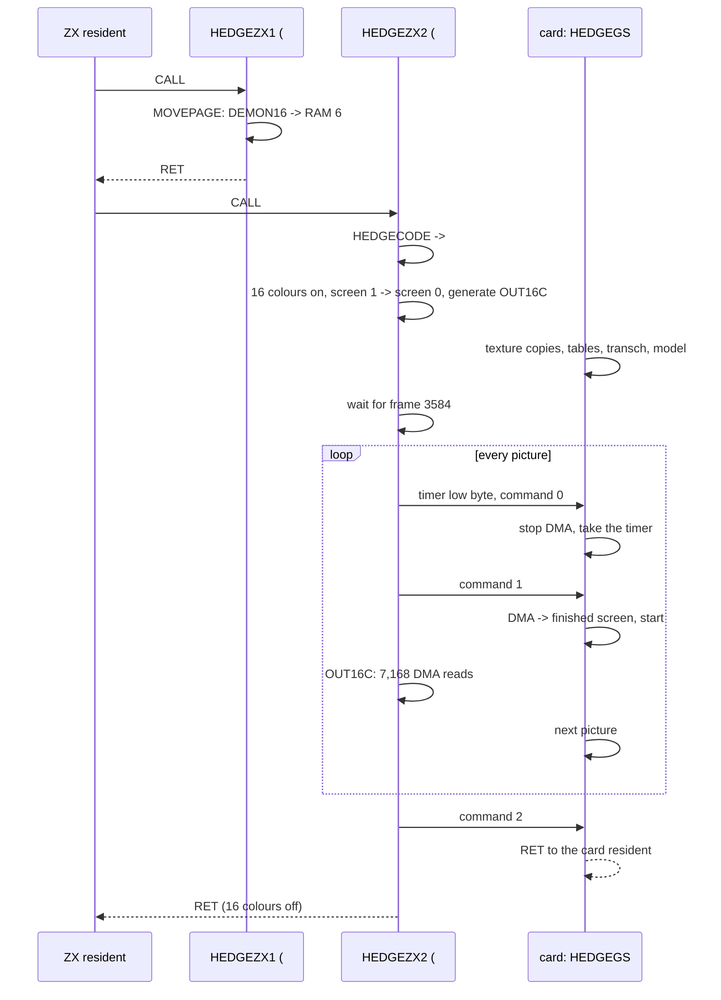
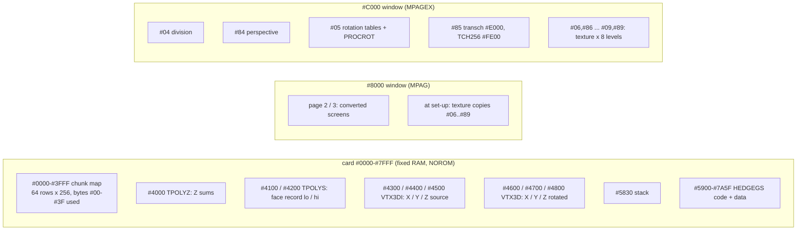
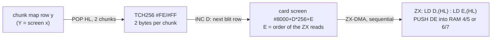

# 8. The hedgehog

A spiky solid (32 vertices, 60 textured triangles) turns in front of a 16-colour picture of a dragon. The NeoGS card does
all the 3D work: rotation, projection, depth sort, texture mapping into a chunky map, and the conversion of that map
into Pentagon 16-colour screen bytes. The ZX only reads the finished bytes through ZX-DMA and pushes them into the
hidden screen with a 7 KB block of code it generates itself.

The hedgehog is the sixth picture of [`parts.png`](../../../../disasm/demo/thelink/parts.png) (bottom row, second).

Sources: [`hedge12.asm`](../../../../disasm/demo/thelink/sjasm/src/hedge12.asm) (the part) and
[`instlpp.asm`](../../../../disasm/demo/thelink/sjasm/src/instlpp.asm) (the card-side table and code generators). The
triangle texture mapper `TRI` / `TRIDRAW` lives in `texpp4.asm` and `vujump.asm` and is explained in
[chapter 10](10-textured-face.md). This chapter covers only what hedge12 gives it and what it gets back.

Previous: [7. Multi-bars](07-multi-bars.md). Next: [9. The girl and the mill](09-girl-and-mill.md).

## 1. What runs where

| | ZX (Z80 3.5 MHz) | NeoGS (Z80 24 MHz) |
|---|---|---|
| Set-up | copy the background picture into the 16-colour screens; turn the 16-colour mode on; generate the blit `OUT16C` | 8 shaded copies of the texture; division, perspective and rotation tables; the generated converter `transch`; the model |
| Each picture | flip screens; ask for the next picture; read 7,168 bytes by DMA and store 6,272 of them | rotate 32 vertices, project, sort 60 faces, clear the chunk map, draw the faces, convert the map to 16-colour bytes, hand them over |
| Part ends | on frame 4466 or SPACE: command 2, 16-colour mode off | `GSLOOP` returns to the card resident |

The part is three files on the release disk (the pages are the release loader's, see
[sjasm/loader/README.md](../../../../disasm/demo/thelink/sjasm/loader/README.md) section 2):

| File | Bytes | Where | Contents |
|---|---|---|---|
| `HEDGEZX1` | 14,356 | `#7FFD` `#B4`, `#C000` | 20-byte stub + `DEMON16.C` (`#3800` bytes): the first half of the background |
| `HEDGEZX2` | 14,703 | `#7FFD` `#B5`, `#C000` | stub + `HEDGECODE` (the ZX effect, 333 bytes) + `DEMON17.C` (`#3800` bytes) |
| `HEDGEGS` | 8,557 | `#7FFD` `#34`, uploaded to the card's code pages | the whole card half |

`hedge12.asm` also has a `GO` at `#7800`. It is in no object: it is the author's stand-alone test harness, a cut-down
copy of `THELINK.asm`'s start-up that uploads only this part and runs it from frame 896. Its `zxtimings` (896..1772)
are not the demo's. In the demo, `THELINK.asm` gives the two ZX pages these frames:

```
        DW 0,0                  ; #B4 HEDGEZX1: copy the picture, return at once
        DW 896*4,896*5-14       ;hedge   = 3584 .. 4466 (#B5 HEDGEZX2)
```

So the hedgehog runs for 882 frames, 17.6 s.



The per-frame handshake is the same as in every part; [chapter 3](03-the-frame.md) explains it. Two details are
hedgehog-specific: the ZX sends the low byte of its frame counter with command 0, and the ZX loop has no `HALT` (the
card's answers set the pace).

## 2. The model

### 2.1 Twelve spikes and twenty dents

The solid starts from an icosahedron. Its 12 vertices are the cyclic permutations of (±a, ±b, 0), with b/a the golden
ratio:

```
icosz=23*2                      ;на 24 редко зашкаливает
icod=(icosz*158&#FFFF)/(256&#FFFF)
V0X=-icod
V0Y=-icosz
V0Z=0
```

`icosz` = 46, `icod` = 46*158/256 = 28, and 256/158 = 1.62. The author's comments on the size: "на 24 редко
зашкаливает" (at 24 it rarely goes off the scale) and "23 реальный GS за фрейм чуть-чуть не тянет" (at 23 a real GS
falls just short of keeping up within a frame). Bigger means more pixels to texture.

Twenty more points are made by the macro `DOTV0_1` (expanded at each call by the converter):

```
; macro DOTV0_1 expanded
V0_8=_
_=_+1
        DB ((V8X-V0X)*k&#FFFF)/(L_m&#FFFF)+V0X,((V8Y-V0Y)*k&#FFFF)/(L_m&#FFFF)+V0Y,((V8Z-V0Z)*k&#FFFF)/(L_m&#FFFF)+V0Z
```

`Va_b` = Va + (Vb − Va)·k/m with k/m = 98/256. (`L_m` is the author's label `m`; sjasmplus reserves `m`, so the
converter renamed it.) Vb is not a neighbour of Va: V0 to V8 is a diagonal (length 91.5 against an edge of 56). I
checked all 20 points numerically. Each one lies in the direction of the centre of one icosahedron face, but deeper:
at radius about 31, against about 43 for a face centre and about 54 for a vertex. So the 12 vertices stand out as
spikes over a dented surface. That is the hedgehog.

Faces: each icosahedron vertex gets a fan of 5 triangles over the ring of the 5 face points around it. 12 × 5 = 60
triangles. In the original source this is one line per fan:

```
        KPOL 0,V0_9,V0_8,V0_5,V0_3,V0_6,1,4,11,10,7
```

The fan centre is vertex 0, the ring is `V0_9 ... V0_6`, and the last five numbers are the icosahedron neighbours of
vertex 0 (1, 4, 11, 10, 7). They are used for lighting (section 5).

ALASM's `/` is an unsigned 16-bit division, so for a negative difference `(Vb-Va)*k` the quotient is huge. The low
byte is still right (mod 256, rounded down), and that is all a `DB` keeps. Where the sum exceeds 255, sjasmplus wants
an explicit `low`, which the converter added (`; ALASM keeps the low byte`).

### 2.2 The tables in card memory



A card page number counts 32K pages in bits 0-6; bit 7 selects the upper 16K half. `#04` and `#84` are the two halves of
one 32K page. This is why the card steps pages with `RLCA : INC A : RRCA` ([chapter 3](03-the-frame.md)).

Vertices are stored "upside down": vertex n is at low byte `#FF-n` of each table, and `VTX3DBEG` holds the lowest used
index (`#E0` for 32 vertices). Every vertex loop runs L up and stops when `INC L` wraps to `#00`, so it needs no
counter:

```
        INC L
        INC IXL
        JR NZ,___R1
```

A face record is 20 bytes (`KPOLY`, word-aligned by `DS $&1`):

| Word | Contents |
|---|---|
| 0-2 | addresses of vertices A, B, C in the Y table (`#FF-n+VTX3DY`; X is `#100` below, Z `#100` above) |
| 3-5 | texture coordinates of A, B, C: `#0004`, `#0000`, `#0400` for every face |
| 6 | `#F200` (the author: `#C300`, or `#F200` "для переворота текстуры", to flip the texture) |
| 7 | texture number in the page plus the border: `(#00+texborder)*257` |
| 8 | `TRIDRAW`, the routine `TRI` jumps to |
| 9 | the "vnormal" vertex (section 5); it replaced the texture page word, still visible as `;DW gspgtex+3` |

All 60 faces use the same texture slot with the same coordinates: the texture is pasted onto each triangle, and
lighting tells the triangles apart.

## 3. Rotation without multiplication

`JTNROTATE` turns every vertex through three planes by the angles `ALPHA`, `BETA`, `GAMMA`. The Z80 has no multiply,
so `GENJTNROT` (instlpp) builds everything in card page `#05` at `#C000`:

| Address | Table |
|---|---|
| `#C000` SIGNOFS | per angle (256 per turn): the low byte of the rotation routine for that angle |
| `#C100` SINOFS | per angle: the page of the multiplication table for \|sin\| |
| `#C200` COSOFS | SINOFS shifted by 64 (a quarter turn) |
| `#C300` PROCROT | the rotation routines, copied from `JTNROTPROC_INST` |
| `#C400`... MULTAB | one 256-byte page per distinct sine value s: entry x (signed) = x·s/128, rounded |

The sine source is `SIN4`, sin(i)·128 for i = 1, 2, ... in 256ths of a turn. The loop stops before the first byte with
bit 7 set (`#80`), so angles 1..60 get tables. A page is generated only when the value differs from the previous one,
so the nearly flat top of the sine costs nothing. Angles 68..127 reuse 60..1, and 128..255 reuse 0..127: the tables
hold |sin|, and the routine takes care of the sign.

`SIGNOFS` picks one of 16 routines per angle, 64 angles per quadrant: `DB 1,U0,3,UB0,57,CH_I,3,UM90` is "1 angle with
cos = 1, sin = 0; 3 angles with cos = 1 and a small sin; 57 general angles; 3 angles next to 90 degrees". The general
first-quadrant routine:

```
; X'=X*COS(F)-Y*SIN(F)
; Y'=X*SIN(F)+Y*COS(F)
CH_I=$-JTNROTPROC_INST
        LD L,C
        LD E,B
        LD A,(DE)
        ADD A,(HL)
        LD L,B
        LD E,C
        LD B,A
        LD A,(DE)
        SUB (HL)
        RET
```

With H = the sin table page and D = the cos table page, `LD L,C : LD A,(HL)` is X·sin and `LD E,B : LD A,(DE)` is Y·cos:
a rotation in four table reads. The special routines skip the reads where cos or sin is ±1.

`JTNROTATE` writes the routine's low byte into the `CALL PROCROT` operand and the two table pages into `LD H,0` /
`LD D,0` (self-modifying code), once per frame per angle:

```
        LD HL,(ALPHA)
        LD A,(HL)
        LD (_ALPCAL),A
        INC H
        LD A,(HL)
        LD (_ASIN),A
        INC H
        LD A,(HL)
        LD (_ACOS),A
```

`ALPHA` is a pointer `SIGNOFS+angle`, so the angle is its low byte and `INC H` walks from one table to the next. Per
vertex: X,Y by alpha; Y,Z by beta; Z,X by gamma. The coordinates pass through `A'` between the calls. The results are
stored as X/2, Y/2 and Z/8 − `perspdist` (16).

The angles move by elapsed ZX frames, so the speed does not depend on how fast the card draws:

```
        CP 2
        JR C,$+4
        LD A,2
        LD B,A
GSTIMERACTION
        LD HL,ALPHA
        INC (HL)
        LD HL,BETA
        DEC (HL)
        LD A,201
        ADD A,0
        LD ($-1),A
        JR NC,$+3               ;некратные угловые скорости
        DEC (HL)
```

The difference of the timer bytes is capped at 2 steps. `LD ($-1),A` stores the sum back into the `ADD A,0` operand,
which becomes a fraction accumulator. Per frame, alpha moves +1, beta −(1 + 201/256), gamma +125/256: "некратные
угловые скорости" (non-multiple angular speeds), so the motion does not repeat soon. Alpha starts at `#40`, 90 degrees.

## 4. Perspective and the chunk map

`PERSPCORR` projects through a table in card page `#84`: the row is the vertex's Z (negative: `#C0`..`#FF` as a
signed byte), the column is X or Y:

```
PERSPCORR0
        LD H,high VTX3DZ
        LD D,(HL)               ;Z-perspdist
        DEC H
        LD E,(HL)               ;Y
        LD A,(DE)
        AND #3F
        LD (HL),A
```

`GENPERSP` (instlpp) fills it with a reciprocal per row (a 16-step restoring division) and then repeated additions.
I ran its arithmetic in Python: the entry is 32 + 16·x/(−z), with x the stored coordinate (half the rotated one) and z
in eighths. Examples:

| z | x = −27 | x = −10 | x = 0 | x = 10 | x = 27 |
|---|---|---|---|---|---|
| −23 | 13 | 25 | 32 | 38 | 50 |
| −16 | 5 | 22 | 32 | 42 | 59 |
| −9 | (wraps) | 14 | 32 | 49 | 80 |

32 is the centre of a 64-chunk range. Y is masked to `#3F`, so it wraps instead of overflowing.

The projected point addresses the chunk map at card `#0000` directly. Y selects the row (H, 64 rows) and X the byte in
the row (L). One chunk is one byte. Its value is a colour index 0..255: 32 × brightness level + texel. `GENDIV` builds
the other table `TRI` uses, `(L/2)/-H` per row and column in page `#04`, for the edge slopes.

The author left a note in `PERSPCORR` about a wider Z range: "можно расширить диапазон Z за счет X,Y - если Z=L, X,Y=H"
(the Z range could be widened at the expense of X,Y, if Z=L and X,Y=H).

## 5. Sorting and lighting

### 5.1 SORTZ

For every face, the loop at `COUNTZ0` adds the three vertex Z values into `TPOLYZ` (1 byte). `SORTZ` is a selection
sort that swaps the Z sum together with the two bytes of the record address. The author's header:

```
SORTZ
;HL=список Z (беззнаковых), в конце 0; #FF
;через INC H лежат адреса полигонов (ld e,(hl):inc h:ld d,(hl))
;в результате они будут по убыванию Z
```

"HL = list of Z (unsigned), 0 at the end; the polygon addresses lie INC H further; as a result they come in descending
Z." The scan does this:

```
SORTZFINDMAX1
        INC L
        CP (HL)
        JP C,SORTZFINDMAX1
```

It skips entries greater than the candidate, so each pass actually finds the smallest unsigned sum and moves it to the
front. Here that is the right order: every Z is negative after `SUB perspdist` (about −23..−9, sums roughly `#BC`..`#E4`), so
the smallest unsigned sum is the farthest face, and it is drawn first (painter's algorithm). The list ends at the first
0. A face whose sum is exactly 0 would cut the list short, but with these sizes no sum gets near 0.

There is no back-face culling: all 60 faces are drawn every picture, far to near, each over the previous ones.

### 5.2 Lighting by a neighbour vertex

The last word of each face record is a vertex: for the 5 faces around icosahedron vertex n, the 5 neighbouring
icosahedron vertices. `TRIDRAW` in `texpp4.asm` turns its projected Y into a brightness and maps the matching texture
copy at `#C000`:

```
        POP HL                  ;vnormal
        LD A,(HL)               ;Y
        SUB lambert
        DUP lambertshr
        SRA A
        EDUP
        JP P,$+4
        XOR A
        CP lambertmax
        JR C,$+4
        LD A,lambertmax
```

Level = (Y − 16) >> 3, clamped to 0..7. Y is at most 63 here, so the level never exceeds 5: copies 6 and 7 are
made but never selected (my reading; `lambertmax` = 7 would matter only for a bigger Y). Y is the projected screen coordinate (0..63, and the engine's Y grows to the
right on the screen). So a face is brighter when its neighbouring spike is further to one side. This is a fake light
from a fixed direction. It costs one byte read per face and needs no normals.

The 8 brightness levels are 8 copies of the texture, made once in `GSHEDGEGO`:

```
GSTEX81 LD A,(HL)
        ADD A,C
        LD (DE),A
        INC HL
        INC DE
        BIT 6,H
        JR NZ,GSTEX81
        LD A,C
        ADD A,32
        LD C,A
        JR NZ,GSTEX80
```

The texture `kishki.C` (16 KB, card page `#20`) holds texels 0..31; I checked the file. Copy k adds 32·k, so a chunk
value is level·32 + texel, and the palette (`palbrick`) maps each of the 256 values to colours. That is 128 KB of card
RAM spent to save an addition per pixel in the texturer's inner loop. `C` wraps to 0 after the eighth copy, which ends
the loop.

### 5.3 Drawing

```
        LD HL,TPOLYS
NPOLYS=$+1
        LD B,4
DRAWPOLYS0
        PUSH BC
        PUSH HL
        LD A,(HL)
        INC H
        LD H,(HL)
        LD L,A
        CALL TRI
```

`NPOLYS` is patched to 60 at set-up. `TRI` takes the record address in HL, uses it as a stack (`LD SP,HL`), patches
the texturer for the triangle and fills spans of the chunk map. The texturers themselves (`INCSYSTEM`, `DECSYSTEM`:
one 256-byte page each, entered by width, plus the operand patchers `PATCHVUINC` / `PATCHVUDEC`) are generated by
the macros `MTEXTURER` and `PATCHVUCODE` in hedge12, which the converter expanded at each call. How they work is in
[chapter 10](10-textured-face.md).

Before drawing, the map is cleared by stack pushes: 64 rows × 32 `PUSH DE` from `SP = row+#40`, which clears bytes
`#00`-`#3F` of each row. That is about 24,000 cycles.

## 6. From chunks to 16-colour bytes: the transposed converter

### 6.1 The target format

In the Pentagon 16-colour mode a screen byte holds two pixels. `COLSTOBYTE` (instlpp) packs two colours 0..15 (bit 3 =
bright) the way the mode wants them:

```
        MACRO COLSTOBYTE
        LD A,(HL)
        INC HL
        ADD A,A
        ADD A,A
        ADD A,A
        ADD A,A
        SRA A
        AND #80+#38
        LD C,A
        LD A,(HL)
        ADD A,A
        ADD A,A
        ADD A,A
        OR (HL)
        INC HL
        AND #47
        OR C
        ENDM
```

The first colour goes to bits 7,5,4,3 and the second to bits 6,2,1,0 (the attribute byte's paper and ink with their
bright bits). [Chapter 1](01-the-machine.md) explains how the four screen areas combine.

`MKCH2X256` turns `palbrick` (1,024 bytes: 4 colours per chunk value) into two tables, `TCH256` at `#FE00` and
`#FF00`. One chunk becomes a 2×2 pixel block: two bytes in two successive lines, each with two colours. A dithered
palette gives more than 16 apparent colours.

### 6.2 The order the ZX will read

The ZX reads the picture as one sequential DMA stream and pushes it into the screen bottom-up. The card therefore
writes its screen (page 2 or 3, at `#8000`) in exactly the order the ZX will consume it:

- card line D (`#80`..`#9B`, 28 lines of 256 bytes) = one row of the ZX blit;
- byte E within the line = the position in that row's 256 reads: 2 pages × 8 segments × 16 bytes.

`MKTRANSCH` generates `transch` (at `#E000` of page `#85`) from this template. The code is 16 blocks, about 2,000
bytes, run 16 times; the author's note says "#114E/2 байт" (#114E/2 bytes), perhaps from an earlier layout:

```
TRANSCHCODE
        POP HL
        LD C,L
        LD A,(BC)
        LD (DE),A
        INC D
        INC B
        LD A,(BC)
        LD (DE),A
        INC D
        LD C,H
        LD A,(BC)
        LD (DE),A
        INC D
        DEC B
        LD A,(BC)
        LD (DE),A
        INC D
```

`POP HL` takes two neighbouring chunks of a map row. Each becomes two bytes (B = `#FE`, then `#FF`, and back for the
second chunk, so the dither alternates), and the four bytes go to four successive D lines. The author: "транспонируем,
двигаясь по источнику горизонтально, по приемнику вертикально" (we transpose, moving horizontally over the source and
vertically over the destination). A map row becomes a screen column. This is why the sources say that the 3D engine's
X grows upward on the screen and Y grows to the right.

The generated code is built from:

- a block: `LD D,#80`, 7 templates (14 chunks, 28 lines = one screen quarter, `parthgt`), then `E += TTRANSCHX[i]`;
- 4 blocks per map row (the 4 quarters; 56 chunks from byte `#04`), framed by `LD SP,HL : EXX` before the first and
  `EXX : INC H` after the last;
- 16 blocks per pass, and 16 passes (`DEC B : JP NZ`) = 64 map rows; then `JP (IX)`.

`TTRANSCHX` sums to −1 mod 256 over a pass, so pass p writes byte 15−p of every 16-byte segment. Within a pass, the 4
map rows go to the 4 byte areas that make up neighbouring pixels (2 pages × the `#C000`/`#E000` halves).



Cost: 101 cycles per template, 7 × 256 templates ≈ 181,000 cycles, or about 7.5 ms at 24 MHz (my count; it ignores
any wait states).

Not every byte reaches the screen. The ZX keeps 14 of every 16 bytes (section 7), which drops the first two of each
segment: passes 15 and 14, that is map rows 56..63. The visible picture is therefore 56 map rows × 56 chunks = 112 × 112
pixels. Rows 56..63 are rendered and thrown away. I derived this from the code and did not confirm it on screen.

## 7. The ZX side

### 7.1 Start-up

`HEDGEZX1` is 20 bytes of code in front of the picture:

```
        MOVEPAGE #16,DEMON16,#3800,#C000
```

`MOVEPAGE` jumps into the resident's `RESMOVEPAGE`, which copies 56 blocks of 256 bytes through `resbuf` (`#BD00`, in
always-mapped RAM) from the current page to `#7FFD` page `#16` (RAM 6), then `RET`s to the resident. `HEDGEZX2` does the
same for `DEMON17` → RAM 7, but first copies `HEDGECODE` to `#7800` and pushes `#7800`. The copy's `RET` therefore lands
in the effect code. `JP RESMOVEPAGE` is assembled with hedge12's own resident address. It still works in the demo because
`THELINK.asm`'s resident loop has the same length (`OR #10 ... INC A` in hedge12, plain `CALL ZXRESNEXTPG` in THELINK),
so `RESMOVEPAGE` ends up at the same address.

`HEDGECODE` then:

1. saves the end frame;
2. turns the 16-colour mode on (`OUT (#EFF7),1`) and shows screen 1 with RAM 7 paged in (`#7FFD` = `#1F`);
3. copies screen 1 to screen 0 (`SCR1TOSCR0`: RAM 7 → 5, 6 → 4, `#1800` bytes at `#C000` and at `#E000`), so both
   screens hold the background;
4. generates `OUT16C`;
5. waits for frame 3584.

In this code, 16-colour screen 0 is RAM 4 + 5 and screen 1 is RAM 6 + 7, using `#C000`-`#D7FF` and `#E000`-`#F7FF` of
each page. The `#E000` half of RAM 5 is CPU `#6000`-`#77FF`. That explains why `HEDGECODE` starts at `#7800`, right
above it, and why the interrupt stack `outimstack` is at `#5F00`, right below. `#7800` is also the main block's
start-up code, which is finished by now.

### 7.2 One frame

```
BIGLOOP
        LD A,(timer)
        OUT (GSDAT),A
        XOR A
        OUT (GSCOM),A
        LD A,#17^#1D
        XOR #1D                 ;видим scr1, рисуем scr0
        LD ($-1),A              ;теперь видим scr0, рисуем scr1
        LD (VIEWPG1),A
        DEC A
        LD (VIEWPG0),A
        setpga
```

The screen flip is another self-modified operand: A alternates between `#17` (RAM 7 paged, screen 0 shown) and `#1D`
(RAM 5 paged, screen 1 shown). The comments read "видим scr1, рисуем scr0" (we see scr1, draw scr0) and "теперь видим
scr0, рисуем scr1" (now we see scr0, draw scr1). `VIEWPG1` and `VIEWPG0` (A and A−1) are patched into `LD HL,#1617`.
HL = the two pages of the hidden screen. Its value is also the DMA read address: any address in `#0000`-`#3FFF` returns
the next byte of the stream.

The loop then checks the end frame and SPACE ("можно жать RESET", one may press RESET), sends command 1, waits, and
jumps into `OUT16C` with `IX` = the return address.

### 7.3 The generated blit

`MKOUT16C` writes 28 rows of this shape, bottom-up from `#D7E0`:

```
        LD A,H
body:   LD (curpg),A
        OUT (C),A               ; BC = #7FFD, left over from setpga
        ; 8 segments:
        LD SP,base+14
        LD D,(HL)
        LD E,(HL)               ; first pair: never stored
        LD D,(HL)
        LD E,(HL)
        PUSH DE                 ; x 7
        LD (base),DE
        ; ...
        CP H
        LD A,L
        JP Z,body
```

(This is a sketch of the generated bytes, not source text.) Each row runs its body twice, first for page H and then for
page L. `CP H` is true only on the first pass. The 8 segments are the 4 quarters (28 lines apart) in the `#C000` half
and the same in the `#E000` half. With `mirrorchunks` set, lines 2,3 and 6,7 of each character cell swap places (the
generator flips bit 0 of D when bit 1 is set: "строки 0,1,3,2,4,5,7,6..."), which matches the order the card wrote
them.

`LD (curpg),A` keeps the interrupt handler honest: after the music it restores `curpg`, so it must be the page the
blit is using. The handler also copes with SP pointing into the screen. The return address the CPU pushes lands
exactly where the next `PUSH DE` goes, and the handler puts DE there instead (`EX DE,HL : EX (SP),HL`). The original
note: "обработчик прерывания должен класть в стек DE вместо адреса возврата" (the interrupt handler must put DE on the
stack instead of the return address). [Chapter 3](03-the-frame.md) has the full handler.

The trailing `LD (base),DE` stores the same pair the last `PUSH` already stored. The author's comments say it was needed
"для 8 линий в #C080..#C780, 7 линий #C900..#CF00, 7 линий #D100..#D700" (for 8 lines in `#C080..#C780`, 7 lines
`#C900..#CF00`, 7 lines `#D100..#D700`), and that he put it on all lines anyway: "будет 32 таких линии вместо 22, а то
запарно проверять" (there will be 32 such lines instead of 22, otherwise it is a pain to check). The earlier version in
`hedgepre.asm` emits it only for those lines.

Numbers (my count from the generator):

| | |
|---|---|
| generated code | 251 bytes per row × 28 + `JP (IX)` = 7,030 bytes, `#794D`-`#94C2` |
| reads per frame | 28 rows × 2 pages × 8 segments × 16 = 7,168 |
| bytes stored | 28 × 2 × 8 × 14 = 6,272 |
| cycles | 219 per segment; 3,594 per row; about 100,600 per frame |

A Pentagon frame is 71,680 cycles, so the blit alone takes about 1.4 frames. Together with the handshake, one picture
takes at least that long on the ZX, and the timer-driven angles hide the variable rate. I did not measure the real
picture rate.

### 7.4 The end

```
QUIT
        LD A,2
        OUT (GSCOM),A           ;конец эффекта
        HALT
        LD A,#10
        setpga
        LD HL,#5800
```

The ZX sends command 2 ("конец эффекта", end of the effect). It then clears the normal attributes at `#5800` to black,
turns the 16-colour mode off and returns to the resident. The card sees a command other than 1 in `GSLOOP` and returns
to its own resident (`DEC A : RET NZ`).

## 8. The card set-up, in order

`GSHEDGEGO` (card `#5900`, after the stub at `#C000` copied 8,543 bytes there):

1. 8 texture copies (section 5.2): 8 × 16 KB;
2. `GENDIV`, `GENPERSP`, `GENJTNROT`, `MKTRANSCH` + `MKCH2X256` (instlpp);
3. the model: `KUB` → `VTX3DI`, the face list → `TPOLYZ` / `TPOLYS`, a 0 after the last entry;
4. `GSLOOP`.

The installers and the palette (`#72E7`-`#7A5F`, 1,912 bytes) run once. The author: "NGS инсталлеры - можно
затирать" (NGS installers - may be overwritten).

## Things to notice

- **The ZX does almost nothing.** All geometry, texturing and even the conversion to the screen format happen on the
  card. The card lays the bytes out in the exact order of the ZX's reads, so the ZX side is pure data movement.
- **Generated code on both sides.** The ZX generates its 7 KB blit. The card generates the 2 KB transposing
  converter and two 256-byte texturers. Unrolled code from a short generator is smaller on disk and faster at run time.
- **Self-modified operands as variables.** `gsdrawscr`, `gstimer`, `gsoldtimer`, the angle accumulators
  (`ADD A,0` / `LD ($-1),A`), the routine and table pages in `JTNROTATE`, the screen flip in `BIGLOOP`, `NPOLYS`,
  `VIEWPG0/1`, `zxendtime`.
- **Loops that end on a wrap.** The vertex tables are filled from `#FF` down so that `INC L : JR NZ` ends the loops. The
  texture-copy loop ends when `C` wraps after 8 × 32.
- **The comment and the code disagree in SORTZ.** "по убыванию Z" (descending Z) versus a pass that picks the minimum.
  Both are right for negative Z, and the label `SORTZFINDMAX` keeps the author's first view.
- **Lighting from a neighbour's screen Y.** No normals, no dot products. A face's brightness is its neighbouring spike's
  projected Y, by choosing one of 8 pre-shaded texture copies. With Y in 0..63 only levels 0..5 occur, so 32 KB of
  texture copies are never read.
- **Dead code.** `LD C,128` before `COUNTZ0` is never used. The `GO` block at `#7800` and the `thelinkm` include are
  only the test harness. Two variants of fan 10 with vnormal 100 are commented out and marked "баг" (bug).
- **Leftover settings.** `incW=0` ("1=исключает выскакивание за текстуру, но дергается": 1 = never runs out of the
  texture, but jerks) and `texborder=1` (a one-texel margin against running out of the texture) show the trade-offs the
  author tried in the mapper.
- **Unexplained start-up commands.** The harness sends the card `#38` and `#D2` and pokes `#4092` "зачем-то" (for some
  reason), and notes that resetting the card "не помогает" (does not help). They are not part of the release objects.
- **The earlier take.** `hedgepre.asm` shows the previous stage: a stand-alone program with a Hrust-packed background
  (`demon16.p`, not on the disk), the whole card program sent in one piece, no timer (one angle step per picture), and a
  blit under `DI` instead of the interrupt-safe stack.

## Try it

1. Boot the release disk [`TheLink.scl`](../../../../../testdata/machines/pentagon1024sl/TheLink-sjasm.scl) on Pentagon 1024
   with NeoGS ([README section 8](../../../../disasm/demo/thelink/README.md) has the configuration). The hedgehog runs
   from frame 3584 to 4466 of the demo's counter `timer` (word at `#BF02`), about 72 s to 89 s after the intro starts.
2. A breakpoint at `#7828` (`BIGLOOP`, inside the copy at `#7800`) stops once per picture. Step into `#794D` (`OUT16C`)
   to see the generated blit: `LD SP,nn`, then pairs of `LD D,(HL) : LD E,(HL)` with `HL` = `#1617` or `#1C1D` (the
   two pages of the hidden screen).
3. Memory: RAM 6 and 7 (`#7FFD` `#16`, `#17`) hold the background halves from the start of the part. RAM 4 and 5 get
   the same copy. The spinning solid changes only the hidden pair each frame.
4. On the card: the chunk map is at card `#0000`-`#3FFF` (bytes `#00`-`#3F` of 64 rows), the converted screens are
   card pages 2 and 3, and the texture copies are pages `#06`..`#89`.
5. To see the lighting, compare a face's chunk values: the high 3 bits are the brightness level (0..7), the low 5 bits
   the texel.

Where these steps depend on debugger features (breakpoints, viewing card memory), use whatever the unreal-ng debugger
or WebAPI offers. I did not run this session in the emulator.

Further reading: [README sections 5-6](../../../../disasm/demo/thelink/README.md) (page plan, protocol),
[sjasm/README.md](../../../../disasm/demo/thelink/sjasm/README.md) (how the sources were converted; the expanded
macros and `L_m` here come from it).
