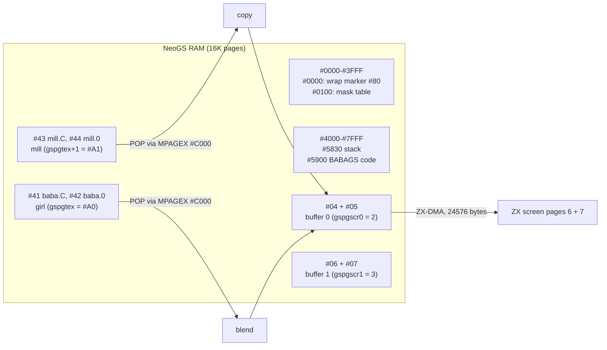

# 9. Girl and mill (`baba4.asm`)

A girl with a broom stands in front of a windmill. Both are full-screen 16-colour pictures, and they slide
vertically at different speeds. The girl is a sprite with a transparent colour, drawn over the mill
(parallax). The card composes each picture: it copies the background and blends the sprite through a 256-byte
mask table. The ZX only copies the result to its 16-colour screen, using about 20 KB of copy code that it
generates at start.


Source: [`baba4.asm`](../../../../disasm/demo/thelink/sjasm/src/baba4.asm) (annotated). A later version,
[`baba5.asm`](../../../../disasm/demo/thelink/sjasm/src/baba5.asm), adds a zoom. It is not in the demo (last
section).

Previous: [8. Hedgehog](08-hedgehog.md). Next: [10. Textured face](10-textured-face.md). The ZX <-> card
handshake that every effect uses (commands 0/1/2, DMA reads from `#00xx`, the timeouts) is in
[3. The frame](03-the-frame.md). It is only referred to here.

## 1. The idea

The two pictures are 256 x 192 pixels or more, in the Pentagon's 16-colour mode: 2 pixels per byte, 128 bytes
per line. The ZX cannot move 24 KB of pixels per frame and blend a sprite on top. The card's Z80 runs at 24 MHz
and can, so the work is split:

| Who | What | Cost per picture |
|---|---|---|
| card (`BABAGS`) | copy 192 background lines into a buffer, blend 160 or 192 sprite lines over them | about 1.3-1.5 M T-states, 55-62 ms at 24 MHz |
| ZX (`BABAZX`) | read the 24,576-byte buffer through ZX-DMA and PUSH it into the screen | about 315 K T-states, 4.4 Pentagon frames (71,680 T each) |

These numbers are counted from the instructions below, without any ZX-DMA wait states (not measured). Both
halves run at the same time: the card draws the next picture while the ZX copies the previous one. The ZX copy
is the slower half, so a new picture appears about every 5 frames, about 10 per second. The code is written for
this. The ZX's frame loop has no `HALT` (it is commented out), and the card moves the pictures by the number of
frames that have passed, at most 5 per picture.

## 2. The pieces and where they live

| Object | Size | In the demo | At run time |
|---|---|---|---|
| `BABAZX` (ZX half) | 394 bytes | `#7FFD` `#B6` (RAM page 54), at `#C000` | copies itself to `#6000`, generates `OUT16C` at `#617A`-`#B2AB` |
| `BABAGS` (card half) | 3,286 bytes | `#7FFD` `#35` (RAM page 37) -> card code page | copies itself to card `#5900`-`#65C7` |
| `baba.C` + `baba.0` | 16,384 + 8,192 (+ 8,192 zero) | `#91`, `#92` -> card 16K pages `#41`, `#42` | the girl: 192 lines + 64 transparent lines |
| `mill.C` + `mill.0` | 16,384 + 13,696 | `#94`, `#95` -> card 16K pages `#43`, `#44` | the mill: 235 lines |

The zero tail of `baba.0` comes from ALASM's `DS -$` (converted to `DS (-$&#FFFF)`). It fills the page to its end,
and the author's comment says why: `;для маски` ("for the mask"). Colour 0 is transparent, so these 64 lines draw
nothing. Section 6 shows how the code depends on them.

`baba4.asm` builds more than the two objects. The rest of the file is a stand-alone test harness: a cut-down copy of
the demo's `GO` that uploads only these four pictures and one code page, plays the music and runs this one effect
(frames 8 to 428). Its `gspgdata = #A0` (card 16K page `#41`) puts `baba.C` where the demo has it. The demo
itself uses `#20` (16K page `#40`), with `kishki` first. [2. The start](02-the-start.md) describes the demo's `GO`.

### Card pages

The card runs with `GSCFG0` EXPAG on: `MPAG` selects the 16K page at `#8000`, and `MPAGEX` the one at `#C000`. A
value `v` means the 16K page `{v6..v0,v7}`, which is `RLCA v` ([3. The frame](03-the-frame.md) has the details).
So `RLCA : INC A : RRCA` gives the next 16K page, and `+#80` the second half of a 32K page.



The two buffers are used in turn. `gsdrawscr` flips between 0 and 1 every picture: the card draws into one while
the ZX reads the other through DMA.

```
GSLOOP
gsdrawscr=$+1
        LD A,1                  ;рисуем в SCR2   (drawing into SCR2)
        XOR 1
        LD (gsdrawscr),A        ;теперь рисуем в SCR1   (now drawing into SCR1)
;потом дадим его ZX'у   (later we give it to the ZX)
```

## 3. The buffer the ZX reads

The buffer layout is chosen by the ZX side, so this section starts there. In the Pentagon's 16-colour mode, the
four bytes of each 8-pixel group lie in four places: RAM page 6 and RAM page 7, each at the normal bitmap address and
at `+#2000` ([1. The machine](01-the-machine.md)). The author draws only on screen 1:

```
;рисовать будем только на scr1 (pg6,7)   (we draw only on scr1, pages 6 and 7)
        LD A,#17
        setpga
```

So the ZX shows the same screen it writes to. There is no ZX double buffer: the card does the buffering.

### Generated copy code: `MKOUT16C`

At start, `MKOUT16C` builds this code at `OUT16C` (`#617A`):

```
; for each of 96 line pairs (DE = line 191, 190, ... 96):
        LD A,H                  ; page #1E (page 6)
loop:   LD (curpg),A            ; for the interrupt handler
        OUT (C),A
        LD SP,line+32      : 16 x (LD D,(HL) : LD E,(HL) : PUSH DE)     ; the line
        LD SP,line-96+32   : 16 x (...)                                ; the line 96 pixels above
        LD SP,line+#2000+32: 16 x (...)
        LD SP,line-96+#2000+32 : 16 x (...)
        CP H                    ; first pass: A = H -> Z
        LD A,L                  ; A = #1F (page 7)
        JP Z,loop               ; once more for page 7
; ... next line pair ...
        JP (IX)
```

`HL` is `#1E1F` during the copy, and it does two jobs. As an address, it is in the ROM area (`#0000`-`#3FFF`), so
every `LD D,(HL)` / `LD E,(HL)` is answered by ZX-DMA with the next byte of the card's buffer. As data, `H` and `L`
are the two pages to select. `CP H : LD A,L : JP Z` runs the same four segments a second time for page 7, and
then falls through. The author left a template of the code in a comment, with `низ` / `верх` (bottom / top), under
`;19K кода для 256X192` ("19K of code for 256x192"). The real size, counted from the generator, is 20,786 bytes:

- 96 line pairs x (6 + 4 x 51 + 5) bytes;
- 3 extra bytes for every segment that starts on a 256-byte boundary (see section 7);
- the final `JP (IX)`.

The ZX reads 96 x 2 x 4 x 32 = 24,576 bytes per picture: 12,288 `LD D,(HL) : LD E,(HL) : PUSH DE` triples of
7 + 7 + 11 = 25 T-states each, 307,200 T. The 768 `LD SP,nn` add 7,680 T more.

From this order, one 256-byte row of the card's buffer holds two screen lines:

| Row offsets | ZX page / plane | Line |
|---|---|---|
| `#00`-`#1F` | page 6 | `y` (bottom half) |
| `#20`-`#3F` | page 6 | `y - 96` (top half) |
| `#40`-`#5F` | page 6, `+#2000` | `y` |
| `#60`-`#7F` | page 6, `+#2000` | `y - 96` |
| `#80`-`#9F` | page 7 | `y` |
| `#A0`-`#BF` | page 7 | `y - 96` |
| `#C0`-`#DF` | page 7, `+#2000` | `y` |
| `#E0`-`#FF` | page 7, `+#2000` | `y - 96` |

Row 0 is line 191 (and 95), and row 95 is line 96 (and 0). `PUSH` stores downwards, so the first byte read lands
in the rightmost column. The buffer is 96 rows x 256 bytes = 24 KB: 64 rows in the first 16K page and 32 in the
second.

## 4. The card: one picture

```mermaid
sequenceDiagram
  participant L as GSLOOP
  participant D as DRAWLINE
  participant B as BLITLINE
  participant Z as ZX
  L->>L: flip gsdrawscr, MPAG = buffer half 1
  L->>D: background, rows 0-63 (bottom lines), then half 2 rows 64-95
  L->>D: background, rows 0-63 (top lines), then half 2 rows 64-95
  L->>B: sprite, the same 4 passes (the last one only if gsfgy < #D800)
  L->>Z: wait for command 0, DMA off, read the ZX timer byte
  Z->>L: command 1 (or 2 = end)
  L->>L: DMA -> this buffer, start; move gsfgy / gsbgy by elapsed frames
```

The line routines use `SP` as the source pointer. A picture line is read with 64 `POP DE`: 10 T for 2 bytes, the
fastest read the Z80 has. Because `SP` is in use, the routines cannot `CALL` or `RET`. The caller loads the return
address into `IX`, and they end with `JP (IX)`:

```
        LD H,#80                ;куда пишем   (where we write)
        LD B,64
        LD IX,GSLOOPDBOTQ
        JP DRAWLINEBOTTOM
GSLOOPDBOTQ
        GSSETSCRPG2             ; MPAG = second 16K half of the buffer
```

`H` is the buffer row (`#80` = row 0 at `#8000`), and `L` is set by each store. The buffer's first-half page value
waits in `A'`, because `A` is busy in the routines.

### `DRAWLINE`: the background

```
        MACRO DRAWLINE
__=0
        DUP 32
        POP DE
        IF (__)==0
        LD A,E
        CP %10000000            ;(#0000)?
        JR NZ,$+6+3+1
        LD A,IYH
        OUT (MPAGEX),A
        LD SP,#C000
        POP DE
        ENDIF
__=1
        LD L,_+#00
        LD (HL),E
        LD L,_+#80
        LD (HL),D
        POP DE
        LD L,_+#40
        LD (HL),E
        LD L,_+#C0
        LD (HL),D
_=_-1
        EDUP
        ENDM
DRAWLINEBOTTOM
_=31
        DRAWLINE
        ...
DRAWLINETOP
_=31+32
        DRAWLINE
```

Each of the 32 passes takes 4 source bytes and stores them at `_+#00`, `_+#80`, `_+#40`, `_+#C0`. These are page
6, page 7, page 6 `+#2000` and page 7 `+#2000` in the table above: the 16-colour byte order. `_` counts down from
31 (bottom lines) or 63 (top lines), because the ZX's `PUSH` reverses each 32-byte segment. The macro is unrolled:
there is no loop counter and no address arithmetic. A pass costs 76 T, and a line about 2,470 T. The 192
background lines cost about 475 K T, 20 ms at 24 MHz.

The source is read forwards, and the first source line goes to buffer row 0, which is screen line 191. So the
pictures are stored bottom line first. This follows from the code; the picture files were not decoded to confirm it.

### The `#0000` wrap marker

A picture is bigger than one 16K page (the mill has 235 lines, 30,080 bytes), and the window at `#C000` shows
only one page. When a `POP` runs past `#FFFF`, `SP` wraps to `#0000`. The card prepares for that at the start of
every picture:

```
        LD A,%10000000          ;не бывает в картинке   (never occurs in a picture)
        LD (0),A
```

The first `POP` of every line tests `E` for `#80`. If it matches, the pointer has wrapped: the routine pages in the
next 16K page (`IYH`, worked out before the passes), sets `SP = #C000` and pops again. Only the first `POP` needs
the test (`__` turns it off after the first pass). Lines start on 128-byte boundaries, so a wrap can only happen at
the start of a line. This costs 23 T per line instead of a test on every `POP`. It relies on the author's promise
that `#80` never occurs as the first byte of a line.

### `BLITLINE`: the sprite and the mask table

The sprite pass is the same macro with a blend in place of the plain store. `B` holds `high gstmask` (`#01`), so
`(BC)` with `C` = sprite byte reads the mask:

```
        LD C,E
        LD A,(BC)               ; mask[s]
        LD L,_+#00
        AND (HL)                ; keep the background where the sprite is transparent
        OR C                    ; add the sprite
        LD (HL),A
```

The table is built once, at `GSBABAGO`, with the author's comments:

```
;генератор таблицы маски для спрайтов   (mask table generator for the sprites)
;%RLRRRLLL
;маска=0                                (mask = 0)
;если L=0, то маска|=%01000111          (if L = 0, mask |= %01000111)
;если R=0, то маска|=%10111000          (if R = 0, mask |= %10111000)
        LD HL,gstmask
MKMASK0 LD A,L
        LD C,%01000111
        AND C
        JR Z,$+4
        LD C,0
        XOR L
        LD A,C
        JR NZ,$+4
        OR %10111000
        LD (HL),A
        INC L
        JR NZ,MKMASK0
```

A 16-colour byte holds two pixels. The bits of the left pixel are `%-L---LLL` and those of the right pixel are
`%R-RRR---`. Colour 0 is transparent, and each pixel is tested on its own:

| Sprite byte | Left pixel | Right pixel | `mask[s]` | Result |
|---|---|---|---|---|
| `#00` | 0 | 0 | `#FF` | background unchanged |
| `#01` | colour | 0 | `#B8` | left from the sprite, right from the background |
| `#08` | 0 | colour | `#47` | left from the background, right from the sprite |
| `#09` | colour | colour | `#00` | sprite only |

A blend pass costs 164 T (four times `LD C : LD A,(BC) : LD L : AND (HL) : OR C : LD (HL),A`, plus 2 `POP`s), and a
line about 5,300 T. That is twice the cost of the background, so the sprite is the bigger half of the card's work.

### Skipping the empty top

The last sprite pass (32 rows, source lines `start+160` to `start+191`) runs only when the sprite has not moved
too far:

```
        LD A,(gsfgy+1)
        CP #D8
        JP C,BLITLINETOP
GSLOOPBTOPQ2
```

From `gsfgy = #D800` (line 48) on, these lines are 208 or higher. Lines 192-255 are the zero tail of `baba.0`, all
transparent. Higher lines would run past the end of page `#42`. The wrap would then reload the same page (`IYH` is
not advanced after the first wrap) and draw `baba.0` a second time. The skip avoids both: the zero lines cost
nothing, and the lines past the end are never read.

## 5. Moving the pictures

After the handshake (see [3. The frame](03-the-frame.md)), the card moves both pictures. The ZX sends the low
byte of its frame counter in `GSDAT` together with command 0, so the card can tell how many frames have passed:

```
gstimer=$+1
        LD A,0                  ; the ZX's timer byte, stored on command 0
gsoldtimer=$+1
        LD C,0
        LD (gsoldtimer),A
        SUB C                   ; frames since the last picture
        JR Z,GSTIMERACTIONQ
        CP 5
        JR C,$+4
        LD A,5                  ; at most 5 steps
        LD B,A
GSTIMERACTION
        LD HL,(gsfgy)
        LD DE,-64               ;-256
        ADD HL,DE
        BIT 6,H
        JR Z,$+5                ; below #C000: stop
        LD (gsfgy),HL
        LD HL,(gsbgy)
        LD DE,-32               ;-128
        ...
        DJNZ GSTIMERACTION
```

| | Start (self-modified operand) | Step per frame | Steps to `#C000` |
|---|---|---|---|
| girl, `gsfgy` | `#EB00` = line 86 | 64 bytes = half a line | 172 |
| mill, `gsbgy` | `(235-192)*128+#C000` = line 43 | 32 bytes = a quarter line | 172 |

Before each pass, the start address is rounded down to a whole line (`AND #80`), so the girl moves one line every
2 frames and the mill one line every 4 frames. This is the parallax. Both reach `#C000` after the same 172 frames
(about 3.4 s), and the `BIT 6,H` test then stops them. The part lasts 434 frames, so for its last 5 seconds the
picture stands still. The comments `-256` / `-128` next to the step values look like earlier, faster settings;
the source does not say so.

Moving by elapsed frames keeps the speed constant whatever the copy rate. The cap of 5 matches the 4.4-frame copy
from section 1. A picture that took longer than 5 frames would make the movement lag behind the music, but not
jump.

## 6. The ZX half

`BABAZX` is short. The resident loop calls it at `#C000` with `BC` = start frame and `DE` = end frame. It:

1. copies itself to `BABACODE` (`#6000`) and stores the end frame in `zxendtime`;
2. waits for the start frame (`ZXWAITSTART`);
3. clears the attributes of both screens and the bitmaps in pages 6 and 7, calls `MKOUT16C`, then turns on 16
   colours (`#EFF7` = 1);
4. loops in `BIGLOOP`: handshake, then `JP OUT16C` with `IX = BIGLOOPVIEWQ`, `BC = #7FFD`, `HL = #1E1F`;
5. at `QUIT` (the end frame, or Space: `;можно жать RESET`, "one may press RESET"), sends command 2, turns 16
   colours off, selects page `#10` and clears the attributes of screen 0.

One instruction before the copy reads and discards a byte:

```
VIEWPG1=$+1
VIEWPG0=$+2
        LD HL,#1E1F
        LD A,(HL)               ;первый байт неверен   (the first byte is wrong)
        JP OUT16C
```

The author found that the first byte read after the DMA start is wrong, so one read is spent on it. Why the DMA
behaves like this is not explained in the source.
The labels `VIEWPG0` / `VIEWPG1` name the two page bytes inside the instruction, but nothing in the file writes to
them.

## 7. Interrupts during a PUSH copy

The copy takes more than four frames, so interrupts arrive in the middle of it, while `SP` points into the screen.
The Z80 pushes the return address at `SP-2`, the next two bytes the copy would write. The author's comment on
`MKOUT16C` gives the rule:

```
;копируем из NGS линейный буфер 16C на экран   (copy the linear 16-colour buffer from the NGS to the screen)
;снизу вверх                                   (bottom-up)
;обработчик прерывания должен класть в стек DE вместо адреса   (the interrupt handler must put DE on the stack
;возврата                                                       instead of the return address)
```

The IM 2 handler, copied to `#BFBF`, follows it:

```
        EX DE,HL
        EX (SP),HL              ;пишем DE вместо адреса возврата   (we write DE in place of the return address)
        LD (outimjp),HL         ; the return address, for the JP at the end
        LD (outimsp),SP
        LD SP,outimstack        ; its own stack at #5F00
        PUSH DE                 ;hl до прерывания   (HL before the interrupt)
        ...                     ; timer, music in page #54, back to curpg
outimsp=$+1
        LD SP,0
        POP DE                  ; DE back; SP is where it was
        EI
outimjp=$+1
        JP 0
```

Only the CPU's own 2-byte push touches the screen. The handler never pushes there itself: it saves its
registers on `outimstack`. The music player needs the page `pgmusic`, so the handler switches pages. It then
restores the page from `curpg`, which is why every page switch in `OUT16C` first stores to `curpg`.

The last two bytes of a line need one more fix. The author again:

```
;у посл. линий третей надо LD (..),DE вместо последнего PUSH
   (the last lines of the thirds need LD (..),DE instead of the last PUSH)
```

When a segment starts on a 256-byte boundary (`E = 0`), the generator overwrites its last `PUSH DE` (`#D5`) with
`LD (nn),DE` (`#ED #53 nn`). This writes the same two bytes, but `SP` stays 2 bytes above the boundary. An
interrupt at that point would write below the line start: for the top line at `#C000`, that is `#BFFE` in page 2,
outside the screen. This explains the "last lines of the thirds": the copy works bottom-up, so they are copied
last.

## 8. What `baba5.asm` tried: a zoom

`baba5.asm` is a later version of the same file. Its `BABAZX` is byte for byte the one from `baba4`, but its
`BABAGS` is 3,907 bytes instead of 3,286. The author's disk has the 3,286-byte one, so the demo shows `baba4`.
The sjasmplus build ([sjasm/README.md](../../../../disasm/demo/thelink/sjasm/README.md)) assembles `baba4` only;
`baba5` assembles too, and saves under `baba5.*` names.

The change: the background zooms out. `GSTIMERACTION` gets a third value:

```
        LD DE,170
        OR A
        LD HL,#7000
        SBC HL,DE
        JR C,GSnscale
        LD ($-6),HL             ; patches the LD HL,#7000 operand
        LD A,H
        LD (gsbgscaley),A
        ADD A,A
        LD (gsbgscalex),A
GSnscale
```

`DRAWLINE` becomes a scaler with two accumulators:

- **Vertical**: in the alternate register set, `A' += gsbgscaley` once per output line. Without a carry, the source
  moves to the next line (`HL' += 128`). With a carry, the same line is drawn again.
- **Horizontal**: `A += gsbgscalex` once per `POP`. A carry gives `DEC SP`: the next `POP` reads one byte again, so
  one source byte covers two output bytes.

With `gsbgscalex = 2 x gsbgscaley`, both directions get the same magnification, `256 / (256 - gsbgscaley)`. It
goes from about 1.78 (`#6F`) down to 1 over 168 frames. Each line starts `gsbgscalex / 8` bytes in, which centres
the stretched line (at `#DE`: about 72 bytes read, 27 skipped on the left).

The scaler moves the source line by line itself, so it detects the page wrap from the carry of `ADD HL,DE`
(`H += #C0`, `MPAGEX = IYH`) instead of the `#0000` marker. `A'` now holds the vertical accumulator, so the buffer
page no longer fits there. A new macro, `GSSETSCRPG1`, reads the page from `gsdrawscr` again each time. The new
`DRAWLINE` uses `LOCAL` labels, so the converter expanded it at its two call sites.

Some things show that it was not finished:

- both register sets are set to `A = C = 0` before the sprite passes, a zero zoom for the girl, but `BLITLINE`
  is unchanged and ignores them;
- the first picture is drawn before any timer step, with both scales still 0, so it is not zoomed; the second
  one jumps to about 1.77;
- the horizontal accumulator is not reset at each line, so the stretch pattern shifts from line to line;
- the cost: the zoom adds `ADD A,C : JR NC` to every `POP` (16 T, or 17 T with `DEC SP`), about 1,050 T more
  per line, on a part where the ZX copy is already the bottleneck.

Why the demo kept `baba4`, the sources do not say. The list above is what can be read from the code.

## Things to notice

- **Copy code generated at run time.** `BABAZX` is 394 bytes on the disk and builds 20,786 bytes of straight-line
  code at start. The demo's loader does not have to load it, and the copy has no loop overhead.
- **`HL = #1E1F` is both an address and data**: a ROM-area address for ZX-DMA, and the two page numbers.
- **A marker byte at `#0000`** catches the `SP` wrap at the end of a 16K page with one test per line.
- **`JP (IX)` as a return**: the drawing routines cannot `RET` while `SP` is the source pointer.
- **Unrolled `DUP` with a counting symbol** (`_=_-1`) gives each store its own address byte: there is no address
  arithmetic in the inner loop.
- **Frame-rate-independent movement** from the ZX's timer byte, capped at 5 steps.
- **The `DS -$` tail "for the mask"** makes the empty part of the sprite transparent. The `#D800` test skips it.
- **The interrupt handler writes DE in place of the return address** and uses its own stack. `LD (nn),DE`
  replaces the last `PUSH` where a line starts on a 256-byte boundary.
- **The author's doubts**, left in the harness: `;не помогает` ("does not help") after a write to `GSCOM`, and
  three `;зачем-то` ("for some reason") before GS commands copied from elsewhere (`POKE #4092,0`, `#38`, `#D2`).
- **Dead code**: `MOVEPAGE` / `RESMOVEPAGE` and `GSSETPGA` are never used, and `gsscr16` is never referenced. The
  first card wait has its timeout commented out (`;JP C,GSRESET`); the second one has it (65,536 polls, then
  `GSRESET`).
- **The pictures stop after 172 frames** and stand still for the rest of the part (derived from the code).

## Try it

1. In unreal-ng, set up a Pentagon with 1024K and a NeoGS. Insert `testdata/machines/pentagon1024sl/TheLink-sjasm.scl`
   and boot it with Enter on the TR-DOS menu.
2. The part runs from frame 4480 to 4914 of the demo's `timer` (`#BF02`, word): `DW 896*5,896*5+448-14` in
   `THELINK.asm`'s `zxtimings`. That is about 90 s after the counter starts.
3. On the ZX side, during the part, page `#B6` is at `#C000` only for the first instructions. The code then runs in
   page 5:
   - `#6000`: the copied `BABAZX`, with `BIGLOOP` at `#6083`, `QUIT` at `#60C5` and `MKOUT16C` at `#60E7`;
   - `#617A`-`#B2AB`: the generated `OUT16C`. Disassemble it to see the `LD SP,nn` / `LD D,(HL) : LD E,(HL) :
     PUSH DE` pattern, and the `ED 53` at the segments that start on `#xx00`.
   - `#EFF7` = 1 (16 colours). The picture is in RAM pages 6 and 7.
4. On the card (NeoGS memory view), the code is at `#5900` (`GSLOOP` `#5915`, `DRAWLINEBOTTOM` `#5A76`,
   `BLITLINEBOTTOM` `#5E1E`, `GSTIMERACTION` `#5A49`, `GSRESET` `#5A6A`). Look at:
   - the mask table at `#0100` (`#FF`, `#B8`, `#47`, `#00`... as in section 4);
   - the marker `#80` at `#0000`;
   - the pictures in 16K pages `#41`-`#44`;
   - the two buffers in 16K pages `#04`-`#07`.
5. Watch the words `gsfgy` and `gsbgy`, the operands of `LD HL,nn` in `GSLOOP`. They count down from `#EB00` and
   `#D580` to `#C000` and then stay there.

For the protocol around all this, see [3. The frame](03-the-frame.md). For the page plan and the build, see
[README.md](../../../../disasm/demo/thelink/README.md) sections 5-6 and
[sjasm/README.md](../../../../disasm/demo/thelink/sjasm/README.md).
