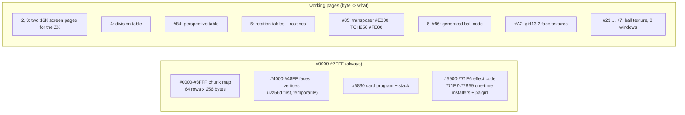
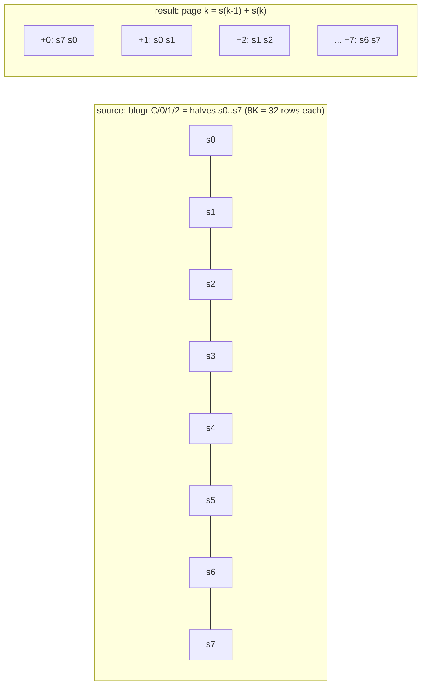
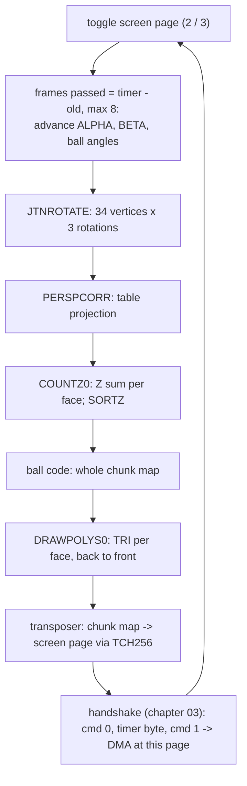
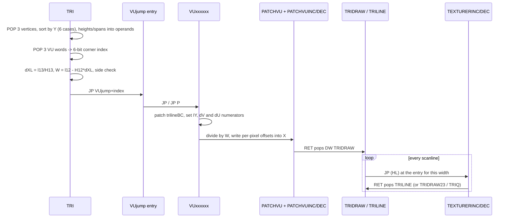

# 10. The textured face (TEX28)

The last effect of The Link shows a girl's face as a textured 3D head. The head turns slowly in
front of a lens-distorted ball that scrolls. The NeoGS card does all of the rendering: it rotates
and projects the head, sorts the faces and fills a chunky buffer with the ball and the textured
triangles. Then it converts the buffer to Pentagon 16-colour bytes. The ZX only copies the finished
16 KB picture to the screen through ZX-DMA.

This chapter also covers the **texture mapper** shared with the hedgehog
([08-hedgehog.md](08-hedgehog.md)): `texpp4.asm` (the triangle code) and `vujump.asm` (its tables),
together with the generated scanline code that `TEX28.asm` assembles.


Sources, all annotated: [`TEX28.asm`](../../../../disasm/demo/thelink/sjasm/src/TEX28.asm),
[`texpp4.asm`](../../../../disasm/demo/thelink/sjasm/src/texpp4.asm),
[`vujump.asm`](../../../../disasm/demo/thelink/sjasm/src/vujump.asm),
[`instpp3.asm`](../../../../disasm/demo/thelink/sjasm/src/instpp3.asm).
The frame handshake that every effect uses (commands 0/1/2, DMA reads, PUSH blits, the IM 2 stack
trick, GSRESET, card page numbers) is described in [03-the-frame.md](03-the-frame.md). This chapter
only refers to it.

## 1. What is on the screen

- The picture is **256 x 128 pixels** in the 16-colour mode, in screen lines 32..159.
- It is a **chunk map of 128 x 64 chunks**. Each chunk is 2 x 2 pixels, and every chunk value has
  four colours of its own, one per pixel (the table `palgirl`, 1024 bytes). This dithers 256 chunk
  values into 16 hardware colours.
- **Background:** a ball. The 256 x 256 texture `blugr` is seen through a lens table (`uv256d`),
  and the texture offset scrolls with two sine waves, so the ball appears to turn.
- **Foreground:** a head of 26 vertices and 28 triangles (`KUB` in `TEX28.asm`), textured with the
  64 x 64 textures of `girl13.2`. It turns around two axes with sine-driven angles. The third angle
  is fixed at 70.
- **Time window** (`zxtimings` in `THELINK.asm`): `DW 896*5+448,896*6+448` - frames 4928..5824,
  about 18 seconds. The credits come next.

## 2. Who does what

| | ZX (TEXZX, 350 bytes) | Card (TEXGS, 12,915 bytes) |
|---|---|---|
| set-up | clears the 16-colour pixel areas of pages 4-7, `#EFF7` = 1, generates the blitter `OUT16C` (~13.8 KB) | copies its code to card `#5900`, runs the generators (ball code, texture windows, tables, transposer) |
| per picture | HALT, timer byte to the card, flip screens, read 16,384 bytes through DMA into the hidden screen | animate, rotate, project, sort, ball, triangles, transpose into a screen page, handshake |
| end | at frame 5824 or on Space: command 2, 16 colours off | `RET` back to the card's resident loop |

Where the objects live (see [01-the-machine.md](01-the-machine.md) for the paging and
[02-the-start.md](02-the-start.md) for the upload):

- `TEXZX`: `#7FFD` = `#B7` (RAM page 55), at `#C000`. It runs from `#7800`.
- `TEXGS`: `#7FFD` = `#36` (RAM page 38). It is the 9th card code page, and the card calls it at
  `#C000` with `MPAGEX`.
- Data: `girl13.2` and `blugr.C/.0/.1/.2` are data pages 6..10 (`pgdata6`..`pgdata10`). On the card
  they are the 16K pages with index `#45`..`#49`.

`TEX28.asm` itself builds both objects. Its `GO` at `#7800` is the author's stand-alone test: a cut-down copy of
`THELINK.asm`'s start that uploads only this part's pages. It is assembled, but not saved
(section 9).

## 3. The card's memory

The card runs at 24 MHz with `NOROM` and `EXPAG` set: RAM at `#0000-#7FFF`, a 16K page at `#8000`
(`MPAG`), and another at `#C000` (`MPAGEX`). Page bytes are rotated 16K indices
([03-the-frame.md](03-the-frame.md)), so `gspgdata` = `#A2` is index `#45`. `TEX28.asm` derives
the ball texture's first page in ALASM as `gspgballtex1=gspgdata*257<1+#101>1&#FF`. In ALASM, `<` and `>`
are 16-bit *cyclic* shifts. `*257` copies the byte into both halves, `<1` turns it into a plain
index, `+#101` adds one page and `>1` rotates it back. The result is `#23`, index `#46`. The
converter writes it out as a long `(((x&#FFFF)<<1|(x&#FFFF)>>>(16-1))&#FFFF)` expression.



Addresses come from the sjasmplus listing of `TEX28.asm`. The effect code is about 6.3 KB, from
`#5900` to `#71E6`. It includes the two texturers (`#5A01-#5BFF`, `#5E01-#5FFF`), their patchers
(`#5C00`, `#6000`), `sin256` at `#6E00`, the stack tables at `#6F82`/`#7082` and `VUjump` at `#7100`. The
generators and `palgirl` follow (`#71E7`-`#7B59`). The author's `DISPLAY` lines mark them:
"без инсталлеров конец кода" / "с инсталлерами конец кода" (end of code without / with the
installers), and "можно затирать" (may be overwritten).

## 4. One-time set-up on the card (`instpp3.asm`)

`GSTEXGO` calls six generators, then copies the model:

```
GSTEXGO
        CALL MKBALLER
        CALL MKBALLTEX
        CALL GENDIV
        CALL GENPERSP
        CALL GENJTNROT
        CALL MKTRANSCH
```

### 4.1 The ball code (`MKBALLER`)

`uv256d` comes from the author's BASIC program `uv256d.bas` (recomputed by `sjasm/tables.py`). It
holds the texture offsets (u, v) of one quarter of the lens: 64 rows x 32 pairs, 4,096 bytes. The
card copies it to `#4000`. `MKBALLER` then:

1. mirrors it into the full table of 128 x 64 pairs (16 KB, page `#85` at `#C000`): the second half
   of each row gets -u, the second half of the rows gets -v;
2. replaces each pair by its difference to the next one (du, dv);
3. **generates code** from the differences. For each of the 128 chunk-map lines it writes:

```
LD SP,<line end>                ; line B: columns #3F..#00; lines 64..127: #BF..#80
LD D,(HL) / LD E,(HL), PUSH DE every two chunks
INC L / DEC L  x |du|           ; between chunks
INC H / DEC H  x |dv|
...
LD A,L : ADD A,du : LD L,A : LD A,H : ADD A,dv   ; next line
CP #F0 : JR C,ok : SUB #20 : <next texture page> : ok: LD H,A
```

The generator stores the opcodes as characters: `','` is `#2C` (INC L), `'-'` is `#2D` (DEC L),
`'$'` is `#24` (INC H) and `'%'` is `#25` (DEC H). The author estimates "~3.5 байта на байт
(2 страницы)" (about 3.5 bytes of code per byte, 2 pages): the code fills two 16K pages, `6` and
`#86`, at `#8000`.

When the output reaches `#BFxx`, the generator writes `LD A,next : OUT (MPAG),A` into the current
page. It then switches `MPAG` itself and writes `JP #8000` *at the same address in the next page*.
At run time the `OUT` pages the next code page in under the running code, and the CPU fetches the
`JP` from the new page.

The ball fills the whole chunk map every picture: 4,096 PUSHes. `GSLOOP` sets the start:

```
        LD A,72+136
angle1=$+1
        SUB 0
angle1corr=$+1
        ADD A,0
        LD H,A                  ; texture row
        LD A,128
angle2=$+1
        SUB 0
        LD L,A                  ; texture column
```

### 4.2 Eight overlapping texture windows (`MKBALLTEX`)

A 256 x 256 texture of one byte per texel is 64 KB, four card pages. The ball code steps `H`
(the texture row) inside a 16K window at `#C000`, and must not cross a page boundary in the middle of a
line. `MKBALLTEX` therefore rebuilds the four pages as **eight** pages, each a 16K window that starts
32 rows (8 KB) further than the one before:



The copy runs backwards in 8K pieces (`LDDR`, from `MPAGEX` to `MPAG`), from page +7 down to page +0.
Each source page is overwritten only after it has been read. For the last piece, the "from" page
wraps to +7, which already holds a copy of the texture's end. The author's comment says
"в +7 копия конца текстуры" (page +7 holds a copy of the texture's end).

The ball code keeps the row in `#D0..#EF` ("запас 16 на переполнение", 16 rows spare for
overflow). After a line, if `H` has passed `#EF`, `BALLCODESAMPLE` subtracts `#20` and maps the next
window (+8 wraps to +0). Inside a line, `H` can then run up to 16 rows either way without a check.

### 4.3 Tables

| Generator | Page | Content |
|---|---|---|
| `GENDIV` | `4`, `#C000` | for each row H = -64..-1, 128 words: (L/2)/-H in 8.8, L = column byte |
| `GENPERSP` | `#84` | for each row Z = -64..-1, 256 bytes: about 16*L/-Z + 32 ("32 times the pgdiv numbers") |
| `GENJTNROT` | `5` | `SIGNOFS` `#C000` routine per angle, `SINOFS` `#C100` / `COSOFS` `#C200` multiplication-table page per angle, `PROCROT` `#C300` rotation routines, `MULTAB` `#C400` one 256-byte x*s/128 table per distinct sine value |
| `MKTRANSCH` | `#85` | the transposer at `#E000`, `TCH256` at `#FE00` (section 6) |

The rotation uses 256 angle steps per turn. `SIN4` holds 128*sin for angles 1..61; at 61 the value
rounds to `#80` = 1.0, which ends the list. `SIGNOFS_INST` assigns a routine to every angle, per
quadrant: 1 routine on the axis, 3 where cos rounds to 1, 57 general ones, and 3 where sin rounds to 1.
The special routines skip the multiplications that would be by 0 or 1. A general routine
(`CH_I`, quadrant I) is two table reads per output coordinate:

```
; C=X    DE=COS
; B=Y    HL=SIN
CH_I    LD L,C
        LD E,B
        LD A,(DE)       ; Y*cos
        ADD A,(HL)      ; + X*sin = Y'
        LD L,B
        LD E,C
        LD B,A
        LD A,(DE)       ; X*cos
        SUB (HL)        ; - Y*sin = X'
        RET
```

`JTNROTATE` patches the routine's address (`CALL PROCROT` with the low byte from `SIGNOFS`) and
the two table pages into its own code once per frame, for each of the three angles.

## 5. One picture on the card (`GSLOOP`)



- **Time-based animation.** The ZX sends the low byte of its frame counter with command 0. The card
  runs the animation step `GSTIMERACTION` once for every frame that has passed, at most 8 times. The
  phases sit in the operands of `LD A,0 : ADD A,3 : LD ($-3),A`. `ALPHA` advances by 3 per frame and
  `BETA` by 2, both through `sin256` (127*sin, from `sin+.bas`).
- **Projection.** `JTNROTATE` writes X, Y and Z/4 - 16 (`curperspdist` is fixed at 16; the animated
  distance is disabled with `IF 1`). `PERSPCORR` looks each coordinate up in the perspective page,
  with row = Z and column = the coordinate. Y gets another +32, so the 128 rows are centred at 64 and
  the 64 columns at 32.
- **Sorting.** `SORTZ` is a selection sort on the sum of the three Z values. The faces are drawn
  back to front, as a painter's algorithm: there is no Z buffer.

### The chunk map is stored transposed

The 3D engine's X grows *upwards* on the screen and its Y *to the right* (the author's note at the top of
`texpp4.asm`). The chunk map stores a screen **column** as a memory row: row = Y, byte in the row = X.
The texture mapper's "scanlines" are therefore vertical on the screen, and a scanline is a run of
consecutive bytes (`INC E` / `DEC E`). The map has only 64 rows of 256 bytes. Y 0..63 uses columns
`#00-#3F`, and Y 64..127 uses the same rows in columns `#80-#BF`. That is the `texdec=1` mode,
"с заворотом" (with wrap-around): when a scanline loop steps below row 0, it continues at row 63
with X xor `#80`.

## 6. The texture mapper (`texpp4.asm`, `vujump.asm`)

The mapper is affine (no perspective correction): over a triangle, the texture coordinates are a
linear function of the screen position. The author designs everything around one restriction: **every
vertex lies on a corner of a 64 x 64 texture square**. A triangle is half of the square (or a
mirrored half). Edge 1-3 then runs along a side or along the diagonal of the square, and the whole
texture walk follows from a few numbers per triangle.

### 6.1 The face record is a stack

A face record (macro `KPOLY`, 20 bytes) is read with `POP`:

```
KPOLYJAWLEFT
        DW #FF-10+VTX3DY        ; vertex addresses (Y row; X is the row below)
        DW #FF-8+VTX3DY
        DW #FF-9+VTX3DY
        DW #0004,#0000,#0400    ; texture corner of each vertex (V,U = 0 or 4)
        DW #C300                ; side byte, see 6.4
        DW (#40+texborder)*257  ; texture origin (which 64x64 texture)
        DW TRIDRAW              ; where the patcher's RET goes
        DW (((gspgtex&#FFFF)<<8|(gspgtex&#FFFF)>>>(16-8))&#FFFF) ; ALASM: gspgtex<8 = page in the high byte
```

`TRI` saves SP and loads SP with the record (`LD (TRIQSP),SP : LD SP,HL`). Every field is then
one `POP`. The record also controls the flow: the last routine of the set-up ends with `RET`, which
pops `DW TRIDRAW`, and `TRIDRAW` pops the texture page with `POP AF`. `TRIQ` restores SP. With the
`lambert` option (hedgehog), the last word is a normal pointer, and `TRIDRAW` turns its Y into one of
8 shaded copies of the texture ([08-hedgehog.md](08-hedgehog.md)).

The texture origin `(#40+texborder)*257` shows ALASM arithmetic: the original text is
`\4+texborder*257`, which ALASM evaluates left to right. The converter added the parentheses.

### 6.2 The pipeline



1. **Sort.** The three vertices are sorted by Y. The `TRISORT` macro is expanded six times, once per
   order. Each expansion stores the heights and X spans into the operands of later instructions:
   `H13`, `l13*2`, `H12`, `(H12-1)*4`, `l12`, `l12*2`, `H23`/`l23*2`. An empty triangle (H13 = 0)
   leaves at once. ALASM's macro compared register names as text (`IF0 "\0\1"-"BC"`). In the
   expansions this appears as numbers: "BC" = 16963, "DE" = 17477, "HL" = 18508.
2. **Division by table, with the operand as the address.**

   ```
   l13SLA=$+2
   mH13=$+3
   mHl13=$+2
           LD DE,(0)
   ```

   The address of `LD DE,(nn)` is `H13 : l13*2`. That is exactly the entry of the division table
   (row = -height, column = 2*span), so the instruction reads l13/H13. `dXR23` (`mHl23`) and
   `texarea/H13` (`mH13_`) use the same trick.
3. **Width and side.** `W = l12 - H12*dXL` is the width of the row through vertex 2, the widest
   one. `TRIMULLOOP` is a shift-and-add multiply by the multiplier held complemented in the top bits
   of A (the author: "DEC A ;даст то же, что H12 CPL", gives the same as H12 CPL). The sign of W
   tells whether vertex 2 lies to the left or to the right of edge 1-3. A "right" triangle is
   drawn with `TEXTURERDEC` (right to left), and a "left" one with `TEXTURERINC`. A triangle whose widest
   row is too narrow is dropped ("слишком узкий, может дать отрицательный сканлайн", too narrow, may give a
   negative scanline).
4. **Corner dispatch.** `t = H12 * dUV13` is the position on edge 1-3 at the row of vertex 2.
   `JP VUjump` (its low byte was patched with the corner index) goes to one of 24 handlers.
5. **The handler** (`VUPATCH` + `dVU*` macros) knows along which side of the square edge 1-3 runs.
   It patches four bytes at `trilineBC`, the code that turns the running position `IY` into the
   texture address BC of a scanline's first pixel:

   | patch | code at `trilineBC` | edge 1-3 runs |
   |---|---|---|
   | `#0E44` | `LD B,IYH : LD C,n : JP (HL)` | vertically: U fixed, V moves |
   | `#064C` | `LD C,IYH : LD B,n : JP (HL)` | horizontally: V fixed, U moves |
   | `#3E44` + `#80`/`#90` | `LD B,IYH : LD A,n : ADD A,B` / `SUB B` `: LD C,A : JP (HL)` | diagonally |

   It then computes the change of V and of U over the width W ("d?=((?2-?1)-(?3-?1)*t)/W"). Each
   case is -t, 63, 63-t, t-63, -63 or t, so it needs no multiplication.
6. **PATCHVU** divides both by W through the `gspgdiv` table and jumps to the patcher (section 6.3).
7. **TRIDRAW** sets the left and right X accumulators (8.8 fixed point) and starts the scanlines.

### 6.3 The scanline code is generated and patched

`TEX28.asm` assembles two texturers: `INCSYSTEM` (pixels left to right, `INC E`; the dispatch page
is `#5B00-#5BFF`) and `DECSYSTEM` (`DEC E`; `#5F00-#5FFF`). The long part sits just below the page
and ends with `JP` at `#xxFD`, so the width-0 byte lands on the round address `#xx00`. The original macros `MTEXTURER` and `PATCHVUCODE` survive as comments. The
converter expanded them at their two uses.

```
TEXTURERINCMAX                  ; 36 pixels for the long widths, then JP TEXTURERINC
        DUP ntexjp+ntexjr
        LD HL,0                 ; patched per triangle: texture offset of this pixel
        ADD HL,BC               ; + scanline start in the texture
        LD A,(HL)
        LD (DE),A               ; into the chunk map
        INC E
        EDUP
```

The layout of one texturer, in the author's own counts:

| Part | Bytes | Author's comment |
|---|---|---|
| `TEXTURERINCMAX` | 36 x 7 + 3 | "(20+16)*7+3=255 байт кода для ширины ??..??" (bytes of code for widths ...) |
| entry for width 0 | 1 | "это круглый адрес / 1 байт адрес для ширины 0" (a round address / 1-byte address for width 0) |
| 16 x `JR`, 20 x `JP` | 32 + 60 | stubs into the long part |
| `TEXTURERINC` | 15 x 7 + 2 + RET | "16*7-4=108 байт кода для ширины 16..0"; the last pixel is `LD A,(BC) : LD (DE),A` ("смещение=0", offset 0) |
| entry table | 52 | "20+16+16=52 байт адресов" (bytes of addresses) |
| | | "итого 256 байт" (256 bytes in all) |

Dispatch costs three instructions. `TRISCANGO` computes the negative width in L, and `H` is the block's
page:

```
texturerH=$+1
        LD H,0                  ;'TEXTURERINC;DEC
        LD L,(HL)               ; entry address low byte from the table at the block's end
        ...
        JP (HL)
```

One pixel costs 39 T-states: `LD HL,nn` 10 + `ADD HL,BC` 11 + `LD A,(HL)` 7 + `LD (DE),A` 7 +
`INC E` 4. The widest scanline is `trimaxl` = 52 pixels.

**Why the patching works.** In an affine mapping, pixel *k* of every scanline of a triangle has the
same texture offset relative to the scanline's first texel: *k* x (dU, dV). So `PATCHVUINC`
(straight code, generated at assembly time with `DUP`/`IF`) writes those offsets into the `LD HL,nn`
operands once per triangle, 4 pixels per group. `LD (op),HL` puts V into the operand's high byte,
and after `EXX`, `LD A,H : LD (op),A` puts U into its low byte. It patches only as many pixels as W
needs. The author adds one pixel to be safe: "на всякий случай патчим на 1 пиксель больше, чем W"
(just in case we patch 1 pixel more than W), because "ошибка XL + ошибка XR + ошибка деления*H12 =
.5+.5+?" (XL error + XR error + division error*H12). A scanline then only needs its start BC and
destination DE.

The conditions in `PATCHVUINC` look strange after the conversion:

```
        IF ((((_V-___&#FFFF)<<1|(_V-___&#FFFF)>>>(16-1))&#FFFF)&1)==0
```

The original is `IF0 _V-___<1&1`. A cyclic shift left by 1 moves bit 15 to bit 0, so this means
"if _V >= ___" as signed 16-bit numbers.

### 6.4 Back faces and the VUjump opcode byte

`VUjump` (`vujump.asm`) has 64 entries of 4 bytes, indexed by the three corners (6 bits; the
author's comment: "младший байт адреса: %(V3)(U3)(V2)(U2)(V1)(U1)00", low byte of the address).
24 entries are `JP VU......` or `JP P,VU......` followed by `NOP`. The other 40 are `DS 3` (three
NOPs) + `NOP`, marked "невозможно" (impossible). I checked that the 24 are exactly the
combinations where the three corners are different.

The opcode byte of an entry is **also data**. After W is known, `TRI` does:

```
        LD HL,(vujump)          ; HL = address of the VUjump entry
        ...
        POP AF                  ; A = #C3 or #F2 from the face record
        CP (HL)                 ; the entry's opcode: #C3 = JP, #F2 = JP P
        JP NZ,TRIQ              ; (right triangle; a left one leaves on Z)
```

A face is drawn only if its side byte agrees with the entry's opcode in the way its screen
side (left or right) requires. That is the **back-face test**, with no cross product. The record's
comment explains how to flip a texture: "#C300 ;для переворота текстуры надо #F200 и переставить VU"
(to flip the texture use #F200 and swap the VU).

*Unconfirmed:* for 18 of the 24 entries the choice of `JP` / `JP P` matches the winding of the
three corners on the texture square. For 6 entries it does not (for example `VU001011`), and I
could not find the rule. The `P` flag at the jump comes from `ADD A,A` on 2t, so `JP P` is
presumably always taken; the author's note there reads "знак=P после умножения" (sign = P after the
multiplication). If it were not taken, execution would fall through the NOPs into the next entry.

### 6.5 The stack is the loop counter

`vujump.asm` also holds `TRISTACK12` and `TRISTACK23`: 62 x `DW TRILINE`, followed by `DW TRIDRAW23`
or `DW TRIQ`. Each table ends on a 256-byte boundary. `TRIDRAW` sets

```
        LD A,(mH12)
        ADD A,A
        LD L,A
        LD H,high TRISTACK12
        LD SP,HL
```

The height is negative, so SP points h-1 entries before the last one ("l=254 для высоты 1 (сразу
выход)", L = 254 for height 1: exit at once). Each scanline ends with the texturer's `RET`, which
pops `TRILINE`. After the upper half it pops `TRIDRAW23`, which switches to edge 2-3 and its table,
and finally `TRIQ`. There is no loop counter and no `DJNZ`: the return addresses count the rows.

`TRILINE` is the whole per-row overhead: step the row (with the wrap of `texdec`), `IY += dUV13`,
both edges `+= dX`, and the width lookup and the four patched bytes that make BC.

## 7. From chunks to 16-colour bytes (`MKTRANSCH`)

The ZX blitter writes the screen in a fixed order (section 8). The card therefore converts the chunk
map into one 16 KB page in exactly that order. `MKTRANSCH` generates the converter at `#E000` of
page `#85`. It reads the chunk map with `POP HL` (SP walks along a memory row, which is a screen
column) and writes down the destination with `INC D`:

```
TRANSCHCODE
        POP HL                  ; two chunks
        LD C,L
        LD A,(BC)               ; TCH256 row #FE: first pixel row of chunk L
        LD (DE),A
        INC D
        INC B
        LD A,(BC)               ; row #FF: second pixel row
        LD (DE),A
        INC D
        LD C,H
        LD A,(BC)               ; chunk H: row #FF first ...
        LD (DE),A
        INC D
        DEC B
        LD A,(BC)               ; ... then row #FE
        LD (DE),A
        INC D
```

`TCH256` (built from `palgirl` by the macro `COLSTOBYTE`) turns a chunk value into two 16-colour
bytes, one per pixel row. Each byte is two pixels in the Pentagon format: one colour in bits 5..3 +
bit 7, the other in bits 2..0 + bit 6.

The second chunk comes out **lower row first**: `INC B` then `DEC B` saves an instruction. The
ZX side undoes this with `mirrorchunks=1`, "строки 0,1,3,2,4,5,7,6..." (lines 0,1,3,2,4,5,7,6),
in `MKOUT16C`:

```
        IF mirrorchunks
        BIT 1,D
        JR Z,$+6
        LD A,D
        XOR 1
        LD D,A
        ENDIF
```

The column steps come from `TTRANSCHX` (`#20,#60,#20,#A0,#20,#60,#20,#1F`, sum = -1). They move
the write pointer between the four "слой" (layers) of the screen, each with a "верх,низ" (top,
bottom) part.

## 8. The ZX half (`TEXZX`)

`TEXZX` is entered by the resident loop with BC = start frame and DE = end frame. It copies itself
to `#7800` and "returns" into the copy (`PUSH DE : RET` with DE = `#7800`). The copy:

1. clears `#C000-#D7FF` and `#E000-#F7FF` of pages 4, 5, 6, 7 (`TEXCL1800PG`);
2. sets `#EFF7` = 1 (16 colours; [01-the-machine.md](01-the-machine.md));
3. generates `OUT16C` right behind itself (`#794F` up, about 13.8 KB; "13K кода для 256X128");
4. waits for the start frame and runs `BIGLOOP`.

**OUT16C.** There are 64 iterations, each for two pixel lines (y and y-64). Each iteration is
emitted as:

```
        LD A,H
loop:   LD (curpg),A            ; keep the IM 2 handler's page restore right
        OUT (C),A               ; page H, then page L
        4 x ( LD SP,<line end> : 16 x (LD D,(HL) : LD E,(HL) : PUSH DE) )
        CP H
        LD A,L
        JP Z,loop
```

The body runs twice, once with page H and once with page L, and fills both banks (`#C000`, `#E000`)
of two lines in both pages of the 16-colour screen. In total: 64 x 2 x 4 x 32 = 16,384 bytes.

**HL does two jobs.** `BIGLOOP` loads `LD HL,#1617` and patches it to `#1C1D` for the other screen.
H and L are the two `#7FFD` values of the screen being drawn. As an address, HL is somewhere in
`#0000-#3FFF`, so every `LD D,(HL)` is a ZX-DMA read ([03-the-frame.md](03-the-frame.md)). The
first byte is read and dropped: "LD A,(HL) ;первый байт неверен" (the first byte is wrong).

**Screen flip.** One immediate operand stores the state:

```
        LD A,#17^#1D
        XOR #1D                 ;видим scr1, рисуем scr0
        LD ($-1),A              ;теперь видим scr0, рисуем scr1
```

The translations are "we see scr1, draw scr0" and "now we see scr0, draw scr1". A alternates `#17` /
`#1D`.

**Interrupts during the blit.** SP points into the screen. Lines that start at `#xx00` or `#xx80`
end with `LD (nn),DE` instead of the last `PUSH`. The author: "для 8 линий в #C080..#C780, 7 линий
#C900..#CF00, 7 линий #D100..#D700 надо LD (..),DE вместо последнего PUSH" (for these lines the last
PUSH must be LD (..),DE), and "будет 32 таких линии вместо 22, а то запарно проверять" (there will
be 32 such lines instead of 22, otherwise it is a pain to check). The IM 2 handler then writes DE
where the CPU pushed the return address. Chapter 03 explains why.

**Budget.** One 16 KB picture is 8,192 x (7 + 7 + 11) = 204,800 T-states for the reads and
pushes, plus 512 `LD SP`. A Pentagon frame is 71,680 T, so the copy takes almost three frames. The
face therefore shows at most one new picture every third frame, about 16-17 per second. This is a
calculation from the code, not a measurement. I did not measure the card's drawing time.

**QUIT** (end frame reached, or Space: "можно жать RESET", you may press RESET): command 2, page 0,
black attributes, `#EFF7` = 0, `RET` to the resident loop, which moves on to the credits.

## 9. The test harness in `TEX28.asm`

ALASM ran the source after assembling it, so `TEX28.asm` contains a whole mini demo:

- `GO` at `#7800`: card reset, the card program sent with GS commands `#18`/`#19` ("как в RIFF
  TRACKER", as in RIFF TRACKER) and started with `#13`. It uploads 5 data pages and 1 code page,
  installs the resident loop and IM 2, and starts the music. The author marks some steps with
  "зачем-то" (for some reason): `POKE #4092,0`, command `#38` (Load FX), `#D2` (Close Stream),
  `#F5` (Busy on).
- `zxtimings`: `DW 224,224*4-20`, the face from frame 224 to 876.
- `ORG #C000,pgeffects+1` : `JR $`, where the test stops.
- `gspgdata` = `#A2`, so that the test uploads `girl13.2` to the card page it has in the full demo.

The objects come from `ObjTab` + `SAVEOBJ4.asm` in ALASM, and from `SAVEBIN` in sjasmplus
([sjasm/README.md](../../../../disasm/demo/thelink/sjasm/README.md)).

## Things to notice

- **Code that writes code.** The card generates the ball code (two pages), the transposer, the
  rotation routines and tables. The ZX generates its 13.8 KB blitter. At assembly time, `DUP`/`IF`
  build the texturers and their patchers.
- **The opcode byte is data.** `JP` / `JP P` in `VUjump` doubles as the back-face flag (6.4).
- **Records and return addresses as control flow.** A face record is popped like a stack and ends
  with `DW TRIDRAW`. The scanline count is a table of return addresses (6.1, 6.5).
- **Division by addressing.** `LD DE,(nn)` with the patched operand *is* the division (6.2).
- **Self-paging generated code.** The ball code switches `MPAG` under itself, and the `JP #8000`
  after it is fetched from the new page (4.1).
- **`HL = #1617`** is both a pair of page numbers and the DMA read address (8).
- **Dead code and leftovers.** The first 8 of the 34 vertices of `KUB` ("cube") are the corners of a
  test cube. No face uses them, but they are rotated every frame. `GENTEX` (a test texture from the
  ZX ROM font at `#3D88`), the plasma ball (`mkballplasma=0`), `CL1800PG` and the `MOVEPAGE` macro
  are never called here. The animated perspective distance is disabled by `IF 1`.
- **A harmless DJNZ.** If no frame has passed, B = 0 and the animation step runs 256 times. With
  steps of 3 and 2 in a 256-entry table, the phases come back to the same values, so it only costs
  time.
- **No timeout on the first wait.** In the frame handshake, `WAITER0` waits for command 0 forever
  (`;JP C,GSRESET` is commented out). Only the second wait has the 65,536-poll timeout.
- **The comments tell the tuning story:** `incW` "1=исключает выскакивание за текстуру, но
  дергается" (1 = prevents running out of the texture, but jitters); `texborder` "против
  выскакивания" (against running out); `trisortmesspop` "1=сокращает код без потери скорости"
  (shortens the code without losing speed).

## Try it

- Boot `testdata/machines/pentagon1024sl/TheLink-sjasm.scl` on a Pentagon 1024 with NeoGS (unreal-ng's
  shipped Pentagon config), then press Enter. The face runs from frame 4928 to 5824 of the demo's
  counter (`timer`, a word at `#BF02`), about 98..117 s after the intro starts.
- **ZX side:** `#7FFD` = `#B7` holds `TEXZX` at `#C000`. During the effect, the code at `#7800`
  is `TEXCODE`, and `#794F` up is the generated `OUT16C`. Break in `BIGLOOP` and watch `#EFF7` = 1
  and pages 4-7 change.
- **Card side:** break on the card Z80 at `#6242` (`GSLOOP`) or `#6712` (`TRI`). The chunk map is
  at card `#0000-#3FFF`. Card page `#85` holds the transposer at `#E000`, and pages `6`/`#86` hold
  the ball code at `#8000`. A face record is at `#64DC` (`KPOLYJAWLEFT`). These are addresses of the
  sjasmplus build, which is byte-identical to the author's.
- Watch the operand at `TEXTURERINC` (`#5B5D` + 1) change from triangle to triangle: that is
  `PATCHVUINC` at work.

Previous: [09-girl-and-mill.md](09-girl-and-mill.md) - Next: [11-building-it.md](11-building-it.md) -
Index: [README.md](README.md) - Source notes:
[docs/disasm/demo/thelink/README.md](../../../../disasm/demo/thelink/README.md)
