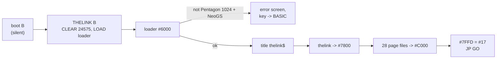
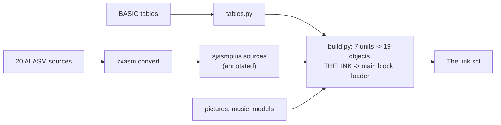

# 11. Building it: from the author's ALASM disk to a release

The author never made a release disk. His working disk starts the demo by loading ALASM, assembling
`THELINK` and jumping to the result - 28 seconds of disk activity before the first picture. This
chapter tells how the demo became an ordinary cross-assembled project and a disk that boots
straight into it. The details are in two READMEs; this is the story and what it teaches.

## 11.1 Step one: know what the assembler leaves in memory

Before replacing ALASM, every byte it leaves behind must be known. The emulator stopped the ALASM
start at the moment the card received its program (card port `GSCFG0` = `#09`, chapter
[2](02-the-start.md)), dumped all 64 RAM pages and compared them with the files on the disk:

- 28 pages each hold one disk file at `#C000`, byte for byte, the rest of the page zero;
- one block of code at `#7800`-`#B154` (14,677 bytes);
- nothing else matters: ALASM's own page, the debugger's page and the packer `m2hrust` that
  `THELINK.asm` includes at `#FB00` are never used by the demo.

So `THELINK.asm` is a **linker in assembler clothing**: every effect was built earlier from its own
source and lies on the disk as a binary; `THELINK` places them with `ORG #C000,page` + `INCBIN`
and assembles only the glue.

## 11.2 Step two: a loader

The loader (`sjasm/loader/loader.asm`, at `#6000`) does by TR-DOS calls what ALASM did by
assembling: it loads the title picture, the main block to `#7800`, and the 28 files into their
pages, zeroing the rest of each page, then jumps to `GO`. Before that it checks the machine -
1024K paging by markers in pages 0, 8, 16, 24, 32; a NeoGS by the card's own detection (the reply
to GS command `#11` after `#F3` is `GSCFG0`; a classic GS answers `#FF`) - and shows an error
screen naming what it found.



The last box has a story. `GO` begins by clearing `#D800`-`#DAFF`, screen 1's attributes, with
`A` loaded with `#17` for page 7 - but the `OUT` is missing, so it clears whatever page is at
`#C000`. After ALASM that page is harmless. After the first version of the loader it was the last
page loaded, the music, and 733 bytes of the player were zeroed. Every frame of the picture was
still identical to the ALASM start, which is why a screen comparison missed it; a comparison of
the music page with its file found it. The loader now selects page 7 itself.

## 11.3 Step three: the whole demo from source

The loader still took the effects' binaries from the author's disk. The last step rebuilt them:
unreal-ng's assembler library, unreal-asm, reads ALASM's tokenized sources straight from the disk
image and converts the whole project to sjasmplus in one command:

```
zxasm convert TheLink.trd --to sjasmplus --out-codepage utf-8 -o out/
```

The converted sources assembled at once into all 19 effect objects, byte for byte the author's.
What the conversion had to get right (439 conditional jumps that are relative in ALASM, 147
multi-operand `LD` lines, 17 macros sjasmplus cannot express, 16-bit cyclic shifts, unsigned
16-bit arithmetic...), what was first done by hand afterwards (the object saver as `SAVEBIN`, 50
explicit `low`) and then taught to the converter - its output now assembles unchanged, with no
warning - and the converter bug it uncovered (`DS -$`) are in
[sjasm/README.md](../../../../disasm/demo/thelink/sjasm/README.md) section 3.

Four tables were not code at all: the author computed them with BASIC programs. `tables.py`
computes them again, rounding as Sinclair BASIC does; one entry of `sin32768` shows the author
fixed an overflow by hand (+32768 does not fit a signed word, the disk has `#7FFF`).



## 11.4 How it was checked

| Check | How |
|---|---|
| objects, tables, main block | sha256 against the author's files, in `build.py` (a mismatch stops the build) |
| the annotations changed no code | each line's code, comments stripped, compared with the converter's output |
| the release disk runs the demo | unreal-ng regression test `NeoGSTheLink_Test.ReleaseDiskBootsIntoTheDemo`: the card gets its program, the music page is whole, the tunnel changes the picture every frame |
| it runs the *same* demo | the screen of the release start against the ALASM start, every frame of the tunnel and the rotator (1,092 frames) |
| wrong machines | 512K, 128K, a classic GS, no card: the error screen names each (`ReleaseDiskNamesWhatIsMissing`) |

## Things to notice

- Byte-exact comparison is what made each step safe: a port that "looks right" but uses `JP NZ`
  for ALASM's `JNZ` assembles fine and is 1 byte longer at every jump.
- A comparison only finds what it compares. The music bug passed a frame-by-frame screen check.
- Annotating 26,000 lines of someone else's code is safe when the build proves the bytes did not
  move: comments only, then the same sha256.

## Try it

```
SJASMPLUS=/path/to/sjasmplus python3 docs/disasm/demo/thelink/sjasm/build.py
```

builds `out/TheLink.scl`. Change a colour in `GENTCOLOR` (`GSTUNNE4.asm`), build with `--no-check`
and boot the disk in unreal-ng: the tunnel changes, the rest of the demo does not.

Back to the [index](README.md).
